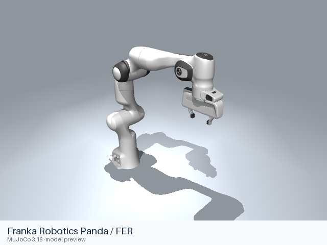
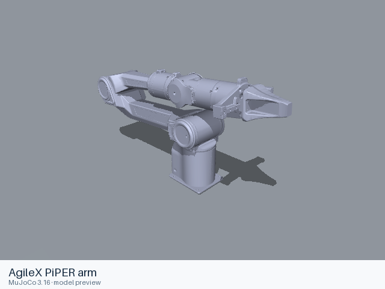
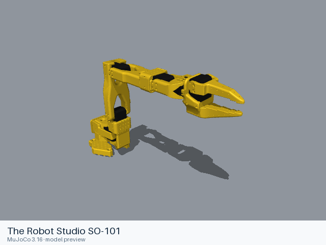
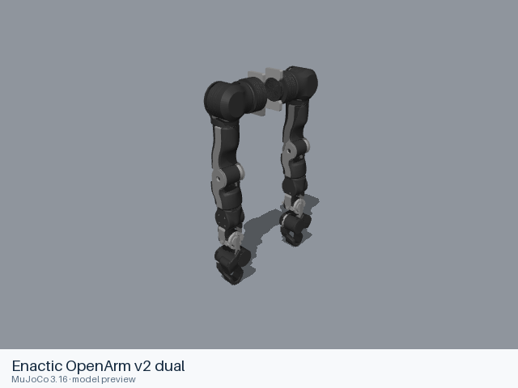
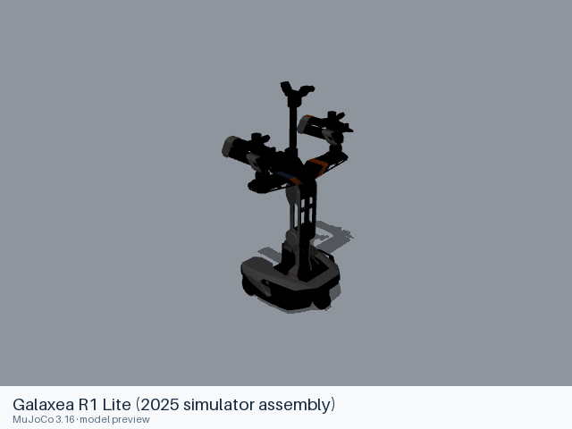

<h1 align="center">Awesome Robot Arm Zoo</h1>

<p align="center">
  <strong>Robot arm models for embodied AI projects.</strong><br>
  Single arms, dual arms and mobile manipulators for VLA, imitation learning and simulation. Browse the models, choose a format, and load one in your project.
</p>

<p align="center">
  <a href="#models"></a>
  <a href="#models"></a>
  
  
  
</p>

<p align="center">
  <b>English</b> · <a href="README_CN.md">简体中文</a><br>
  <a href="#quick-start">Quick start</a> · <a href="#models">Browse models</a> · <a href="#using-models-in-your-project">Use in your project</a> · <a href="#contributing">Contribute</a>
</p>

<table align="center">
  <tr>
    <td align="center" width="33%">
      <a href="models/franka/panda/README.md"><br><b>Franka Panda</b></a>
      <br><sub>URDF · MJCF</sub>
    </td>
    <td align="center" width="33%">
      <a href="models/agilex/piper/README.md"><br><b>AgileX PiPER</b></a>
      <br><sub>URDF · MJCF</sub>
    </td>
    <td align="center" width="33%">
      <a href="models/the_robot_studio/so101/README.md"><br><b>SO-101</b></a>
      <br><sub>URDF · MJCF</sub>
    </td>
  </tr>
  <tr>
    <td align="center" width="33%">
      <a href="models/enactic/openarm_v2_dual/README.md"><br><b>OpenArm v2 dual</b></a>
      <br><sub>URDF · MJCF</sub>
    </td>
    <td align="center" width="33%">
      <a href="models/galaxea/r1_lite_2025/README.md"><br><b>Galaxea R1 Lite</b></a>
      <br><sub>URDF</sub>
    </td>
    <td align="center" width="33%">
      <a href="models/trossen/aloha2/README.md"><br><b>Trossen ALOHA 2</b></a>
      <br><sub>MJCF</sub>
    </td>
  </tr>
</table>

<p align="center"><sub>Click a robot to see its files, variants and usage notes. <a href="docs/PREVIEWS.md">About the previews</a></sub></p>

## Quick start

Open a Panda scene in MuJoCo:

```sh
git clone --depth 1 https://github.com/hyyyyyyz/awesome-robot-arm-zoo.git
cd awesome-robot-arm-zoo
python -m pip install mujoco
```

The model files occupy about **1.8 GB**.

Run this Python snippet from the repository root:

```python
from pathlib import Path

import mujoco
import mujoco.viewer

scene = Path("models/franka/panda/mjcf/menagerie/scene.xml").resolve()
model = mujoco.MjModel.from_xml_path(str(scene))
mujoco.viewer.launch(model)
```

This opens the Panda with a floor and lighting. To add the robot to your own MuJoCo scene, use [`panda.xml`](models/franka/panda/mjcf/menagerie/panda.xml) in the same directory.

## Models

**67 models and assemblies across 32 brands and open-source projects.** Choose a brand or project to browse robot previews and model files. The number beside each name is its model count.

<!-- MODEL_CATALOG:START -->

<table width="100%">
  <tr>
    <td width="33%"><a href="models/abb/README.md">ABB</a> <sub>·&nbsp;1</sub></td>
    <td width="33%"><a href="models/agibot/README.md">AgiBot</a> <sub>·&nbsp;1</sub></td>
    <td width="33%"><a href="models/agilex/README.md">AgileX</a> <sub>·&nbsp;3</sub></td>
  </tr>
  <tr>
    <td width="33%"><a href="models/airbot/README.md">AIRBOT</a> <sub>·&nbsp;2</sub></td>
    <td width="33%"><a href="models/arx/README.md">ARX</a> <sub>·&nbsp;2</sub></td>
    <td width="33%"><a href="models/aubo/README.md">AUBO</a> <sub>·&nbsp;1</sub></td>
  </tr>
  <tr>
    <td width="33%"><a href="models/denso/README.md">DENSO</a> <sub>·&nbsp;1</sub></td>
    <td width="33%"><a href="models/dobot/README.md">Dobot</a> <sub>·&nbsp;1</sub></td>
    <td width="33%"><a href="models/elephant_robotics/README.md">Elephant Robotics</a> <sub>·&nbsp;2</sub></td>
  </tr>
  <tr>
    <td width="33%"><a href="models/enactic/README.md">Enactic</a> <sub>·&nbsp;2</sub></td>
    <td width="33%"><a href="models/fanuc/README.md">FANUC</a> <sub>·&nbsp;1</sub></td>
    <td width="33%"><a href="models/flexiv/README.md">Flexiv</a> <sub>·&nbsp;3</sub></td>
  </tr>
  <tr>
    <td width="33%"><a href="models/franka/README.md">Franka Robotics</a> <sub>·&nbsp;5</sub></td>
    <td width="33%"><a href="models/galaxea/README.md">Galaxea</a> <sub>·&nbsp;2</sub></td>
    <td width="33%"><a href="models/jaka/README.md">JAKA</a> <sub>·&nbsp;1</sub></td>
  </tr>
  <tr>
    <td width="33%"><a href="models/kinova/README.md">Kinova</a> <sub>·&nbsp;4</sub></td>
    <td width="33%"><a href="models/koch/README.md">Koch</a> <sub>·&nbsp;1</sub></td>
    <td width="33%"><a href="models/kuka/README.md">KUKA</a> <sub>·&nbsp;1</sub></td>
  </tr>
  <tr>
    <td width="33%"><a href="models/lebai/README.md">Lebai</a> <sub>·&nbsp;2</sub></td>
    <td width="33%"><a href="models/lekiwi/README.md">LeKiwi</a> <sub>·&nbsp;1</sub></td>
    <td width="33%"><a href="models/pollen_robotics/README.md">Pollen Robotics</a> <sub>·&nbsp;2</sub></td>
  </tr>
  <tr>
    <td width="33%"><a href="models/realman/README.md">RealMan</a> <sub>·&nbsp;3</sub></td>
    <td width="33%"><a href="models/rethink_robotics/README.md">Rethink Robotics</a> <sub>·&nbsp;2</sub></td>
    <td width="33%"><a href="models/robotis/README.md">ROBOTIS</a> <sub>·&nbsp;3</sub></td>
  </tr>
  <tr>
    <td width="33%"><a href="models/rokae/README.md">ROKAE</a> <sub>·&nbsp;1</sub></td>
    <td width="33%"><a href="models/seeed_studio/README.md">Seeed Studio</a> <sub>·&nbsp;1</sub></td>
    <td width="33%"><a href="models/the_robot_studio/README.md">The Robot Studio</a> <sub>·&nbsp;2</sub></td>
  </tr>
  <tr>
    <td width="33%"><a href="models/trossen/README.md">Trossen / Interbotix</a> <sub>·&nbsp;5</sub></td>
    <td width="33%"><a href="models/ufactory/README.md">UFACTORY</a> <sub>·&nbsp;4</sub></td>
    <td width="33%"><a href="models/unitree/README.md">Unitree</a> <sub>·&nbsp;1</sub></td>
  </tr>
  <tr>
    <td width="33%"><a href="models/universal_robots/README.md">Universal Robots</a> <sub>·&nbsp;5</sub></td>
    <td width="33%"><a href="models/xlerobot/README.md">XLeRobot</a> <sub>·&nbsp;1</sub></td>
    <td width="33%"></td>
  </tr>
</table>

<details>
<summary>View all brands, model counts and formats</summary>

| Brand / project | Models | Formats |
|---|---:|---|
| [ABB](models/abb/README.md) | 1 | URDF |
| [AgiBot](models/agibot/README.md) | 1 | USD |
| [AgileX](models/agilex/README.md) | 3 | URDF, MJCF |
| [AIRBOT](models/airbot/README.md) | 2 | MJCF |
| [ARX](models/arx/README.md) | 2 | URDF, MJCF |
| [AUBO](models/aubo/README.md) | 1 | URDF |
| [DENSO](models/denso/README.md) | 1 | URDF |
| [Dobot](models/dobot/README.md) | 1 | URDF |
| [Elephant Robotics](models/elephant_robotics/README.md) | 2 | URDF |
| [Enactic](models/enactic/README.md) | 2 | URDF, MJCF |
| [FANUC](models/fanuc/README.md) | 1 | URDF |
| [Flexiv](models/flexiv/README.md) | 3 | URDF, MJCF |
| [Franka Robotics](models/franka/README.md) | 5 | URDF, MJCF |
| [Galaxea](models/galaxea/README.md) | 2 | URDF |
| [JAKA](models/jaka/README.md) | 1 | URDF |
| [Kinova](models/kinova/README.md) | 4 | URDF, MJCF |
| [Koch](models/koch/README.md) | 1 | MJCF |
| [KUKA](models/kuka/README.md) | 1 | URDF, MJCF |
| [Lebai](models/lebai/README.md) | 2 | URDF |
| [LeKiwi](models/lekiwi/README.md) | 1 | URDF |
| [Pollen Robotics](models/pollen_robotics/README.md) | 2 | URDF, MJCF |
| [RealMan](models/realman/README.md) | 3 | URDF |
| [Rethink Robotics](models/rethink_robotics/README.md) | 2 | URDF, MJCF |
| [ROBOTIS](models/robotis/README.md) | 3 | URDF |
| [ROKAE](models/rokae/README.md) | 1 | URDF |
| [Seeed Studio](models/seeed_studio/README.md) | 1 | MJCF |
| [The Robot Studio](models/the_robot_studio/README.md) | 2 | URDF, MJCF |
| [Trossen / Interbotix](models/trossen/README.md) | 5 | URDF, MJCF |
| [UFACTORY](models/ufactory/README.md) | 4 | URDF, MJCF |
| [Unitree](models/unitree/README.md) | 1 | URDF, MJCF |
| [Universal Robots](models/universal_robots/README.md) | 5 | URDF, MJCF |
| [XLeRobot](models/xlerobot/README.md) | 1 | URDF |

</details>

<!-- MODEL_CATALOG:END -->

## Using models in your project

Keep this repository wherever you store your project's assets. Find your robot in the catalog, open its README, and copy the path for the format you need. For example:

| Model | Format | File path from the repository root |
|---|---|---|
| Franka Panda | MJCF | [`models/franka/panda/mjcf/menagerie/panda.xml`](models/franka/panda/mjcf/menagerie/panda.xml) |
| Franka Panda | URDF | [`models/franka/panda/urdf/panda.urdf`](models/franka/panda/urdf/panda.urdf) |
| SO-101 | URDF | [`models/the_robot_studio/so101/urdf/so101_new_calib.urdf`](models/the_robot_studio/so101/urdf/so101_new_calib.urdf) |
| AgiBot G1 | USD | [`models/agibot/g1_120s/usd/robot.usda`](models/agibot/g1_120s/usd/robot.usda) |

Join the file path with your local checkout location and pass it to your simulator's model loader. **Keep the meshes, textures and included files together when moving a model**—copy its complete `urdf/`, `mjcf/` or `usd/` directory.

### Which format should I use?

| Your project | Start with |
|---|---|
| MuJoCo | An available MJCF model; `scene.xml` files include a demonstration environment |
| ROS or a simulator with a URDF importer | The model's URDF; check its notes for grippers, fixed-base settings and importer requirements |
| Isaac Sim / Genie Sim | AgiBot G1's native USD; see its model notes for material modules and loading requirements |

Formats vary by model. Each model README lists the exact files, joint information and loading examples.

## Sources and licenses

Models come primarily from manufacturer and open-hardware repositories, with additional descriptions from universities and [MuJoCo Menagerie](https://github.com/google-deepmind/mujoco_menagerie). Thank you to the authors and maintainers who make these resources available.

**Licenses vary by model and format.** Read the source and license links in the model README before reusing or redistributing its assets. The original license texts and notices are included alongside the files.

AgiBot G1 uses CC BY-NC-SA 4.0, with noncommercial and ShareAlike terms applying to its resources and preview.

## Known limitations

- Simulator support varies by model and format; check the model page for loading requirements. URDF and USD thumbnails are static views of the geometry. Controllers, dynamics and training behavior need validation in your own setup.
- Some COLLADA files use millimetres or inches. Your importer needs to honor the units declared in those files; affected model pages have details.

See [source coverage and loading details](docs/SOURCE_COVERAGE.md) for the tested environments and models still missing from the collection.

## Contributing

This collection focuses on VLA and embodied manipulation and is still growing. If a research platform or hardware configuration you use is missing, [open an issue](https://github.com/hyyyyyyz/awesome-robot-arm-zoo/issues) or send a pull request to add it. Links to official model repositories or downloads are welcome too.

Loading fixes, additional model formats and usage examples are also welcome. Please include the model's source and license when contributing files; see the [contribution guide](CONTRIBUTING.md) for details.
