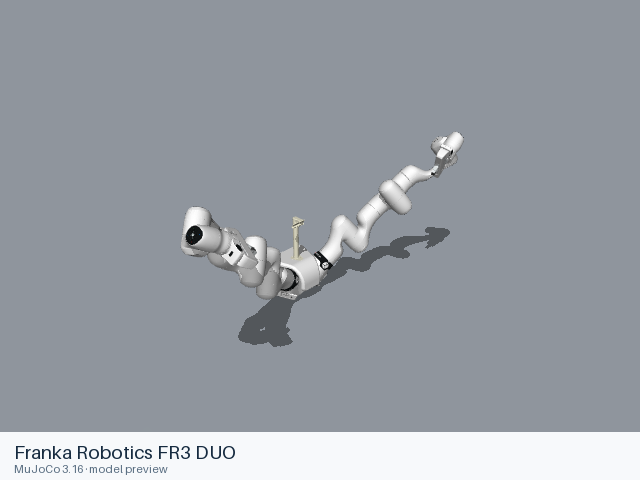

<h1 align="center">Awesome Robot Arm Zoo</h1>

<p align="center">
  <strong>为你的下一个仿真项目，找一款机械臂。</strong><br>
  工业机械臂、协作臂、SCARA、双臂机器人，按品牌浏览，选好型号即可接入自己的项目。
</p>

<p align="center">
  <a href="#模型目录"></a>
  <a href="#模型目录"></a>
  
  
</p>

<p align="center">
  <a href="README.md">English</a> · <b>简体中文</b><br>
  <a href="#快速开始">快速开始</a> · <a href="#模型目录">浏览模型</a> · <a href="#接入你的项目">接入项目</a> · <a href="#参与贡献">参与贡献</a>
</p>

<table align="center">
  <tr>
    <td align="center" width="33%">
      <a href="models/franka/panda/README.md"><br><b>Franka Panda</b></a>
      <br><sub>URDF · MJCF</sub>
    </td>
    <td align="center" width="33%">
      <a href="models/universal_robots/ur5e/README.md"><br><b>Universal Robots UR5e</b></a>
      <br><sub>URDF · MJCF</sub>
    </td>
    <td align="center" width="33%">
      <a href="models/agilex/piper/README.md"><br><b>AgileX PiPER</b></a>
      <br><sub>URDF · MJCF</sub>
    </td>
  </tr>
  <tr>
    <td align="center" width="33%">
      <a href="models/fanuc/crx10ia/README.md"><br><b>FANUC CRX-10iA</b></a>
      <br><sub>URDF</sub>
    </td>
    <td align="center" width="33%">
      <a href="models/abb/yumi_irb14000/README.md"><br><b>ABB YuMi</b></a>
      <br><sub>URDF</sub>
    </td>
    <td align="center" width="33%">
      <a href="models/franka/fr3_duo/README.md"><br><b>Franka FR3 Duo</b></a>
      <br><sub>URDF</sub>
    </td>
  </tr>
</table>

<p align="center"><sub>点击图片查看模型文件、配置变体和使用说明。<a href="docs/PREVIEWS.md">了解预览图</a></sub></p>

## 快速开始

先在 MuJoCo 中打开一个 Panda 场景：

```sh
git clone --depth 1 https://github.com/hyyyyyyz/awesome-robot-arm-zoo.git
cd awesome-robot-arm-zoo
python -m pip install mujoco
```

完整模型文件在克隆后约占 **6 GB** 磁盘空间。

在仓库根目录运行下面的 Python 代码：

```python
from pathlib import Path

import mujoco
import mujoco.viewer

scene = Path("models/franka/panda/mjcf/menagerie/scene.xml").resolve()
model = mujoco.MjModel.from_xml_path(str(scene))
mujoco.viewer.launch(model)
```

这会打开带地板和灯光的 Panda 场景。在自己的 MuJoCo 场景中使用机器人时，选择同目录下的 [`panda.xml`](models/franka/panda/mjcf/menagerie/panda.xml)。

## 模型目录

**31 个品牌，482 个型号与装配。** 点击品牌查看模型图库、可用格式和模型文件，包含单臂、双臂、不同夹爪配置及移动操作机器人。

<!-- MODEL_CATALOG:START -->

| 品牌 | 模型数 | 格式 |
|---|---:|---|
| [ABB](models/abb/README.md) | 27 | URDF |
| [AgileX](models/agilex/README.md) | 3 | URDF, MJCF |
| [ARX](models/arx/README.md) | 1 | MJCF |
| [AUBO](models/aubo/README.md) | 11 | URDF |
| [Comau](models/comau/README.md) | 14 | URDF |
| [DENSO](models/denso/README.md) | 3 | URDF |
| [Dobot](models/dobot/README.md) | 10 | URDF |
| [Elephant Robotics](models/elephant_robotics/README.md) | 21 | URDF |
| [Elite Robots](models/elite_robots/README.md) | 5 | URDF |
| [Epson](models/epson/README.md) | 64 | URDF |
| [FANUC](models/fanuc/README.md) | 71 | URDF |
| [Flexiv](models/flexiv/README.md) | 23 | URDF, MJCF |
| [Franka Robotics](models/franka/README.md) | 7 | URDF, MJCF |
| [Han’s / Huayan Robotics](models/hans_robot/README.md) | 6 | URDF |
| [JAKA](models/jaka/README.md) | 1 | URDF |
| [Kinova](models/kinova/README.md) | 17 | URDF, MJCF |
| [KUKA](models/kuka/README.md) | 47 | URDF, MJCF |
| [Lebai](models/lebai/README.md) | 3 | URDF |
| [Mitsubishi Electric](models/mitsubishi/README.md) | 10 | URDF |
| [Pollen Robotics](models/pollen_robotics/README.md) | 1 | URDF |
| [RealMan](models/realman/README.md) | 11 | URDF |
| [Rethink Robotics](models/rethink_robotics/README.md) | 2 | URDF, MJCF |
| [ROBOTIS](models/robotis/README.md) | 6 | URDF |
| [ROKAE](models/rokae/README.md) | 14 | URDF |
| [Stäubli](models/staubli/README.md) | 12 | URDF |
| [Techman Robot](models/techman/README.md) | 10 | URDF |
| [Trossen / Interbotix](models/trossen/README.md) | 10 | URDF |
| [UFACTORY](models/ufactory/README.md) | 7 | URDF, MJCF |
| [Unitree](models/unitree/README.md) | 1 | URDF, MJCF |
| [Universal Robots](models/universal_robots/README.md) | 14 | URDF, MJCF |
| [Yaskawa Motoman](models/yaskawa/README.md) | 50 | URDF |

<!-- MODEL_CATALOG:END -->

## 接入你的项目

把仓库放在项目的模型资源目录，或你习惯存放资产的位置。在目录里选好机器人，打开型号说明，复制所需格式的模型路径。例如：

| 型号 | 格式 | 相对仓库根目录的文件路径 |
|---|---|---|
| Franka Panda | MJCF | [`models/franka/panda/mjcf/menagerie/panda.xml`](models/franka/panda/mjcf/menagerie/panda.xml) |
| Franka Panda | URDF | [`models/franka/panda/urdf/panda.urdf`](models/franka/panda/urdf/panda.urdf) |
| ABB YuMi | URDF | [`models/abb/yumi_irb14000/urdf/yumi_irb14000.urdf`](models/abb/yumi_irb14000/urdf/yumi_irb14000.urdf) |

将文件路径与你本地的仓库位置拼接，交给项目中已有的模型加载器。**移动模型时，请一起复制完整的 `urdf/` 或 `mjcf/` 目录**，保留配套网格、纹理和引用文件。

### 选哪种格式？

| 你的项目 | 从这里开始 |
|---|---|
| MuJoCo | 选择该型号提供的 MJCF；`scene.xml` 是带演示环境的场景文件 |
| ROS，或支持导入 URDF 的仿真器 | 选择 URDF；夹爪、固定底座和导入选项见型号说明 |

各型号提供的格式不同。具体文件、关节信息和加载示例都在对应的型号 README 中。

## 来源与许可

模型主要来自厂商官方仓库，部分模型来自 ROS-Industrial、大学团队和 [MuJoCo Menagerie](https://github.com/google-deepmind/mujoco_menagerie)。感谢原作者和维护者公开这些资源。

**不同模型、不同格式的许可证可能不同。** 使用或分发模型前，请查看型号 README 中的来源和许可链接；原始许可证及署名文件随模型一起保留。

## 已知限制

- 不同型号和格式的仿真器支持情况不同，请先查看型号说明。URDF 预览仅展示外观；控制器、动力学和训练效果需要在自己的项目里验证。
- 部分 COLLADA 文件使用毫米或英寸。导入器需要正确读取文件声明的单位，受影响的型号页有具体说明。

已测试的环境和暂未收录的模型见[来源覆盖与加载说明](docs/SOURCE_COVERAGE.md)。

## 参与贡献

想补充一款模型、修复加载问题，或分享更好的使用示例？欢迎[提 Issue](https://github.com/hyyyyyyz/awesome-robot-arm-zoo/issues) 或提交 Pull Request。模型文件、来源和许可要求见[贡献指南](CONTRIBUTING.md)。
