# ABB models

[All manufacturers](../../README.md#models) · [Chinese index](../../README_CN.md#模型目录)

Previews are rendered with MuJoCo. See the [rendering method](../../docs/PREVIEWS.md); each model page links its exact entry and rendering record.

Industrial arm models are maintained by ROS-Industrial in ros-industrial/abb. The dual-arm YuMi IRB 14000 with modeled servo grippers comes from Örebro University’s archived yumi repository under BSD-2-Clause. These sources are identified individually in each model README and are not presented as official ABB-supported releases.

| Preview | Model / assembly | Native entries | Upstream |
|---|---|---|---|
| [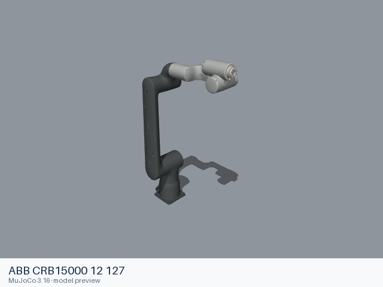](crb15000_12_127/README.md) | [ABB CRB15000 12 127](crb15000_12_127/README.md) | [URDF](crb15000_12_127/urdf/crb15000_12_127.urdf) | [abb](https://github.com/ros-industrial/abb) |
| [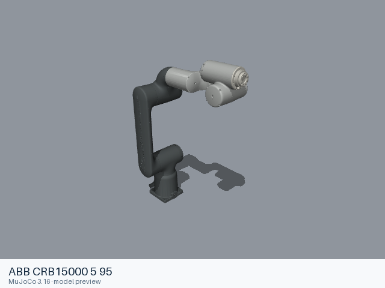](crb15000_5_95/README.md) | [ABB CRB15000 5 95](crb15000_5_95/README.md) | [URDF](crb15000_5_95/urdf/crb15000_5_95.urdf) | [abb](https://github.com/ros-industrial/abb) |
| [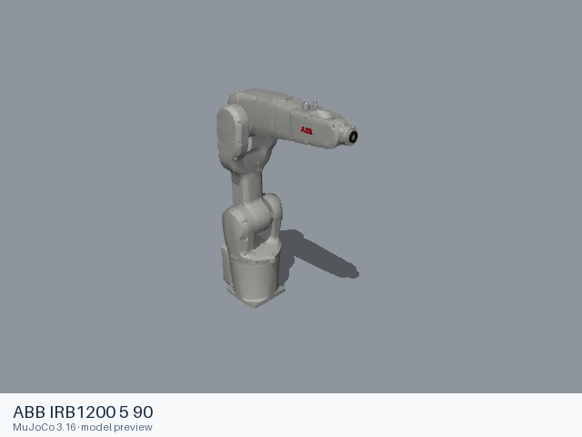](irb1200_5_90/README.md) | [ABB IRB1200 5 90](irb1200_5_90/README.md) | [URDF](irb1200_5_90/urdf/irb1200_5_90.urdf) | [abb](https://github.com/ros-industrial/abb) |
| [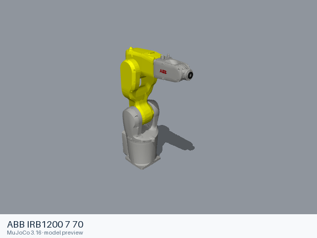](irb1200_7_70/README.md) | [ABB IRB1200 7 70](irb1200_7_70/README.md) | [URDF](irb1200_7_70/urdf/irb1200_7_70.urdf) | [abb](https://github.com/ros-industrial/abb) |
| [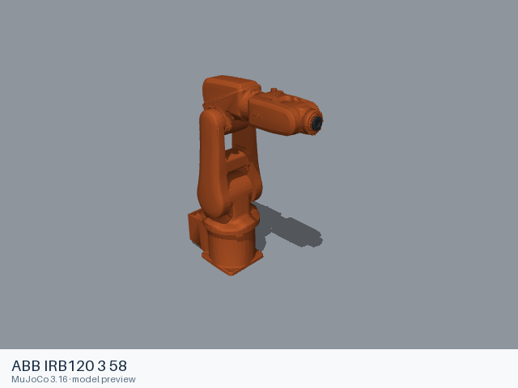](irb120_3_58/README.md) | [ABB IRB120 3 58](irb120_3_58/README.md) | [URDF](irb120_3_58/urdf/irb120_3_58.urdf) | [abb](https://github.com/ros-industrial/abb) |
|  | [ABB IRB120T 3 58](irb120t_3_58/README.md) | [URDF](irb120t_3_58/urdf/irb120t_3_58.urdf) | [abb](https://github.com/ros-industrial/abb) |
| [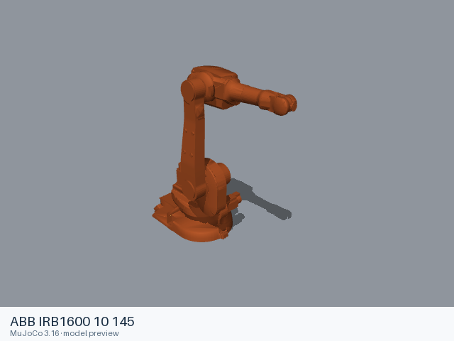](irb1600_10_145/README.md) | [ABB IRB1600 10 145](irb1600_10_145/README.md) | [URDF](irb1600_10_145/urdf/irb1600_10_145.urdf) | [abb](https://github.com/ros-industrial/abb) |
| [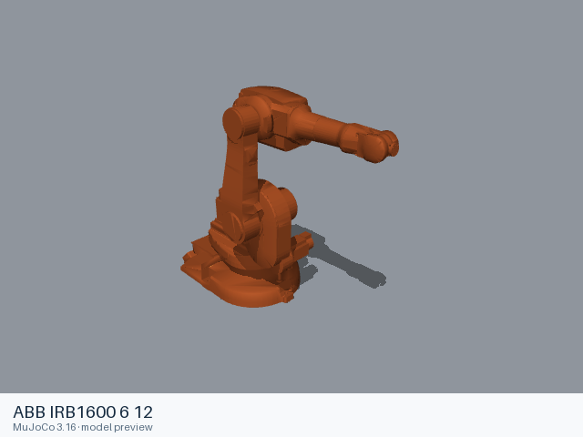](irb1600_6_12/README.md) | [ABB IRB1600 6 12](irb1600_6_12/README.md) | [URDF](irb1600_6_12/urdf/irb1600_6_12.urdf) | [abb](https://github.com/ros-industrial/abb) |
| [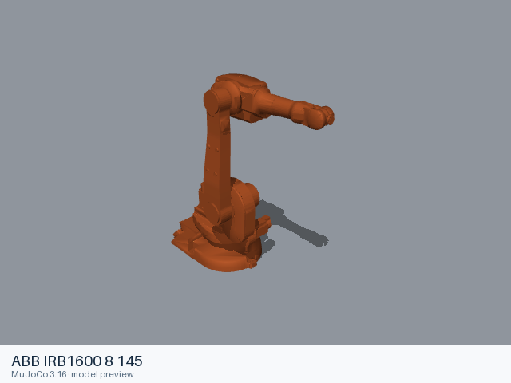](irb1600_8_145/README.md) | [ABB IRB1600 8 145](irb1600_8_145/README.md) | [URDF](irb1600_8_145/urdf/irb1600_8_145.urdf) | [abb](https://github.com/ros-industrial/abb) |
| [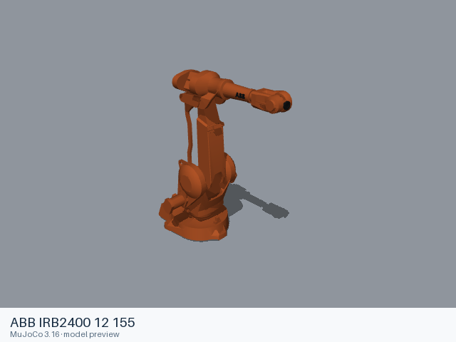](irb2400_12_155/README.md) | [ABB IRB2400 12 155](irb2400_12_155/README.md) | [URDF](irb2400_12_155/urdf/irb2400_12_155.urdf) | [abb](https://github.com/ros-industrial/abb) |
|  | [ABB IRB2600 12 165](irb2600_12_165/README.md) | [URDF](irb2600_12_165/urdf/irb2600_12_165.urdf) | [abb](https://github.com/ros-industrial/abb) |
| [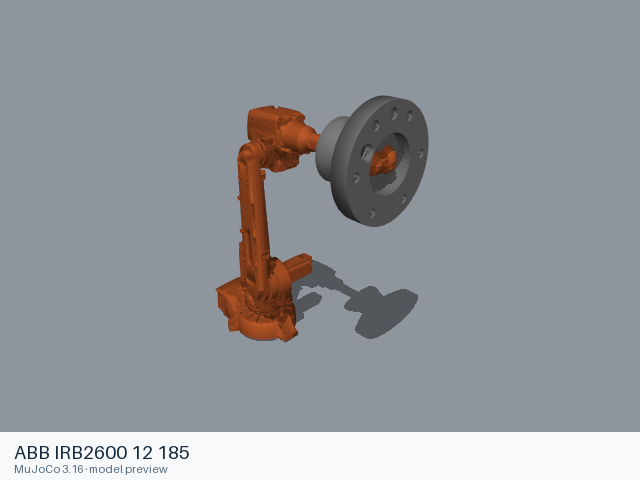](irb2600_12_185/README.md) | [ABB IRB2600 12 185](irb2600_12_185/README.md) | [URDF](irb2600_12_185/urdf/irb2600_12_185.urdf) | [abb](https://github.com/ros-industrial/abb) |
| [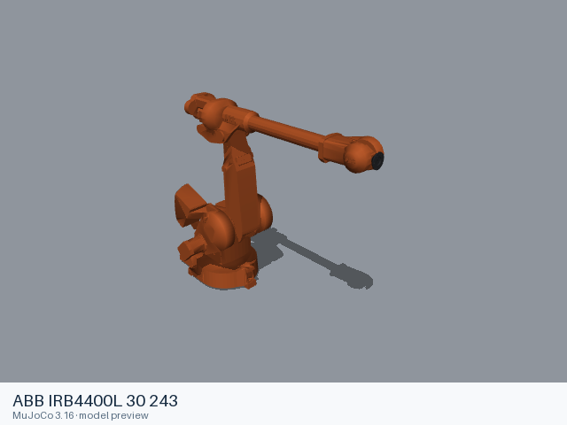](irb4400l_30_243/README.md) | [ABB IRB4400L 30 243](irb4400l_30_243/README.md) | [URDF](irb4400l_30_243/urdf/irb4400l_30_243.urdf) | [abb](https://github.com/ros-industrial/abb) |
| [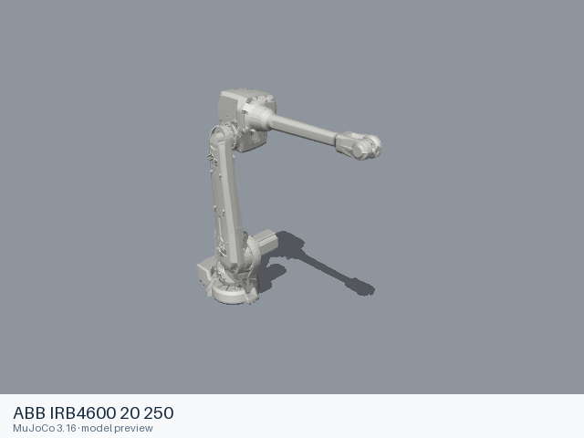](irb4600_20_250/README.md) | [ABB IRB4600 20 250](irb4600_20_250/README.md) | [URDF](irb4600_20_250/urdf/irb4600_20_250.urdf) | [abb](https://github.com/ros-industrial/abb) |
| [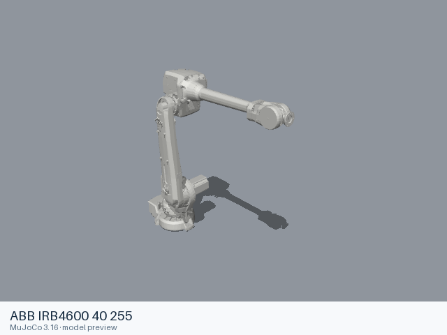](irb4600_40_255/README.md) | [ABB IRB4600 40 255](irb4600_40_255/README.md) | [URDF](irb4600_40_255/urdf/irb4600_40_255.urdf) | [abb](https://github.com/ros-industrial/abb) |
| [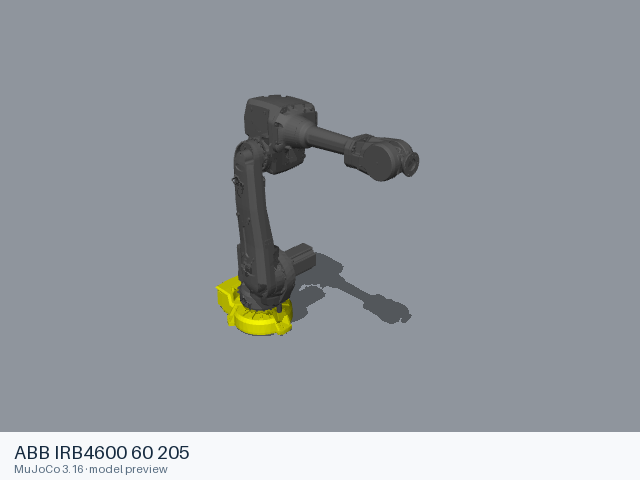](irb4600_60_205/README.md) | [ABB IRB4600 60 205](irb4600_60_205/README.md) | [URDF](irb4600_60_205/urdf/irb4600_60_205.urdf) | [abb](https://github.com/ros-industrial/abb) |
| [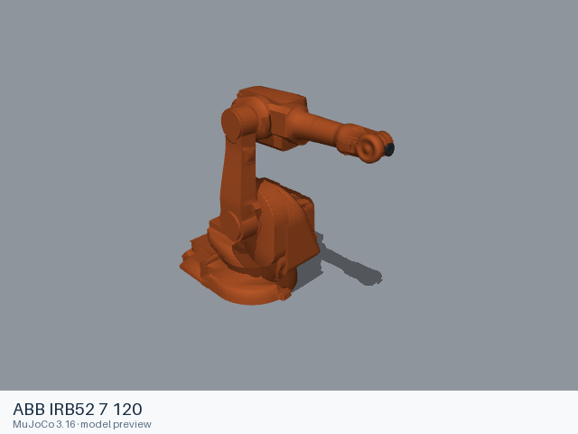](irb52_7_120/README.md) | [ABB IRB52 7 120](irb52_7_120/README.md) | [URDF](irb52_7_120/urdf/irb52_7_120.urdf) | [abb](https://github.com/ros-industrial/abb) |
| [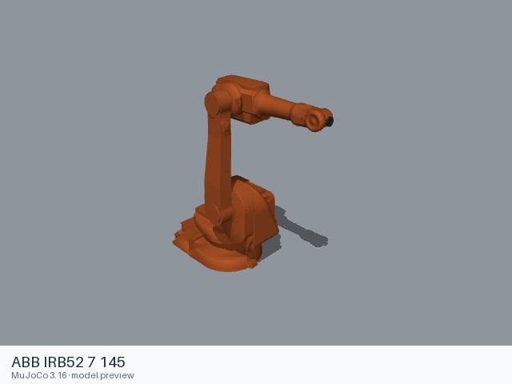](irb52_7_145/README.md) | [ABB IRB52 7 145](irb52_7_145/README.md) | [URDF](irb52_7_145/urdf/irb52_7_145.urdf) | [abb](https://github.com/ros-industrial/abb) |
| [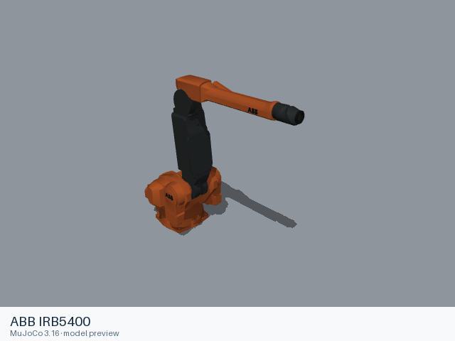](irb5400/README.md) | [ABB IRB5400](irb5400/README.md) | [URDF](irb5400/urdf/irb5400.urdf) | [abb](https://github.com/ros-industrial/abb) |
| [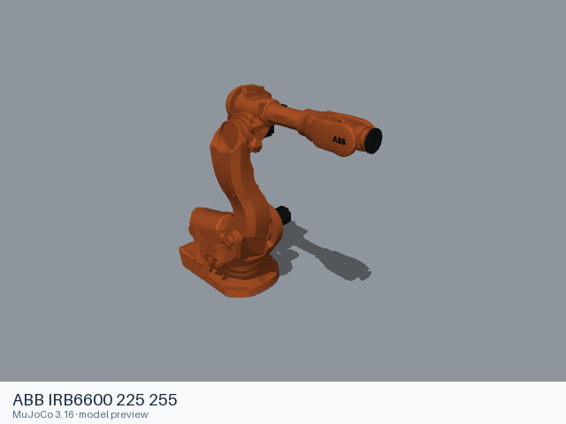](irb6600_225_255/README.md) | [ABB IRB6600 225 255](irb6600_225_255/README.md) | [URDF](irb6600_225_255/urdf/irb6600_225_255.urdf) | [abb](https://github.com/ros-industrial/abb) |
| [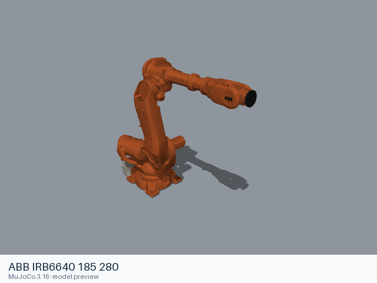](irb6640_185_280/README.md) | [ABB IRB6640 185 280](irb6640_185_280/README.md) | [URDF](irb6640_185_280/urdf/irb6640_185_280.urdf) | [abb](https://github.com/ros-industrial/abb) |
| [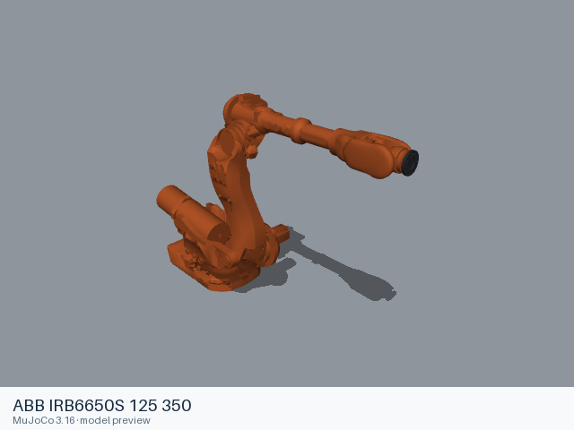](irb6650s_125_350/README.md) | [ABB IRB6650S 125 350](irb6650s_125_350/README.md) | [URDF](irb6650s_125_350/urdf/irb6650s_125_350.urdf) | [abb](https://github.com/ros-industrial/abb) |
| [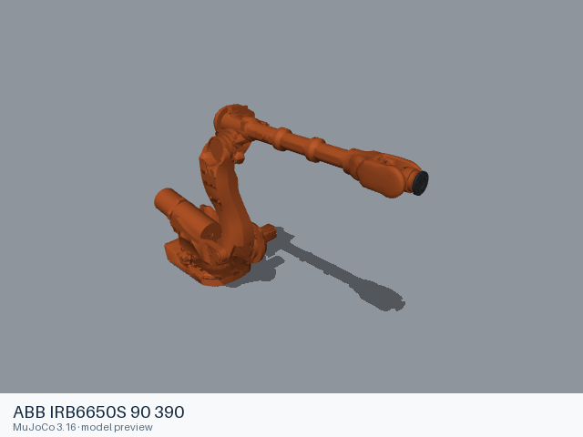](irb6650s_90_390/README.md) | [ABB IRB6650S 90 390](irb6650s_90_390/README.md) | [URDF](irb6650s_90_390/urdf/irb6650s_90_390.urdf) | [abb](https://github.com/ros-industrial/abb) |
|  | [ABB IRB6700 200 260](irb6700_200_260/README.md) | [URDF](irb6700_200_260/urdf/irb6700_200_260.urdf) | [abb](https://github.com/ros-industrial/abb) |
| [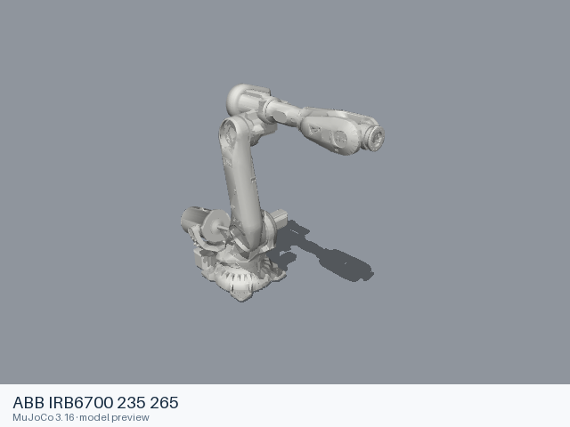](irb6700_235_265/README.md) | [ABB IRB6700 235 265](irb6700_235_265/README.md) | [URDF](irb6700_235_265/urdf/irb6700_235_265.urdf) | [abb](https://github.com/ros-industrial/abb) |
| [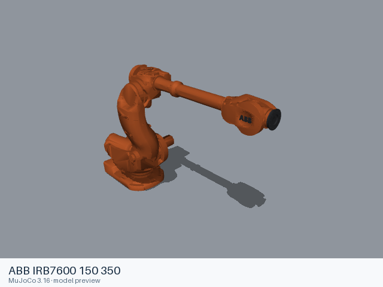](irb7600_150_350/README.md) | [ABB IRB7600 150 350](irb7600_150_350/README.md) | [URDF](irb7600_150_350/urdf/irb7600_150_350.urdf) | [abb](https://github.com/ros-industrial/abb) |
| [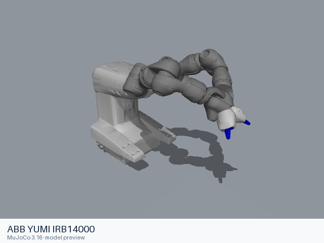](yumi_irb14000/README.md) | [ABB YUMI IRB14000](yumi_irb14000/README.md) | [URDF](yumi_irb14000/urdf/yumi_irb14000.urdf) | [yumi](https://github.com/OrebroUniversity/yumi) |

Each model contains a static entry, the resources it references, and its applicable license files. Mechanical details and loading records are in the model READMEs.
