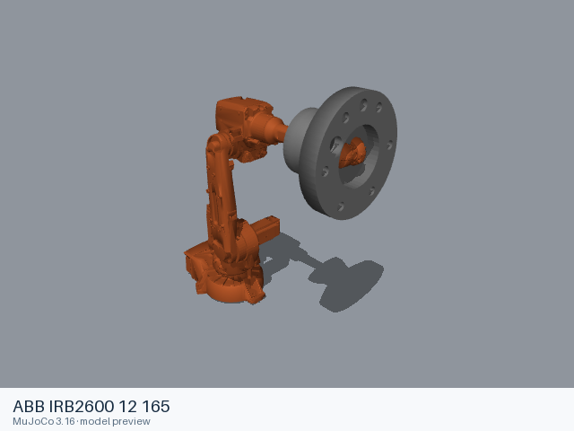

# ABB IRB2600 12 165

[Manufacturer gallery](../README.md) · [All manufacturers](../../../README.md)



MuJoCo preview · [Rendering record](preview.json) · [Rendering method](../../../docs/PREVIEWS.md)

6-joint arm without a gripper. The entry preserves the upstream kinematic, visual, collision, inertial and joint-limit definitions.

## Model entries

Entry paths are relative to the repository root.

| Purpose / assembly | Format | Entry path | Target environment and required loading options |
|---|---|---|---|
| Robot model: 6-joint arm without a gripper | URDF | [`models/abb/irb2600_12_165/urdf/irb2600_12_165.urdf`](urdf/irb2600_12_165.urdf) | A native URDF loader with relative mesh resolution; attach the base to the consuming scene. |

## Mechanical information

| Item | Definition |
|---|---|
| Hardware revision and gripper | 6-joint arm without a gripper |
| Units | Metres, kilograms, radians; revolute joint effort in N·m and prismatic effort in N. Mesh scale attributes remain as supplied upstream. |
| Base | `base_link`; root of the URDF tree. Any supplied fixed base transform is retained. |
| Arm joint order | `joint_1` → `joint_2` → `joint_3` → `joint_4` → `joint_5` → `joint_6` |
| Gripper | No gripper is included. |
| End effector / TCP | `flange`, `tool0`; fixed transforms remain in the entry. |
| Included poses | No named poses are defined by this URDF entry. |

## Loading example

```python
from yourdfpy import URDF

robot = URDF.load(
    '/absolute/path/to/awesome-robot-arm-zoo/models/abb/irb2600_12_165/urdf/irb2600_12_165.urdf',
    load_meshes=True, load_collision_meshes=True,
    build_collision_scene_graph=True,
)
```

## Sources and licensing

| Format or file scope | Upstream project | Version | Upstream file path | License file |
|---|---|---|---|---|
| Static URDF and its bundled resources (abb_irb2600_support) | [https://github.com/ros-industrial/abb](https://github.com/ros-industrial/abb) | `45f4769d826cf3ac62a65495f2db67b78b0c81df` | `abb_irb2600_support/urdf/irb2600_12_165.xacro`; model mesh paths under the named packages | [LICENSE](urdf/LICENSE), [LICENSE.abb_resources](urdf/LICENSE.abb_resources) |

Bundled upstream resource directories: `abb_irb2600_support/meshes/irb2600_12_165/collision`, `abb_irb2600_support/meshes/irb2600_12_165/visual`.

License scope: Apache-2.0, for the model support package and `abb_resources`. The complete upstream license texts and notices accompany this format directory.

## Model preparation

The static entry was expanded with xacro 2.1.1 using upstream defaults. Resources were copied only when referenced by the entry or by one of its mesh/material files. Resource references are local relative paths. Mesh contents and physical parameters retain the upstream definitions.

## Loading verification

Checks performed on 2026-10-15. The complete format directory was copied to a temporary location and loaded by absolute path from a separate working directory.

| Entry | Environment and loader version | Verification steps | Result |
|---|---|---|---|
| `models/abb/irb2600_12_165/urdf/irb2600_12_165.urdf` | macOS 27.2, arm64, Python 3.12.14; yourdfpy 0.0.60 | Load visual/collision geometry and update the joint configuration. | Passed, including resource relocation. |

## Known limitations

Dynamic task execution, controller performance and training behavior have not been validated.

ROS, Gazebo and physics simulators have not been verified for this entry. This is a ROS-Industrial maintained model, rather than an ABB-supported product.

The source omits inertial definitions on these moving links with geometry: `link_1`, `link_2`, `link_3`, `link_4`, `link_5`, `link_6`. It does not supply a complete dynamics model.
