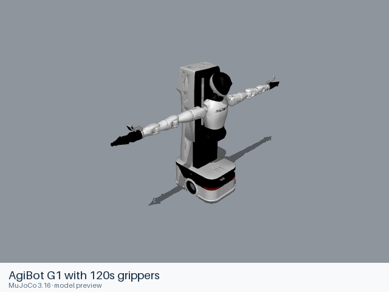

# AgiBot G1 with 120s grippers

[Manufacturer gallery](../README.md) · [All manufacturers](../../../README.md)



MuJoCo preview · [Rendering record](preview.json) · [Rendering method](../../../docs/PREVIEWS.md)

Dual-arm manipulation platform with a lift, turning torso, pan/tilt head, two seven-axis arms and 120s parallel grippers. This is AgiBot's G1 platform.

## Model entries

Entry paths are relative to the repository root.

| Purpose / assembly | Format | Entry path | Target environment and required loading options |
|---|---|---|---|
| Complete G1 articulation with 120s grippers and cameras | USD | [`models/agibot/g1_120s/usd/robot.usda`](usd/robot.usda) | Isaac Sim / Genie Sim USD asset. Requires the runtime's OmniPBR MDL material library and PhysX/Isaac schemas. |

## Mechanical information

| Item | Definition |
|---|---|
| Hardware revision and gripper | Upstream `G1_120s` assembly with two 120s grippers and wrist camera mounts. |
| Units | Metres, kilograms; USD revolute joint limits and drive targets use degrees. Up axis is Z. |
| Base | `/G1` articulation; `/G1/base_link`. An upstream world fixed joint anchors the base. |
| Torso | `idx01_body_joint1` lift, `idx02_body_joint2` rotation. |
| Left arm joint order | `idx21_arm_l_joint1`, `idx22_arm_l_joint2`, `idx23_arm_l_joint3`, `idx24_arm_l_joint4`, `idx25_arm_l_joint5`, `idx26_arm_l_joint6`, `idx27_arm_l_joint7`. |
| Right arm joint order | `idx61_arm_r_joint1`, `idx62_arm_r_joint2`, `idx63_arm_r_joint3`, `idx64_arm_r_joint4`, `idx65_arm_r_joint5`, `idx66_arm_r_joint6`, `idx67_arm_r_joint7`. |
| Gripper relationships | The authored articulation includes driven and passive finger joints, spherical joints and four loop joints. Preserve these constraints in a physics loader. |
| End effector / TCP | `arm_l_end_link`, `arm_r_end_link` and attached `gripper_l_base_link`, `gripper_r_base_link`; no added TCP transform. |
| Included poses | Authored USD transforms and drive targets. `config.yaml` records the upstream URDF-conversion settings. |

## Loading example

```python
from pxr import Usd

stage = Usd.Stage.Open(
    '/absolute/path/to/awesome-robot-arm-zoo/models/agibot/g1_120s/usd/robot.usda'
)
```

Open the same entry in Isaac Sim to use its authored PhysX articulation, drives and sensor definitions. OpenUSD alone composes the asset without running those systems.

## Sources and licensing

| Format or file scope | Upstream project | Version | Upstream file path | License file |
|---|---|---|---|---|
| USD layers, embedded meshes and conversion settings | [AgiBot World GenieSimAssets](https://huggingface.co/datasets/agibot-world/GenieSimAssets) | `a0813aad7c16165daffbe6c2737754e0344809ee` | `robot/G1_120s/` | [CC BY-NC-SA 4.0](usd/LICENSE), [attribution](usd/NOTICES) |

The [upstream dataset card](https://huggingface.co/datasets/agibot-world/GenieSimAssets/blob/a0813aad7c16165daffbe6c2737754e0344809ee/README.md) states the license. Noncommercial and ShareAlike terms apply to these resources and the preview depicting them. This asset does not use the repository's general code license.

## Model preparation

The native entry, four referenced USD layers and upstream conversion settings retain their original contents and relative paths. Geometry is embedded in the USD layers. `OmniPBR.mdl` is an Isaac Sim runtime material module, rather than a missing model download. No URDF or MJCF physics conversion is supplied.

## Loading verification

Checked on 2026-10-16 with OpenUSD 0.26.8 (`usd-core` 26.8), macOS 27.2 arm64 and Python 3.12.14. The complete `usd/` directory was copied to a temporary location and opened by absolute path from a different working directory. All five layers composed without composition errors; 73 meshes including instance proxies, 50 joints, all 99 body targets and six mimic references resolved. Geometry bounds were finite. The only external dependency was the runtime-provided `OmniPBR.mdl` module. Result: native USD composition and resource relocation passed. This check did not run Isaac Sim physics or MDL shading.

## Known limitations

Isaac Sim simulation, MDL shading, sensors, joint motion and controller behavior have not been executed in this checkout. OpenUSD composition validates the layers and geometry, rather than PhysX dynamics. The gallery uses composed meshes and constant diffuse colors in a static MuJoCo scene; it does not execute MDL shaders or USD physics.
