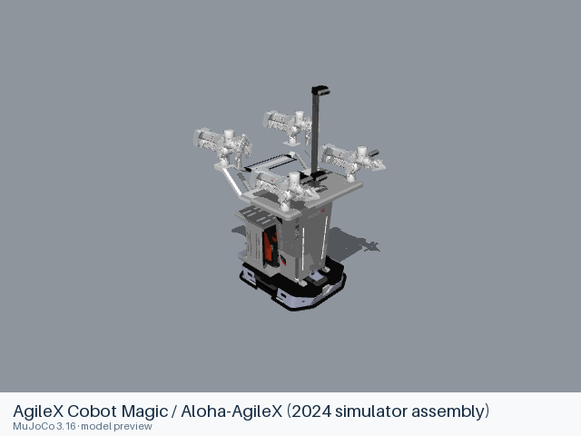

# AgileX Cobot Magic / Aloha-AgileX (2024 simulator assembly)

[Manufacturer gallery](../README.md) · [All manufacturers](../../../README.md)



MuJoCo preview · [Rendering record](preview.json) · [Rendering method](../../../docs/PREVIEWS.md)

The 2024 mobile_aloha_sim master assembly. The URDF includes the Tracer mobile base, four ARX arms, grippers, frame and cameras. The separate upstream MJCF scene has two follower arms on a static assembly, cameras, a work table and objects.

## Model entries

Entry paths are relative to the repository root.

| Purpose / assembly | Format | Entry path | Target environment and required loading options |
|---|---|---|---|
| Complete mobile four-arm assembly | URDF | [`models/agilex/cobot_magic_2024/urdf/mobile_four_arm/aloha_sapien_sim.urdf`](urdf/mobile_four_arm/aloha_sapien_sim.urdf) | yourdfpy or another GLB-capable URDF importer; load visual and collision meshes. |
| Demonstration scene — static dual-arm assembly, table and objects | MJCF | [`models/agilex/cobot_magic_2024/mjcf/scene/aloha_v1.xml`](mjcf/scene/aloha_v1.xml) | MuJoCo; source world and scene are included. |

## Mechanical information

### mobile_four_arm

| Item | Definition |
|---|---|
| Hardware revision and gripper | The 2024 mobile_aloha_sim master assembly. The URDF includes the Tracer mobile base, four ARX arms, grippers, frame and cameras. The separate upstream MJCF scene has two follower arms on a static assembly, cameras, a work table and objects. |
| Units | Metres, kilograms and radians; source mesh scales are retained. |
| Base | `footprint`; root frame retained from the source. |
| Movable joint order | `right_wheel`, `left_wheel`, `fl_castor_wheel`, `fr_castor_wheel`, `rr_castor_wheel`, `rl_castor_wheel`, `fl_wheel`, `fr_wheel`, `rr_wheel`, `rl_wheel`, `fl_joint1`, `fl_joint2`, `fl_joint3`, `fl_joint4`, `fl_joint5`, `fl_joint6`, `fl_joint7`, `fl_joint8`, `fr_joint1`, `fr_joint2`, `fr_joint3`, `fr_joint4`, `fr_joint5`, `fr_joint6`, `fr_joint7`, `fr_joint8`, `lr_joint1`, `lr_joint2`, `lr_joint3`, `lr_joint4`, `lr_joint5`, `lr_joint6`, `rr_joint1`, `rr_joint2`, `rr_joint3`, `rr_joint4`, `rr_joint5`, `rr_joint6` (source declaration order). |
| End effector / TCP | Leaf frames: `box2_Link`, `camera_link2`, `fl_link7`, `fl_link8`, `fl_wheel_link`, `fr_link7`, `fr_link8`, `fr_wheel_link`, `inertial_link`, `left_camera`, `left_wheel_link`, `lr_link7`, `right_camera`, `right_wheel_link`, `rl_wheel_link`, `rr_link7`, `rr_wheel_link`. Source transforms are retained. |
| Included poses | No separate pose configuration is included. |
| Gripper coupling | No mimic constraint is declared; source movable joints remain independent. |

| Joint | Type | Lower | Upper | Units |
|---|---|---|---|---|
| `right_wheel` | continuous | — | — | radians |
| `left_wheel` | continuous | — | — | radians |
| `fl_castor_wheel` | continuous | — | — | radians |
| `fr_castor_wheel` | continuous | — | — | radians |
| `rr_castor_wheel` | continuous | — | — | radians |
| `rl_castor_wheel` | continuous | — | — | radians |
| `fl_wheel` | continuous | — | — | radians |
| `fr_wheel` | continuous | — | — | radians |
| `rr_wheel` | continuous | — | — | radians |
| `rl_wheel` | continuous | — | — | radians |
| `fl_joint1` | revolute | -10 | 10 | radians |
| `fl_joint2` | revolute | -10 | 10 | radians |
| `fl_joint3` | revolute | -10 | 10 | radians |
| `fl_joint4` | revolute | -10 | 10 | radians |
| `fl_joint5` | revolute | -10 | 10 | radians |
| `fl_joint6` | revolute | -10 | 10 | radians |
| `fl_joint7` | prismatic | 0 | 0.04765 | metres |
| `fl_joint8` | prismatic | 0 | 0.04765 | metres |
| `fr_joint1` | revolute | -10 | 10 | radians |
| `fr_joint2` | revolute | -10 | 10 | radians |
| `fr_joint3` | revolute | -10 | 10 | radians |
| `fr_joint4` | revolute | -10 | 10 | radians |
| `fr_joint5` | revolute | -10 | 10 | radians |
| `fr_joint6` | revolute | -10 | 10 | radians |
| `fr_joint7` | prismatic | 0 | 0.04765 | metres |
| `fr_joint8` | prismatic | 0 | 0.04765 | metres |
| `lr_joint1` | revolute | -10 | 10 | radians |
| `lr_joint2` | revolute | -10 | 10 | radians |
| `lr_joint3` | revolute | -10 | 10 | radians |
| `lr_joint4` | revolute | -10 | 10 | radians |
| `lr_joint5` | revolute | -10 | 10 | radians |
| `lr_joint6` | revolute | -10 | 10 | radians |
| `rr_joint1` | revolute | -10 | 10 | radians |
| `rr_joint2` | revolute | -10 | 10 | radians |
| `rr_joint3` | revolute | -10 | 10 | radians |
| `rr_joint4` | revolute | -10 | 10 | radians |
| `rr_joint5` | revolute | -10 | 10 | radians |
| `rr_joint6` | revolute | -10 | 10 | radians |

### scene

| Item | Definition |
|---|---|
| Hardware revision and gripper | Source 2024 MJCF scene with two follower arms and independent finger joints. |
| Units | Metres, kilograms and radians; source mesh scaling is retained. |
| Base | Static world geometry; the source scene includes its table and task objects. |
| Movable joint order | The soda-can body first declares an unnamed free joint, followed by the named joints: `object0:joint_x`, `object0:joint_y`, `object0:joint_z`, `object0:joint_r`, `object0:joint_p`, `object0:joint_yw`, `fl_joint1`, `fl_joint2`, `fl_joint3`, `fl_joint4`, `fl_joint5`, `fl_joint6`, `fl_joint7`, `fl_joint8`, `fr_joint1`, `fr_joint2`, `fr_joint3`, `fr_joint4`, `fr_joint5`, `fr_joint6`, `fr_joint7`, `fr_joint8` (source declaration order). |
| Gripper | `fl_joint7`, `fl_joint8`, `fr_joint7`, `fr_joint8` are independent slides, each 0–0.04765 m; position-control range is 0–0.0475 m. No equality coupling is declared. |
| End effector / TCP | Terminal wrist bodies are `fl_link6` and `fr_link6`; no dedicated TCP site is declared. |
| Included poses | No keyframe poses are declared. |

## Loading example

```python
from yourdfpy import URDF

robot = URDF.load(
    '/absolute/path/to/awesome-robot-arm-zoo/models/agilex/cobot_magic_2024/urdf/mobile_four_arm/aloha_sapien_sim.urdf',
    load_meshes=True, load_collision_meshes=True,
    build_collision_scene_graph=True,
)
```

```python
import mujoco

model = mujoco.MjModel.from_xml_path(
    '/absolute/path/to/awesome-robot-arm-zoo/models/agilex/cobot_magic_2024/mjcf/scene/aloha_v1.xml'
)
data = mujoco.MjData(model)
mujoco.mj_forward(model, data)
```

## Sources and licensing

| Format or file scope | Upstream project | Version | Upstream file path | License file |
|---|---|---|---|---|
| Entry and complete resource closure | [Upstream project](https://github.com/agilexrobotics/mobile_aloha_sim) | `2843ff11d2695c1563a1c9847f632aa9734f5bbc` | `aloha_sapien_sim/urdf/aloha_sapien_sim.urdf` | [LICENSE](urdf/mobile_four_arm/LICENSE), [NOTICES](urdf/mobile_four_arm/NOTICES) |
| Entry and complete resource closure | [Upstream project](https://github.com/agilexrobotics/mobile_aloha_sim) | `2843ff11d2695c1563a1c9847f632aa9734f5bbc` | `aloha_mujoco/aloha/meshes_mujoco/aloha_v1.xml` | [LICENSE](mjcf/scene/LICENSE), [NOTICES](mjcf/scene/NOTICES) |

MIT, Copyright (c) 2024, from the source master branch. The resource closure uses the source SAPIEN assembly assets and MJCF scene meshes; no Livox simulation package is included.

## Model preparation

The URDF mesh references are local to its variant directory. The source `box2_Link.dae.zip` is unpacked for preparation; the frame mesh is supplied as self-contained `box2_Link.glb`, exported with Trimesh 5.1.1. The GLB retains all 322 geometry instances, scene transforms, normals, 2,090,871 triangles and three embedded images without simplification. Source Phong colors and textures use the exporter’s PBR material translation; original Phong coefficients are retained in mesh metadata. The MJCF scene retains its source contents and complete referenced mesh set.

## Loading verification

The complete format directory was copied to a temporary location and each absolute entry path was loaded from a different working directory on 2026-10-16.

| Entry | Environment and loader version | Verification steps | Result |
|---|---|---|---|
| `models/agilex/cobot_magic_2024/urdf/mobile_four_arm/aloha_sapien_sim.urdf` | macOS 27.2, arm64, Python 3.12.14; yourdfpy 0.0.60 | Load visual and collision meshes; update every actuated joint to a value within its limits; check finite bounds. | Passed, including relocation and joint configuration. |
| `models/agilex/cobot_magic_2024/mjcf/scene/aloha_v1.xml` | macOS 27.2, arm64, Python 3.12.14; MuJoCo 3.16.0 | Compile the model, construct MjData and run mj_forward. | Passed, including relocation and joint configuration. |

## Known limitations

Dynamic task execution, controller performance and training behavior have not been validated. ROS, Gazebo, SAPIEN and Isaac Sim execution have not been tested.

The URDF frame mesh requires an importer with glTF 2.0 binary (GLB) mesh support. The recorded yourdfpy loader supports it.

The MJCF scene uses a static chassis without the URDF’s mobile wheel joints or rear arms. It is a separate source assembly and does not represent the URDF’s full mechanism.
