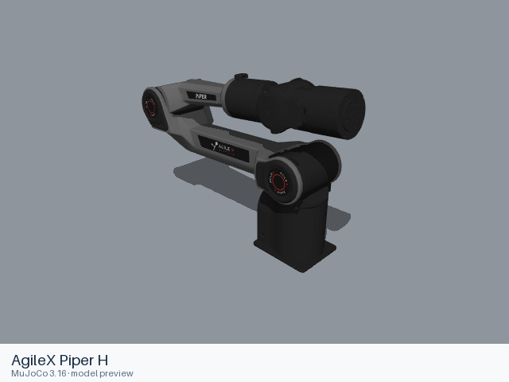

# AgileX Piper H

[Manufacturer gallery](../README.md) · [All manufacturers](../../../README.md)



MuJoCo preview · [Rendering record](preview.json) · [Rendering method](../../../docs/PREVIEWS.md)

Official manufacturer model files for the assembly identified below.

## Model entries

Entry paths are relative to the repository root.

| Purpose / assembly | Format | Entry path | Target environment and required loading options |
|---|---|---|---|
| Robot model — arm | URDF | [`models/agilex/piper_h/urdf/arm/piper_h.urdf`](urdf/arm/piper_h.urdf) | Local file loader; use a fixed base for mounted arms. |
| Robot model — with_gripper | URDF | [`models/agilex/piper_h/urdf/with_gripper/piper_h.urdf`](urdf/with_gripper/piper_h.urdf) | Local file loader; use a fixed base for mounted arms. |

## Mechanical information

### arm

| Item | Definition |
|---|---|
| Hardware revision and gripper | AgileX Piper H; configuration represented by the entry. |
| Units | URDF SI conventions: metres, kilograms, radians. Mesh scaling is retained from upstream. |
| Base | `world`; attach this root frame to the consuming scene. |
| Movable joint order | `joint1`, `joint2`, `joint3`, `joint4`, `joint5`, `joint6` (upstream declaration order; fixed joints omitted). |
| Gripper | No mimic coupling is declared. Any gripper joint limits remain in the entry. |
| End effector / TCP | Leaf frames: `link6`. Their upstream transforms are retained. |
| Included poses | No separate pose configuration is included. |
### with_gripper

| Item | Definition |
|---|---|
| Hardware revision and gripper | AgileX Piper H with gripper; configuration represented by the entry. |
| Units | URDF SI conventions: metres, kilograms, radians. Mesh scaling is retained from upstream. |
| Base | `world`; attach this root frame to the consuming scene. |
| Movable joint order | `joint1`, `joint2`, `joint3`, `joint4`, `joint5`, `joint6`, `gripper`, `gripper_joint1`, `gripper_joint2` (upstream declaration order; fixed joints omitted). |
| Gripper | gripper_joint1 mimics gripper (multiplier 0.5, offset 0.0); gripper_joint2 mimics gripper (multiplier -0.5, offset 0.0) |
| End effector / TCP | Leaf frames: `gripper_link`, `gripper_link1`, `gripper_link2`. Their upstream transforms are retained. |
| Included poses | No separate pose configuration is included. |

## Loading example

```python
from yourdfpy import URDF

robot = URDF.load(
    '/absolute/path/to/awesome-robot-arm-zoo/models/agilex/piper_h/urdf/arm/piper_h.urdf',
    load_meshes=True, load_collision_meshes=True,
    build_collision_scene_graph=True,
)
```

## Sources and licensing

| Format or file scope | Upstream project | Version | Upstream file path | License file |
|---|---|---|---|---|
| URDF / arm entry and referenced resources | [agx_arm_urdf](https://github.com/agilexrobotics/agx_arm_urdf) | `a68b8e876a2c6fcb0ecee7a7943129e4d48dd864` | `piper_h/urdf/piper_h_description.urdf` | [LICENSE](urdf/arm/LICENSE), [NOTICES](urdf/arm/NOTICES) |
| URDF / with_gripper entry and referenced resources | [agx_arm_urdf](https://github.com/agilexrobotics/agx_arm_urdf) | `a68b8e876a2c6fcb0ecee7a7943129e4d48dd864` | `piper_h/urdf/piper_h_with_gripper_description.xacro` | [LICENSE](urdf/with_gripper/LICENSE), [NOTICES](urdf/with_gripper/NOTICES) |

License: MIT. The license and attribution notices apply to the model entry and copied dependencies from the stated project.

## Model preparation

 Referenced resources are stored inside the format directory and resource URIs are relative to the entry. Joint limits, inertial values, visual and collision geometry retain their upstream definitions.

 Xacro 2.1.1 expansion mappings: `{}`. Referenced resources are stored inside the format directory and resource URIs are relative to the entry. Joint limits, inertial values, visual and collision geometry retain their upstream definitions.

## Loading verification

Checks performed on 2026-10-15. The complete format directory was copied to a temporary location and loaded by absolute path from a separate working directory.

| Entry | Environment and loader version | Verification steps | Result |
|---|---|---|---|
| `models/agilex/piper_h/urdf/arm/piper_h.urdf` | macOS 27.2, arm64, Python 3.12.14; yourdfpy 0.0.60 | Load visual/collision geometry and update the joint configuration. | Passed, including resource relocation. |
| `models/agilex/piper_h/urdf/with_gripper/piper_h.urdf` | macOS 27.2, arm64, Python 3.12.14; yourdfpy 0.0.60 | Load visual/collision geometry and update the joint configuration. | Passed, including resource relocation. |

## Known limitations

Dynamic task execution, controller performance and training behavior have not been validated.

- ROS and Gazebo control extensions, when present, retain their upstream metadata; their external runtime plugins are not included.
- Upstream hardware or revision distinctions beyond the source filename are not independently established.
- The URDF has no inertial element for `world`.
- The URDF has no inertial element for `world`, `gripper_link`.
