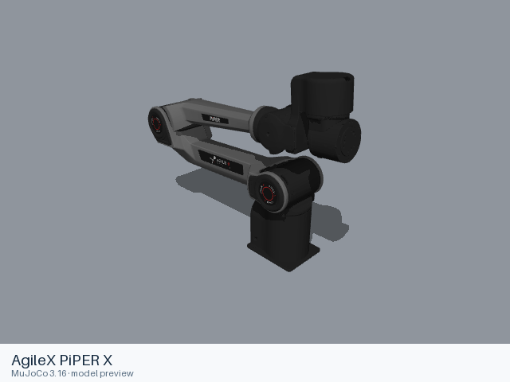

# AgileX PiPER X

[Manufacturer gallery](../README.md) · [All manufacturers](../../../README.md)



MuJoCo preview · [Rendering record](preview.json) · [Rendering method](../../../docs/PREVIEWS.md)

Six-axis PiPER X arm, available as a bare arm or with the source AGX parallel gripper and flange assembly.

## Model entries

Entry paths are relative to the repository root.

| Purpose / assembly | Format | Entry path | Target environment and required loading options |
|---|---|---|---|
| Robot model — bare arm | URDF | [`models/agilex/piper_x/urdf/arm/piper_x_description.urdf`](urdf/arm/piper_x_description.urdf) | yourdfpy; full visual and collision meshes. Fix the root when mounted. |
| Robot model — AGX gripper | URDF | [`models/agilex/piper_x/urdf/with_gripper/piper_x_with_gripper.urdf`](urdf/with_gripper/piper_x_with_gripper.urdf) | yourdfpy; full visual and collision meshes. Fix the root when mounted. |

## Mechanical information

### arm

| Item | Definition |
|---|---|
| Hardware revision and gripper | Six-axis PiPER X arm, available as a bare arm or with the source AGX parallel gripper and flange assembly. |
| Units | Metres, kilograms and radians; source mesh scales are retained. |
| Base | `world`; root frame retained from the source. |
| Movable joint order | `joint1`, `joint2`, `joint3`, `joint4`, `joint5`, `joint6` (source declaration order). |
| End effector / TCP | Leaf frames: `link6`. Source transforms are retained. |
| Included poses | No separate pose configuration is included. |
| Gripper coupling | No mimic constraint is declared; source movable joints remain independent. |

| Joint | Type | Lower | Upper | Units |
|---|---|---|---|---|
| `joint1` | revolute | -2.6179938 | 2.6179938 | radians |
| `joint2` | revolute | 0 | 3.1415926 | radians |
| `joint3` | revolute | -2.9670597 | 0 | radians |
| `joint4` | revolute | -1.553343 | 1.553343 | radians |
| `joint5` | revolute | -1.553343 | 1.553343 | radians |
| `joint6` | revolute | -2.9670597 | 2.9670597 | radians |

### with_gripper

| Item | Definition |
|---|---|
| Hardware revision and gripper | Six-axis PiPER X arm, available as a bare arm or with the source AGX parallel gripper and flange assembly. |
| Units | Metres, kilograms and radians; source mesh scales are retained. |
| Base | `world`; root frame retained from the source. |
| Movable joint order | `joint1`, `joint2`, `joint3`, `joint4`, `joint5`, `joint6`, `gripper`, `gripper_joint1`, `gripper_joint2` (source declaration order). |
| End effector / TCP | Leaf frames: `gripper_link`, `gripper_link1`, `gripper_link2`. Source transforms are retained. |
| Included poses | No separate pose configuration is included. |
| Gripper coupling | `gripper_joint1 = 0.5 × gripper + 0.0`; `gripper_joint2 = -0.5 × gripper + 0.0`. |

| Joint | Type | Lower | Upper | Units |
|---|---|---|---|---|
| `joint1` | revolute | -2.6179938 | 2.6179938 | radians |
| `joint2` | revolute | 0 | 3.1415926 | radians |
| `joint3` | revolute | -2.9670597 | 0 | radians |
| `joint4` | revolute | -1.553343 | 1.553343 | radians |
| `joint5` | revolute | -1.553343 | 1.553343 | radians |
| `joint6` | revolute | -2.9670597 | 2.9670597 | radians |
| `gripper` | prismatic | 0 | 0.1 | metres |
| `gripper_joint1` | prismatic | 0 | 0.05 | metres |
| `gripper_joint2` | prismatic | -0.05 | 0 | metres |

## Loading example

```python
from yourdfpy import URDF

robot = URDF.load(
    '/absolute/path/to/awesome-robot-arm-zoo/models/agilex/piper_x/urdf/arm/piper_x_description.urdf',
    load_meshes=True, load_collision_meshes=True,
    build_collision_scene_graph=True,
)
```

## Sources and licensing

| Format or file scope | Upstream project | Version | Upstream file path | License file |
|---|---|---|---|---|
| Entry and complete resource closure | [Upstream project](https://github.com/agilexrobotics/agx_arm_urdf) | `a68b8e876a2c6fcb0ecee7a7943129e4d48dd864` | `piper_x/urdf/piper_x_description.urdf` | [LICENSE](urdf/arm/LICENSE), [NOTICES](urdf/arm/NOTICES) |
| Entry and complete resource closure | [Upstream project](https://github.com/agilexrobotics/agx_arm_urdf) | `a68b8e876a2c6fcb0ecee7a7943129e4d48dd864` | `piper_x/urdf/piper_x_with_gripper_description.xacro` | [LICENSE](urdf/with_gripper/LICENSE), [NOTICES](urdf/with_gripper/NOTICES) |

MIT, Copyright (c) 2026 aalicecc; the source license accompanies the PiPER X and AGX gripper model resources.

## Model preparation

ROS package mesh URIs are local relative paths. The gripper entry statically expands the one source Xacro include; it preserves the source flange mounting, AGX gripper, mimic joints and physical values.

## Loading verification

The complete format directory was copied to a temporary location and each absolute entry path was loaded from a different working directory on 2026-10-16.

| Entry | Environment and loader version | Verification steps | Result |
|---|---|---|---|
| `models/agilex/piper_x/urdf/arm/piper_x_description.urdf` | macOS 27.2, arm64, Python 3.12.14; yourdfpy 0.0.60 | Load visual and collision meshes; update every actuated joint to a value within its limits; check finite bounds. | Passed, including relocation and joint configuration. |
| `models/agilex/piper_x/urdf/with_gripper/piper_x_with_gripper.urdf` | macOS 27.2, arm64, Python 3.12.14; yourdfpy 0.0.60 | Load visual and collision meshes; update every actuated joint to a value within its limits; check finite bounds. | Passed, including relocation and joint configuration. |

## Known limitations

Dynamic task execution, controller performance and training behavior have not been validated. ROS, Gazebo, SAPIEN and Isaac Sim execution have not been tested.
