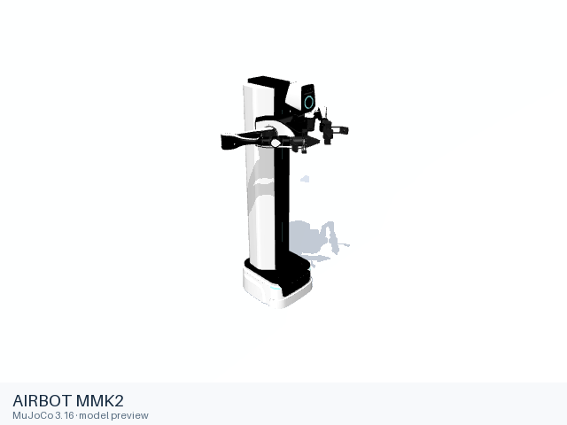
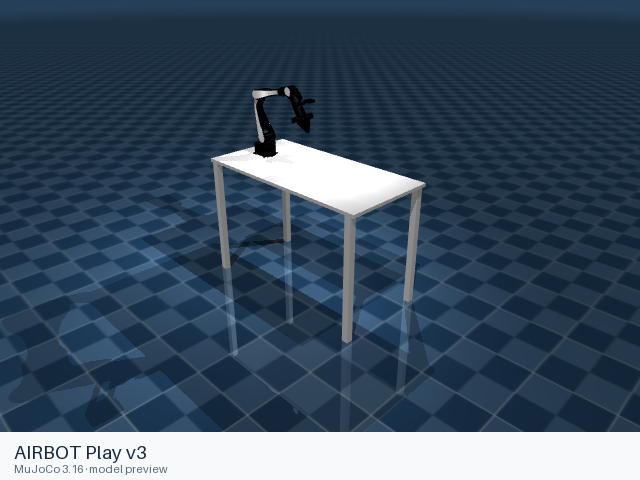

# AIRBOT

[All manufacturers](../../README.md#models) · [Chinese index](../../README_CN.md#模型目录)

Previews are rendered with MuJoCo. See the [rendering method](../../docs/PREVIEWS.md); each model page links its exact entry and rendering record.

AIRBOT Play and MMK2 simulation assemblies from DISCOVERSE. Native entries retain the source physical definitions and carry complete local resource closures and MIT terms.

| Preview | Model / assembly | Native entries |
|---|---|---|
|  | [AIRBOT MMK2](mmk2/README.md) | [MJCF](mmk2/mjcf/source/mmk2_floor.xml) |
|  | [AIRBOT Play v3](play_v3/README.md) | [MJCF](play_v3/mjcf/source/manipulator/robot_airbot_play.xml) |
