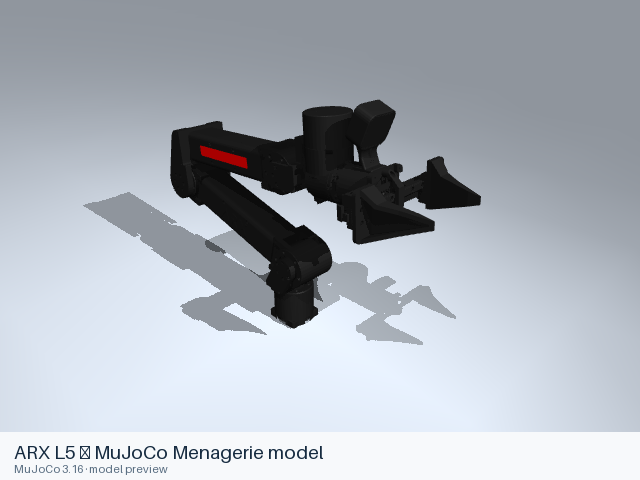

# Arx models

[All manufacturers](../../README.md#models) · [Chinese index](../../README_CN.md#模型目录)

Previews are rendered with MuJoCo. See the [rendering method](../../docs/PREVIEWS.md); each model page links its exact entry and rendering record.

## Curated MuJoCo entries

The following MJCF files come from the Google DeepMind-maintained MuJoCo Menagerie collection. Their model-specific licenses and source versions are recorded with each entry.

| Preview | Model / assembly | Native entries |
|---|---|---|
|  | [ARX L5 — MuJoCo Menagerie model](l5/README.md) | [MJCF](l5/mjcf/menagerie/arx_l5.xml) [All 2 entries](l5/README.md#model-entries) |
