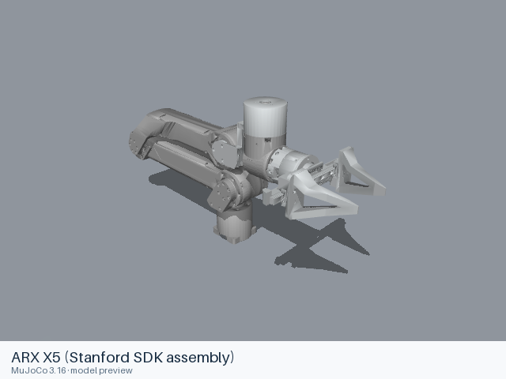

# ARX X5 (Stanford SDK assembly)

[Manufacturer gallery](../README.md) · [All manufacturers](../../../README.md)



MuJoCo preview · [Rendering record](preview.json) · [Rendering method](../../../docs/PREVIEWS.md)

Six-axis silver-and-black X5 arm from the Stanford arx5-sdk model set. This source provides an end-effector reference frame and fixed wrist geometry.

## Model entries

Entry paths are relative to the repository root.

| Purpose / assembly | Format | Entry path | Target environment and required loading options |
|---|---|---|---|
| Robot model — six-axis arm | URDF | [`models/arx/x5/urdf/stanford_sdk/X5.urdf`](urdf/stanford_sdk/X5.urdf) | yourdfpy; full visual and collision meshes. Fix the root when mounted. |

## Mechanical information

### stanford_sdk

| Item | Definition |
|---|---|
| Hardware revision and gripper | Six-axis silver-and-black X5 arm from the Stanford arx5-sdk model set. This source provides an end-effector reference frame and fixed wrist geometry. |
| Units | Metres, kilograms and radians; source mesh scales are retained. |
| Base | `base_link`; root frame retained from the source. |
| Movable joint order | `joint1`, `joint2`, `joint3`, `joint4`, `joint5`, `joint6` (source declaration order). |
| End effector / TCP | Leaf frames: `eef_link`. Source transforms are retained. |
| Included poses | No separate pose configuration is included. |
| Gripper coupling | No mimic constraint is declared; source movable joints remain independent. |

| Joint | Type | Lower | Upper | Units |
|---|---|---|---|---|
| `joint1` | revolute | -10 | 10 | radians |
| `joint2` | revolute | 0 | 3.14 | radians |
| `joint3` | revolute | 0 | 3.14 | radians |
| `joint4` | revolute | -1.57079632679 | 1.57079632679 | radians |
| `joint5` | revolute | -1.67 | 1.67 | radians |
| `joint6` | revolute | -1.57 | 1.57 | radians |

## Loading example

```python
from yourdfpy import URDF

robot = URDF.load(
    '/absolute/path/to/awesome-robot-arm-zoo/models/arx/x5/urdf/stanford_sdk/X5.urdf',
    load_meshes=True, load_collision_meshes=True,
    build_collision_scene_graph=True,
)
```

## Sources and licensing

| Format or file scope | Upstream project | Version | Upstream file path | License file |
|---|---|---|---|---|
| Entry and complete resource closure | [Upstream project](https://github.com/real-stanford/arx5-sdk) | `c160db7834530a3d80fec524547c74e1d4fa8035` | `models/X5.urdf` | [LICENSE](urdf/stanford_sdk/LICENSE), [NOTICES](urdf/stanford_sdk/NOTICES) |

MIT, Copyright (c) 2024 Yihuai Gao. The entry and all meshes come from this licensed SDK model directory.

## Model preparation

The source base mesh reference is localized to the supplied `meshes/X5/base_link.STL`. All other source geometry, inertias, limits, primitive collisions and the fixed `eef_link` transform retain their definitions.

## Loading verification

The complete format directory was copied to a temporary location and each absolute entry path was loaded from a different working directory on 2026-10-16.

| Entry | Environment and loader version | Verification steps | Result |
|---|---|---|---|
| `models/arx/x5/urdf/stanford_sdk/X5.urdf` | macOS 27.2, arm64, Python 3.12.14; yourdfpy 0.0.60 | Load visual and collision meshes; update every actuated joint to a value within its limits; check finite bounds. | Passed, including relocation and joint configuration. |

## Known limitations

Dynamic task execution, controller performance and training behavior have not been validated. ROS, Gazebo, SAPIEN and Isaac Sim execution have not been tested.

The SDK does not identify a hardware year for this URDF. It has six actuated arm joints and a fixed `eef_link`; no movable gripper-finger joint is included.
