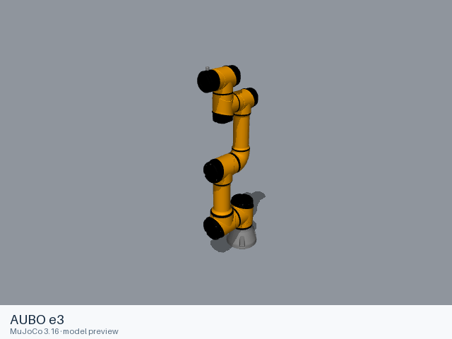
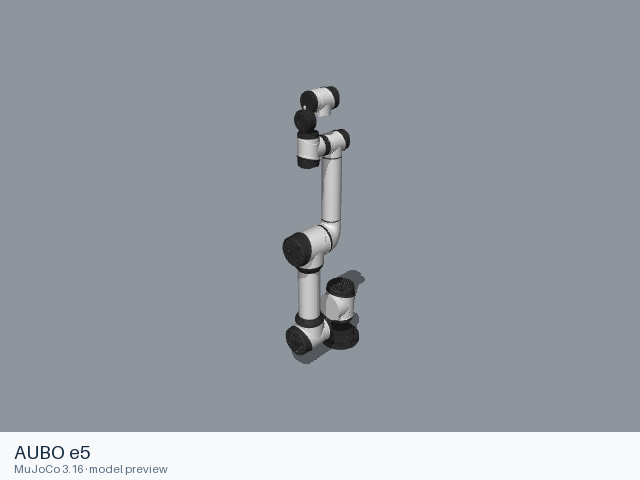
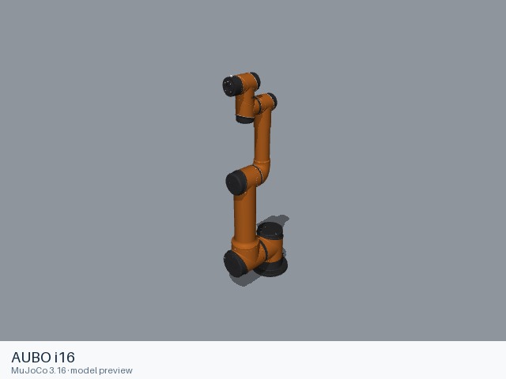
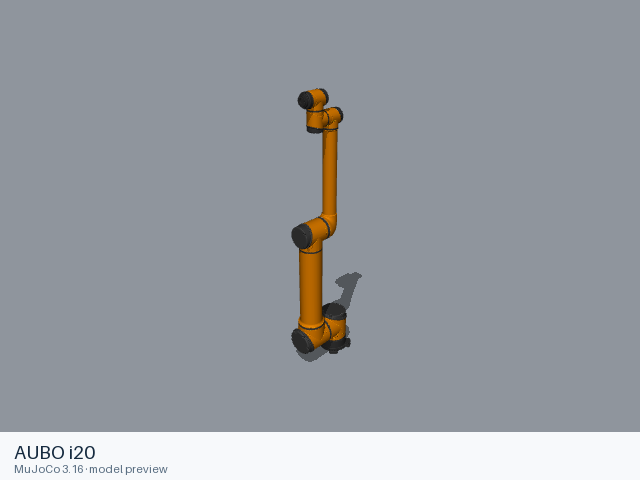
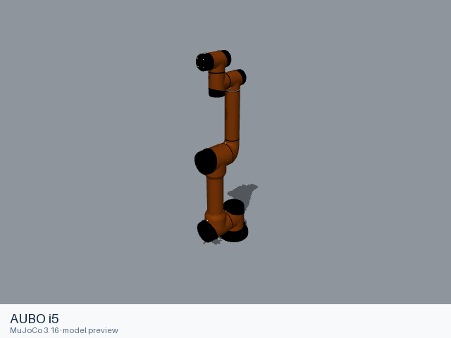
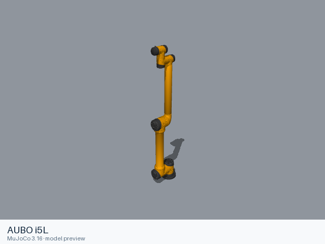
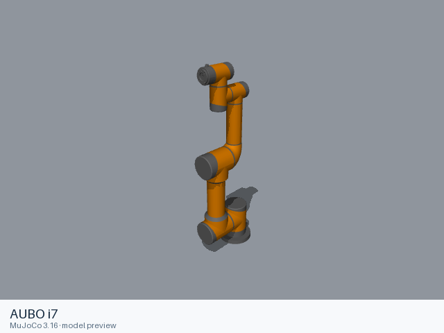
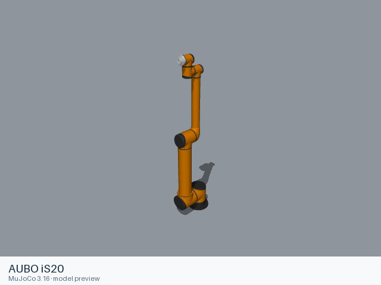
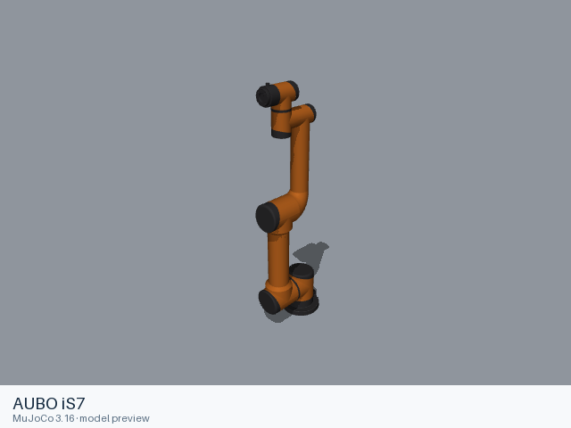

# Aubo models

[All manufacturers](../../README.md#models) · [Chinese index](../../README_CN.md#模型目录)

Previews are rendered with MuJoCo. See the [rendering method](../../docs/PREVIEWS.md); each model page links its exact entry and rendering record.

These entries come from manufacturer-maintained public repositories. Source versions and file scopes are recorded with each model.

| Preview | Model / assembly | Native entries | Source status | Source |
|---|---|---|---|---|
|  | [AUBO e3](e3/README.md) | [URDF](e3/urdf/e3.urdf) | Official manufacturer repository | [aubo_robot](https://github.com/AuboRobot/aubo_robot) |
|  | [AUBO e5](e5/README.md) | [URDF](e5/urdf/e5.urdf) | Official manufacturer repository | [aubo_robot](https://github.com/AuboRobot/aubo_robot) |
|  | [AUBO i10](i10/README.md) | [URDF](i10/urdf/i10.urdf) | Official manufacturer repository | [aubo_robot](https://github.com/AuboRobot/aubo_robot) |
|  | [AUBO i16](i16/README.md) | [URDF](i16/urdf/i16.urdf) | Official manufacturer repository | [aubo_robot](https://github.com/AuboRobot/aubo_robot) |
|  | [AUBO i20](i20/README.md) | [URDF](i20/urdf/i20.urdf) | Official manufacturer repository | [aubo_robot](https://github.com/AuboRobot/aubo_robot) |
|  | [AUBO i3](i3/README.md) | [URDF](i3/urdf/i3.urdf) | Official manufacturer repository | [aubo_robot](https://github.com/AuboRobot/aubo_robot) |
|  | [AUBO i5](i5/README.md) | [URDF](i5/urdf/i5.urdf) | Official manufacturer repository | [aubo_robot](https://github.com/AuboRobot/aubo_robot) |
|  | [AUBO i5L](i5l/README.md) | [URDF](i5l/urdf/i5l.urdf) | Official manufacturer repository | [aubo_robot](https://github.com/AuboRobot/aubo_robot) |
|  | [AUBO i7](i7/README.md) | [URDF](i7/urdf/i7.urdf) | Official manufacturer repository | [aubo_robot](https://github.com/AuboRobot/aubo_robot) |
|  | [AUBO iS20](is20/README.md) | [URDF](is20/urdf/is20.urdf) | Official manufacturer repository | [aubo_robot](https://github.com/AuboRobot/aubo_robot) |
|  | [AUBO iS7](is7/README.md) | [URDF](is7/urdf/is7.urdf) | Official manufacturer repository | [aubo_robot](https://github.com/AuboRobot/aubo_robot) |
