# Comau models

[All manufacturers](../../README.md#models) · [Chinese index](../../README_CN.md#模型目录)

Previews are rendered with MuJoCo. See the [rendering method](../../docs/PREVIEWS.md); each model page links its exact entry and rendering record.

Models from the manufacturer’s Comau/COMAU-ROS2-DRIVER repository, including eDO, Racer and NJ arms, a Racer5 Cobot rail assembly and AURA. The source repository grants MIT terms; description-package metadata declares BSD-2-Clause and is retained with each model.

| Preview | Model / assembly | Native entries | Upstream |
|---|---|---|---|
| [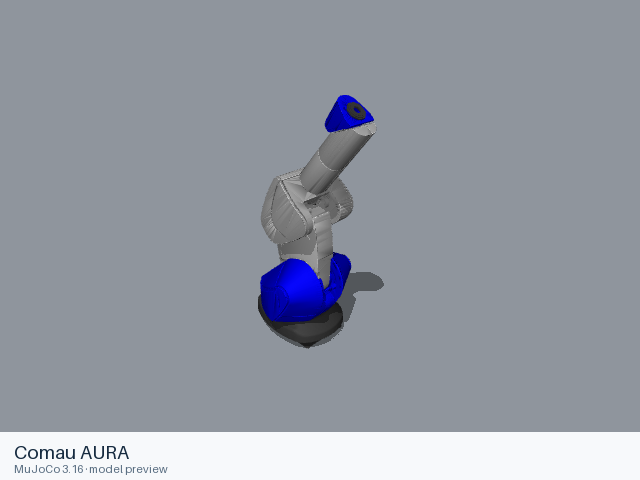](aura/README.md) | [Comau AURA](aura/README.md) | [URDF](aura/urdf/aura.urdf) | [COMAU-ROS2-DRIVER](https://github.com/Comau/COMAU-ROS2-DRIVER) |
| [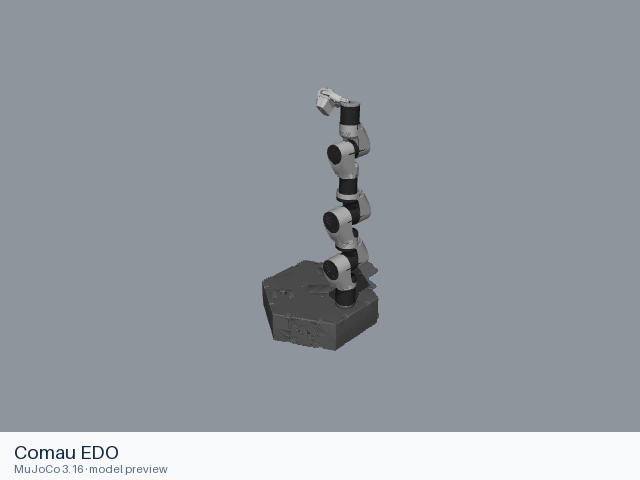](edo/README.md) | [Comau EDO](edo/README.md) | [URDF](edo/urdf/edo.urdf) | [COMAU-ROS2-DRIVER](https://github.com/Comau/COMAU-ROS2-DRIVER) |
| [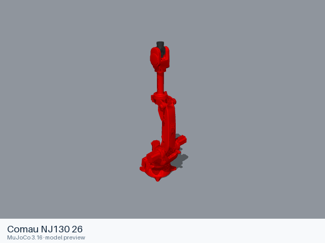](nj130_26/README.md) | [Comau NJ130 26](nj130_26/README.md) | [URDF](nj130_26/urdf/nj130_26.urdf) | [COMAU-ROS2-DRIVER](https://github.com/Comau/COMAU-ROS2-DRIVER) |
| [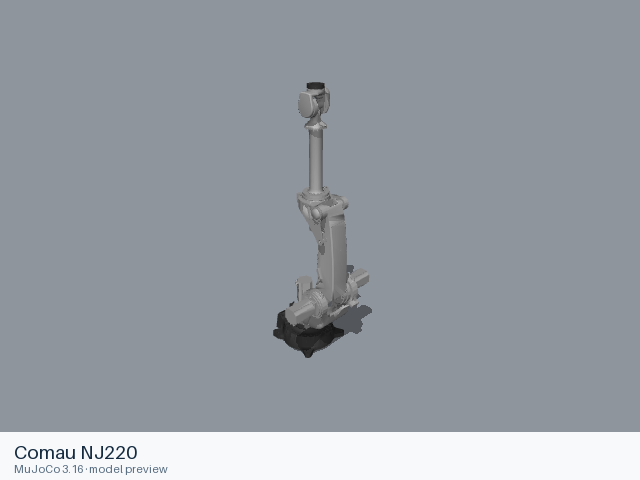](nj220/README.md) | [Comau NJ220](nj220/README.md) | [URDF](nj220/urdf/nj220.urdf) | [COMAU-ROS2-DRIVER](https://github.com/Comau/COMAU-ROS2-DRIVER) |
| [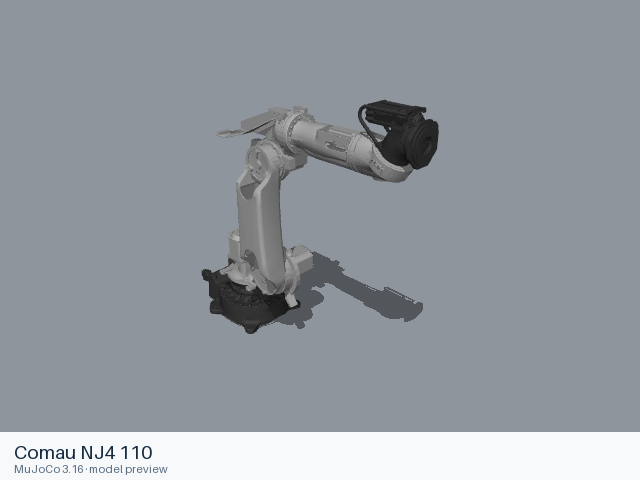](nj4_110/README.md) | [Comau NJ4 110](nj4_110/README.md) | [URDF](nj4_110/urdf/nj4_110.urdf) | [COMAU-ROS2-DRIVER](https://github.com/Comau/COMAU-ROS2-DRIVER) |
| [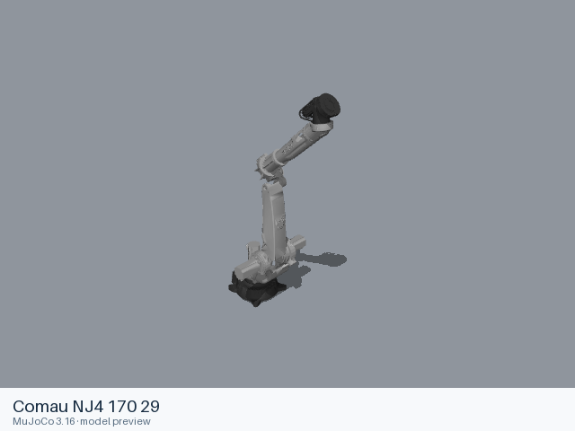](nj4_170_29/README.md) | [Comau NJ4 170 29](nj4_170_29/README.md) | [URDF](nj4_170_29/urdf/nj4_170_29.urdf) | [COMAU-ROS2-DRIVER](https://github.com/Comau/COMAU-ROS2-DRIVER) |
| [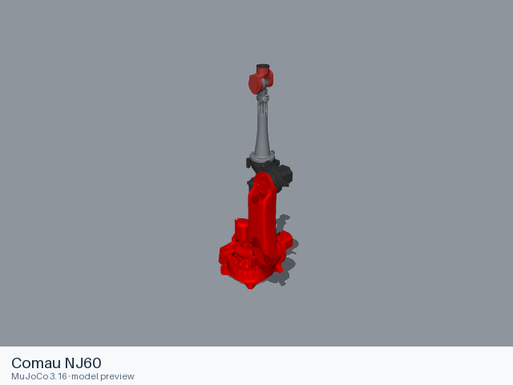](nj60/README.md) | [Comau NJ60](nj60/README.md) | [URDF](nj60/urdf/nj60.urdf) | [COMAU-ROS2-DRIVER](https://github.com/Comau/COMAU-ROS2-DRIVER) |
| [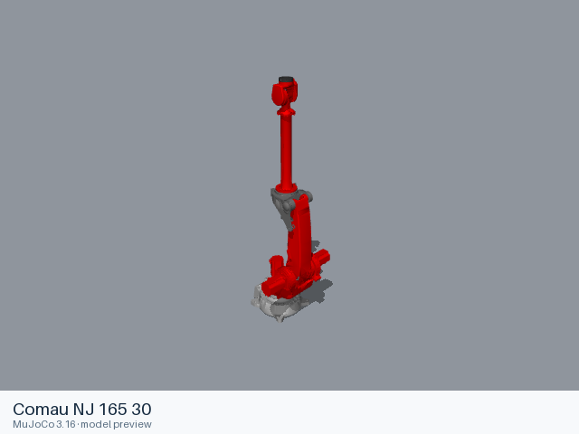](nj_165_30/README.md) | [Comau NJ 165 30](nj_165_30/README.md) | [URDF](nj_165_30/urdf/nj_165_30.urdf) | [COMAU-ROS2-DRIVER](https://github.com/Comau/COMAU-ROS2-DRIVER) |
| [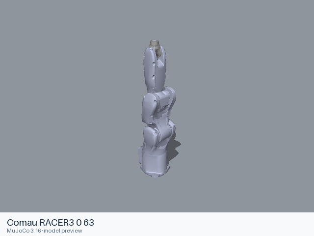](racer3_0_63/README.md) | [Comau RACER3 0 63](racer3_0_63/README.md) | [URDF](racer3_0_63/urdf/racer3_0_63.urdf) | [COMAU-ROS2-DRIVER](https://github.com/Comau/COMAU-ROS2-DRIVER) |
| [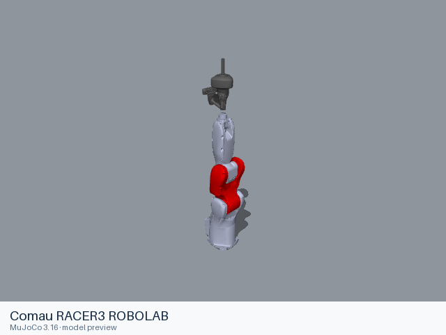](racer3_robolab/README.md) | [Comau RACER3 ROBOLAB](racer3_robolab/README.md) | [URDF](racer3_robolab/urdf/racer3_robolab.urdf) | [COMAU-ROS2-DRIVER](https://github.com/Comau/COMAU-ROS2-DRIVER) |
| [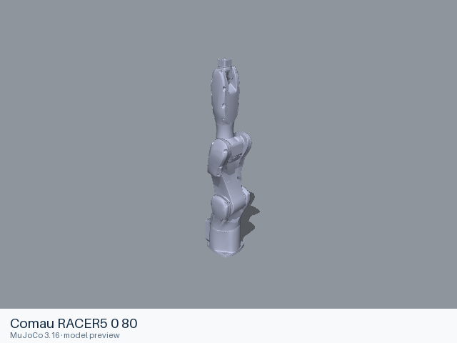](racer5_0_80/README.md) | [Comau RACER5 0 80](racer5_0_80/README.md) | [URDF](racer5_0_80/urdf/racer5_0_80.urdf) | [COMAU-ROS2-DRIVER](https://github.com/Comau/COMAU-ROS2-DRIVER) |
| [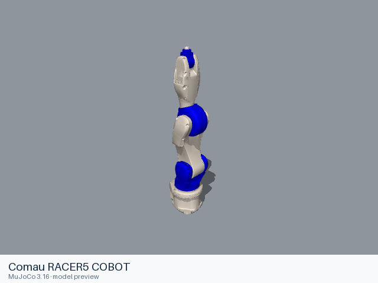](racer5_cobot/README.md) | [Comau RACER5 COBOT](racer5_cobot/README.md) | [URDF](racer5_cobot/urdf/racer5_cobot.urdf) | [COMAU-ROS2-DRIVER](https://github.com/Comau/COMAU-ROS2-DRIVER) |
| [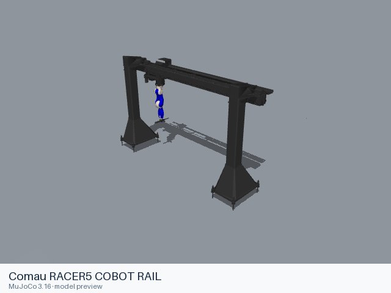](racer5_cobot_rail/README.md) | [Comau RACER5 COBOT RAIL](racer5_cobot_rail/README.md) | [URDF](racer5_cobot_rail/urdf/racer5_cobot_rail.urdf) | [COMAU-ROS2-DRIVER](https://github.com/Comau/COMAU-ROS2-DRIVER) |
| [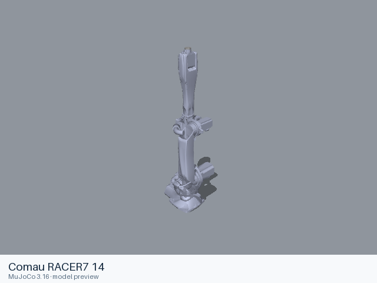](racer7_14/README.md) | [Comau RACER7 14](racer7_14/README.md) | [URDF](racer7_14/urdf/racer7_14.urdf) | [COMAU-ROS2-DRIVER](https://github.com/Comau/COMAU-ROS2-DRIVER) |

Each model contains a static entry, the resources it references, and its applicable license files. Mechanical details and loading records are in the model READMEs.
