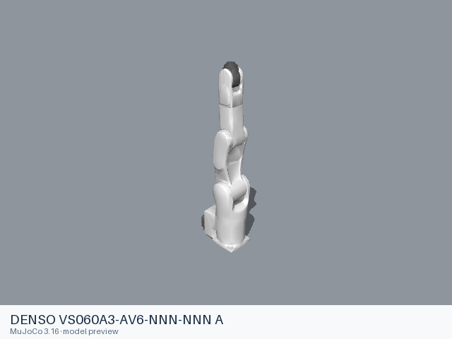

# DENSO models

[All manufacturers](../../README.md#models) · [Chinese index](../../README_CN.md#模型目录)

Previews are rendered with MuJoCo. See the [rendering method](../../docs/PREVIEWS.md); each model page links its exact entry and rendering record.

Official model sources from [DENSORobot/denso_robot_ros2](https://github.com/DENSORobot/denso_robot_ros2), maintained by the manufacturer. All entries below include a standalone static URDF and their local mesh dependencies.

| Preview | Model / assembly | Native entries | Movable joints | Source license |
|---|---|---|---|---|
|  | [DENSO COBOTTA (CVR038A1-NV6-NN)](cobotta/README.md) | [URDF](cobotta/urdf/cobotta.urdf) | 6 | Apache-2.0 |
|  | [DENSO HSR065A1-N32-NNN-NNN A](hsr065a1_n32/README.md) | [URDF](hsr065a1_n32/urdf/hsr065a1_n32.urdf) | 4 | Apache-2.0 |
|  | [DENSO VS060A3-AV6-NNN-NNN A](vs060/README.md) | [URDF](vs060/urdf/vs060.urdf) | 6 | Apache-2.0 |

## Known limitations

Loading support and physical-model limitations are recorded in each model README. The manufacturer name identifies the source hardware and upstream organization; inclusion here does not imply endorsement of this collection.
