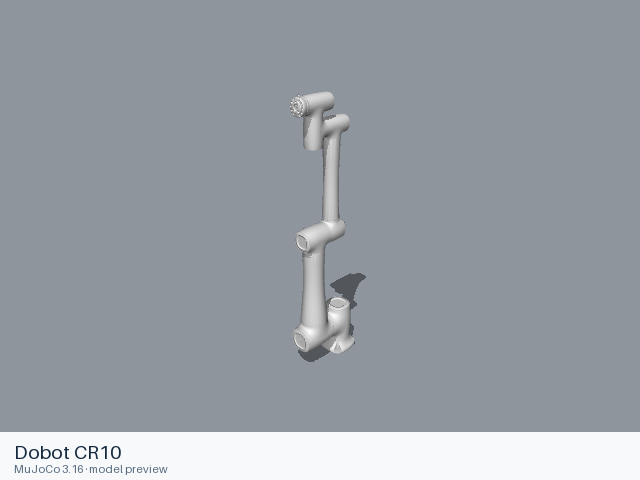
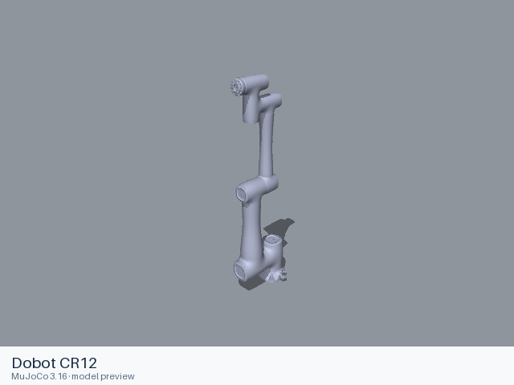
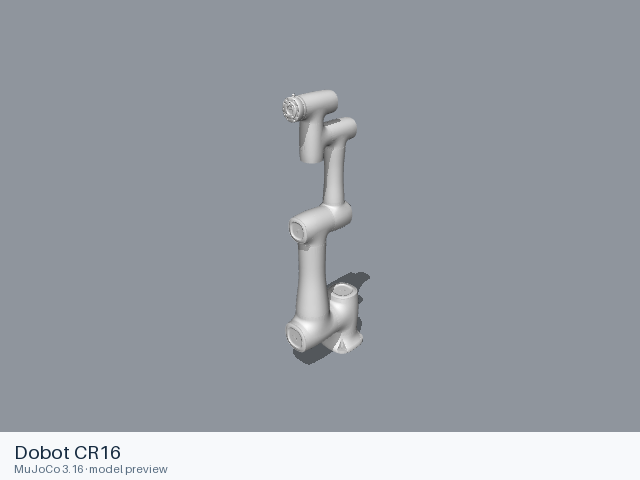
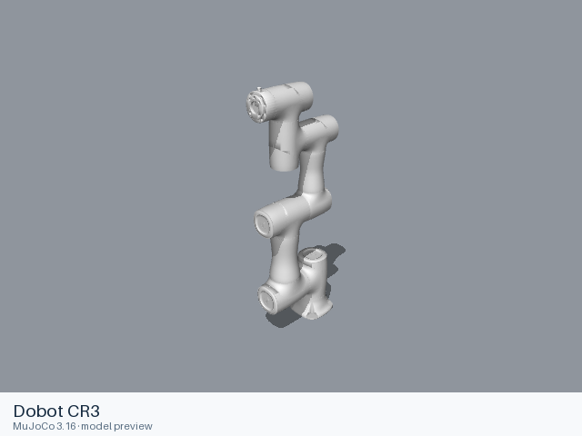
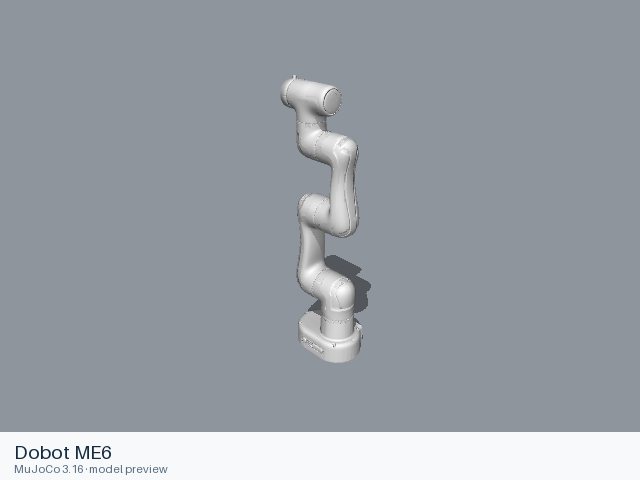
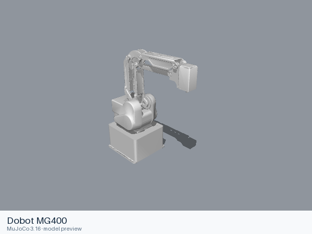
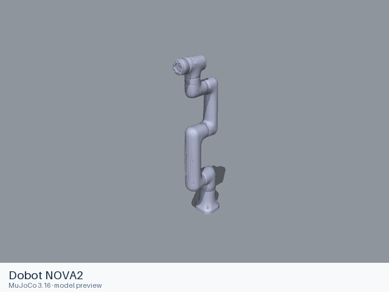
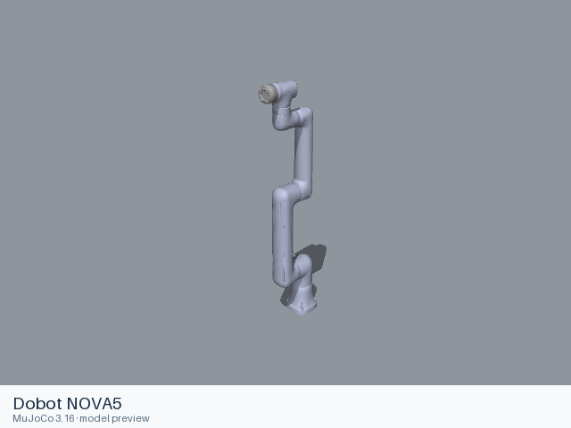

# Dobot models

[All manufacturers](../../README.md#models) · [Chinese index](../../README_CN.md#模型目录)

Previews are rendered with MuJoCo. See the [rendering method](../../docs/PREVIEWS.md); each model page links its exact entry and rendering record.

These entries come from manufacturer-maintained public repositories. Source versions and file scopes are recorded with each model.

| Preview | Model / assembly | Native entries | Source status | Source |
|---|---|---|---|---|
|  | [Dobot CR10](cr10/README.md) | [URDF](cr10/urdf/cr10.urdf) | Official manufacturer repository | [dobot_tcp_ip_ros](https://github.com/Dobot-Arm/TCP-IP-ROS-6AXis) |
|  | [Dobot CR12](cr12/README.md) | [URDF](cr12/urdf/cr12.urdf) | Official manufacturer repository | [dobot_tcp_ip_ros](https://github.com/Dobot-Arm/TCP-IP-ROS-6AXis) |
|  | [Dobot CR16](cr16/README.md) | [URDF](cr16/urdf/cr16.urdf) | Official manufacturer repository | [dobot_tcp_ip_ros](https://github.com/Dobot-Arm/TCP-IP-ROS-6AXis) |
|  | [Dobot CR3](cr3/README.md) | [URDF](cr3/urdf/cr3.urdf) | Official manufacturer repository | [dobot_tcp_ip_ros](https://github.com/Dobot-Arm/TCP-IP-ROS-6AXis) |
|  | [Dobot CR5](cr5/README.md) | [URDF](cr5/urdf/cr5.urdf) | Official manufacturer repository | [dobot_tcp_ip_ros](https://github.com/Dobot-Arm/TCP-IP-ROS-6AXis) |
|  | [Dobot CR7](cr7/README.md) | [URDF](cr7/urdf/cr7.urdf) | Official manufacturer repository | [dobot_tcp_ip_ros](https://github.com/Dobot-Arm/TCP-IP-ROS-6AXis) |
|  | [Dobot ME6](me6/README.md) | [URDF](me6/urdf/me6.urdf) | Official manufacturer repository | [dobot_tcp_ip_ros](https://github.com/Dobot-Arm/TCP-IP-ROS-6AXis) |
|  | [Dobot MG400](mg400/README.md) | [URDF](mg400/urdf/mg400.urdf) | Official manufacturer repository | [dobot_mg400_ros](https://github.com/Dobot-Arm/MG400_ROS) |
|  | [Dobot NOVA2](nova2/README.md) | [URDF](nova2/urdf/nova2.urdf) | Official manufacturer repository | [dobot_tcp_ip_ros](https://github.com/Dobot-Arm/TCP-IP-ROS-6AXis) |
|  | [Dobot NOVA5](nova5/README.md) | [URDF](nova5/urdf/nova5.urdf) | Official manufacturer repository | [dobot_tcp_ip_ros](https://github.com/Dobot-Arm/TCP-IP-ROS-6AXis) |
