# Elephant Robotics models

[All manufacturers](../../README.md#models) · [Chinese index](../../README_CN.md#模型目录)

Previews are rendered with MuJoCo. See the [rendering method](../../docs/PREVIEWS.md); each model page links its exact entry and rendering record.

These entries come from manufacturer-maintained public repositories. Source versions and file scopes are recorded with each model.

| Preview | Model / assembly | Native entries | Source status | Source |
|---|---|---|---|---|
|  | [Elephant Robotics mecharm 270 m5](mecharm_270_m5/README.md) | [URDF](mecharm_270_m5/urdf/arm/mecharm_270_m5.urdf) | Official manufacturer repository | [mycobot_ros](https://github.com/elephantrobotics/mycobot_ros) |
| [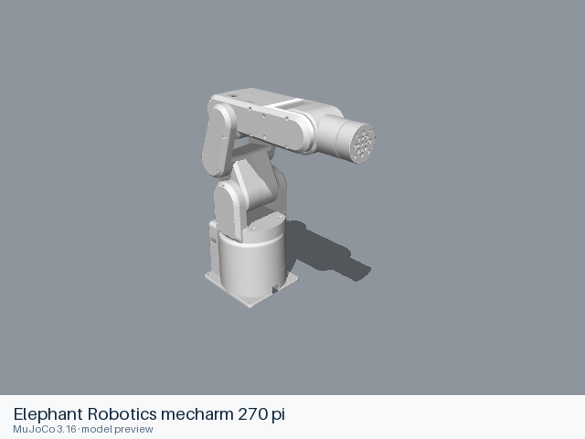](mecharm_270_pi/README.md) | [Elephant Robotics mecharm 270 pi](mecharm_270_pi/README.md) | [URDF](mecharm_270_pi/urdf/arm/mecharm_270_pi.urdf) | Official manufacturer repository | [mycobot_ros](https://github.com/elephantrobotics/mycobot_ros) |
| [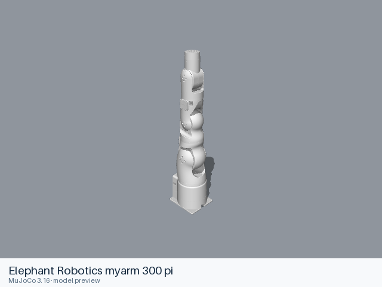](myarm_300_pi/README.md) | [Elephant Robotics myarm 300 pi](myarm_300_pi/README.md) | [URDF](myarm_300_pi/urdf/arm/myarm_300_pi.urdf) | Official manufacturer repository | [mycobot_ros](https://github.com/elephantrobotics/mycobot_ros) |
| [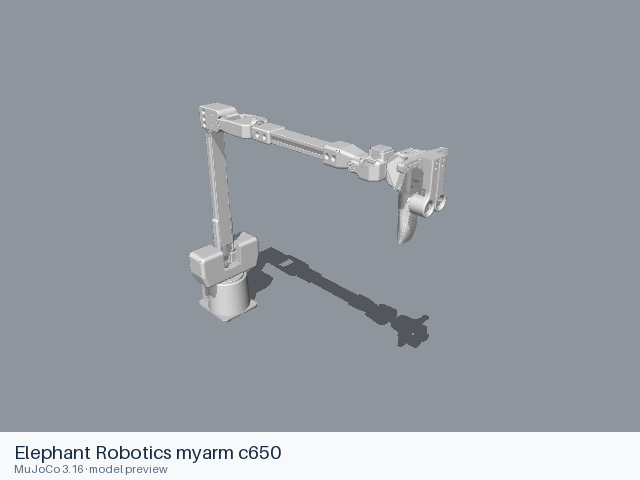](myarm_c650/README.md) | [Elephant Robotics myarm c650](myarm_c650/README.md) | [URDF](myarm_c650/urdf/arm/myarm_c650.urdf) | Official manufacturer repository | [mycobot_ros](https://github.com/elephantrobotics/mycobot_ros) |
| [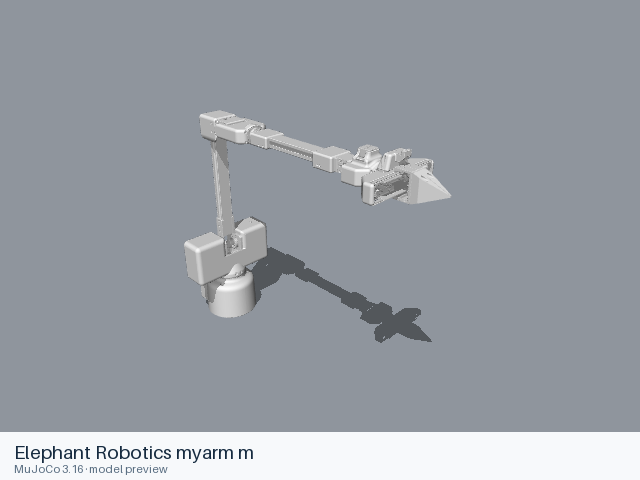](myarm_m/README.md) | [Elephant Robotics myarm m](myarm_m/README.md) | [URDF](myarm_m/urdf/arm/myarm_m.urdf) | Official manufacturer repository | [mycobot_ros](https://github.com/elephantrobotics/mycobot_ros) |
| [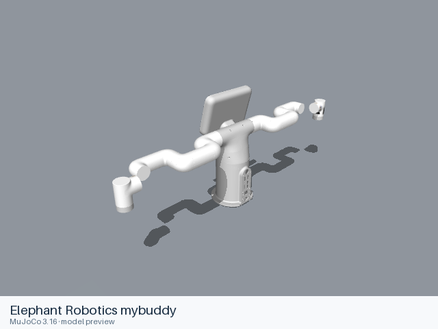](mybuddy/README.md) | [Elephant Robotics mybuddy](mybuddy/README.md) | [URDF](mybuddy/urdf/arm/mybuddy.urdf) | Official manufacturer repository | [mycobot_ros](https://github.com/elephantrobotics/mycobot_ros) |
| [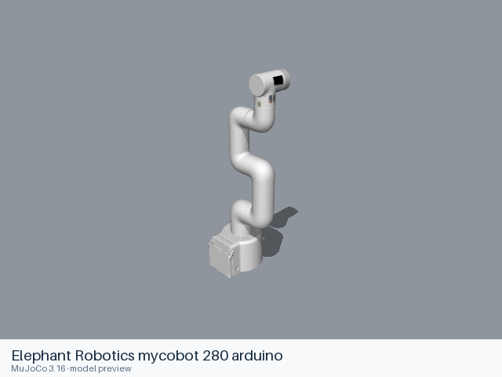](mycobot_280_arduino/README.md) | [Elephant Robotics mycobot 280 arduino](mycobot_280_arduino/README.md) | [URDF](mycobot_280_arduino/urdf/arm/mycobot_280_arduino.urdf) | Official manufacturer repository | [mycobot_ros](https://github.com/elephantrobotics/mycobot_ros) |
| [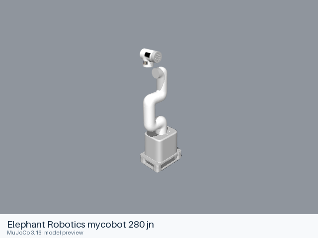](mycobot_280_jn/README.md) | [Elephant Robotics mycobot 280 jn](mycobot_280_jn/README.md) | [URDF](mycobot_280_jn/urdf/arm/mycobot_280_jn.urdf) [All 3 entries](mycobot_280_jn/README.md#model-entries) | Official manufacturer repository | [mycobot_ros](https://github.com/elephantrobotics/mycobot_ros) |
| [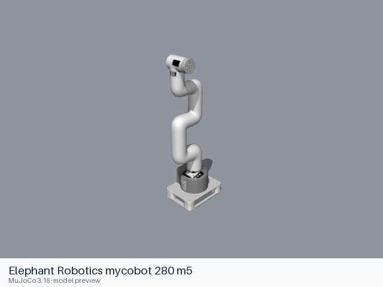](mycobot_280_m5/README.md) | [Elephant Robotics mycobot 280 m5](mycobot_280_m5/README.md) | [URDF](mycobot_280_m5/urdf/arm/mycobot_280_m5.urdf) [All 3 entries](mycobot_280_m5/README.md#model-entries) | Official manufacturer repository | [mycobot_ros](https://github.com/elephantrobotics/mycobot_ros) |
| [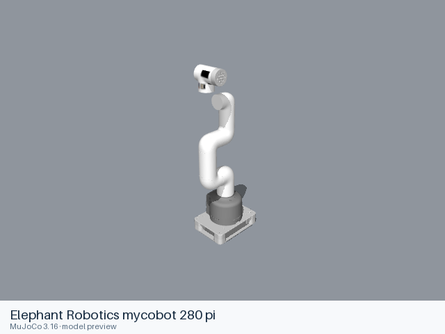](mycobot_280_pi/README.md) | [Elephant Robotics mycobot 280 pi](mycobot_280_pi/README.md) | [URDF](mycobot_280_pi/urdf/arm/mycobot_280_pi.urdf) | Official manufacturer repository | [mycobot_ros](https://github.com/elephantrobotics/mycobot_ros) |
| [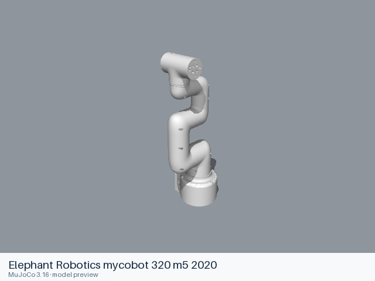](mycobot_320_m5_2020/README.md) | [Elephant Robotics mycobot 320 m5 2020](mycobot_320_m5_2020/README.md) | [URDF](mycobot_320_m5_2020/urdf/arm/mycobot_320_m5_2020.urdf) [All 2 entries](mycobot_320_m5_2020/README.md#model-entries) | Official manufacturer repository | [mycobot_ros](https://github.com/elephantrobotics/mycobot_ros) |
| [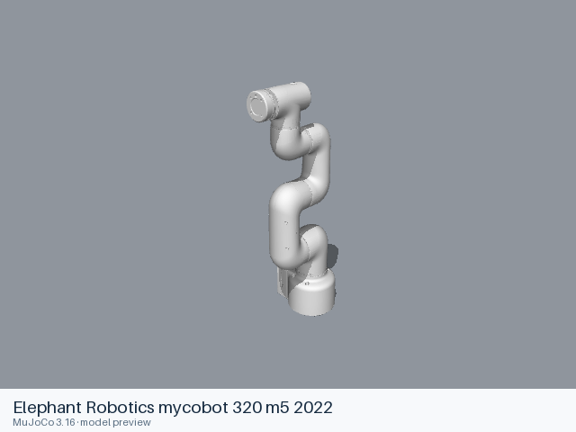](mycobot_320_m5_2022/README.md) | [Elephant Robotics mycobot 320 m5 2022](mycobot_320_m5_2022/README.md) | [URDF](mycobot_320_m5_2022/urdf/arm/mycobot_320_m5_2022.urdf) [All 3 entries](mycobot_320_m5_2022/README.md#model-entries) | Official manufacturer repository | [mycobot_ros](https://github.com/elephantrobotics/mycobot_ros) |
|  | [Elephant Robotics mycobot 320 pi 2022](mycobot_320_pi_2022/README.md) | [URDF](mycobot_320_pi_2022/urdf/arm/mycobot_320_pi_2022.urdf) [All 3 entries](mycobot_320_pi_2022/README.md#model-entries) | Official manufacturer repository | [mycobot_ros](https://github.com/elephantrobotics/mycobot_ros) |
| [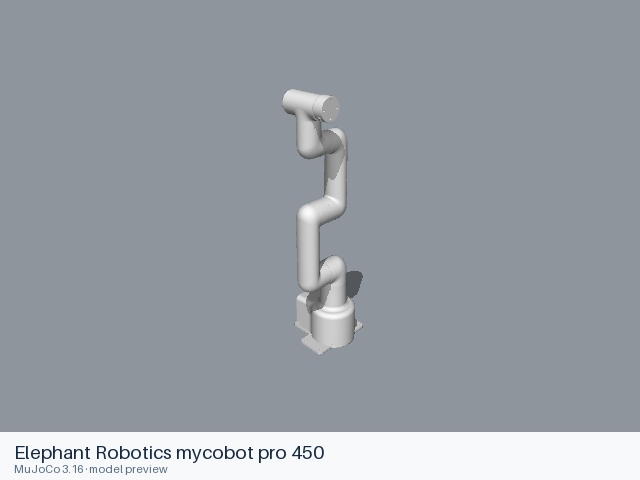](mycobot_pro_450/README.md) | [Elephant Robotics mycobot pro 450](mycobot_pro_450/README.md) | [URDF](mycobot_pro_450/urdf/arm/mycobot_pro_450.urdf) [All 2 entries](mycobot_pro_450/README.md#model-entries) | Official manufacturer repository | [mycobot_ros](https://github.com/elephantrobotics/mycobot_ros) |
| [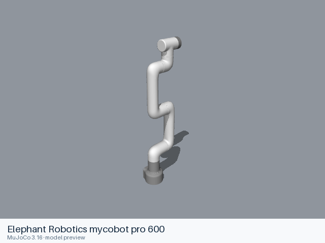](mycobot_pro_600/README.md) | [Elephant Robotics mycobot pro 600](mycobot_pro_600/README.md) | [URDF](mycobot_pro_600/urdf/arm/mycobot_pro_600.urdf) [All 2 entries](mycobot_pro_600/README.md#model-entries) | Official manufacturer repository | [mycobot_ros](https://github.com/elephantrobotics/mycobot_ros) |
| [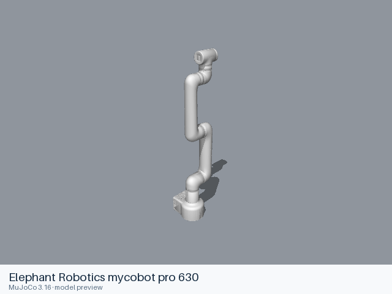](mycobot_pro_630/README.md) | [Elephant Robotics mycobot pro 630](mycobot_pro_630/README.md) | [URDF](mycobot_pro_630/urdf/arm/mycobot_pro_630.urdf) [All 4 entries](mycobot_pro_630/README.md#model-entries) | Official manufacturer repository | [mycobot_ros](https://github.com/elephantrobotics/mycobot_ros) |
| [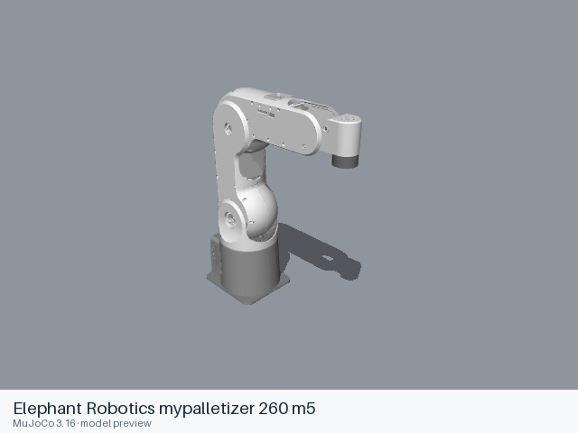](mypalletizer_260_m5/README.md) | [Elephant Robotics mypalletizer 260 m5](mypalletizer_260_m5/README.md) | [URDF](mypalletizer_260_m5/urdf/arm/mypalletizer_260_m5.urdf) | Official manufacturer repository | [mycobot_ros](https://github.com/elephantrobotics/mycobot_ros) |
| [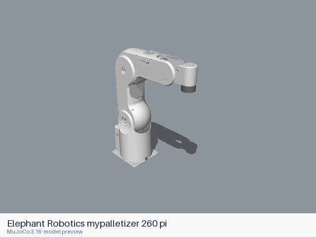](mypalletizer_260_pi/README.md) | [Elephant Robotics mypalletizer 260 pi](mypalletizer_260_pi/README.md) | [URDF](mypalletizer_260_pi/urdf/arm/mypalletizer_260_pi.urdf) | Official manufacturer repository | [mycobot_ros](https://github.com/elephantrobotics/mycobot_ros) |
| [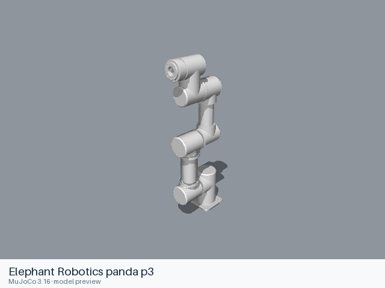](panda_p3/README.md) | [Elephant Robotics panda p3](panda_p3/README.md) | [URDF](panda_p3/urdf/arm/panda_p3.urdf) | Official manufacturer repository | [mycobot_ros](https://github.com/elephantrobotics/mycobot_ros) |
| [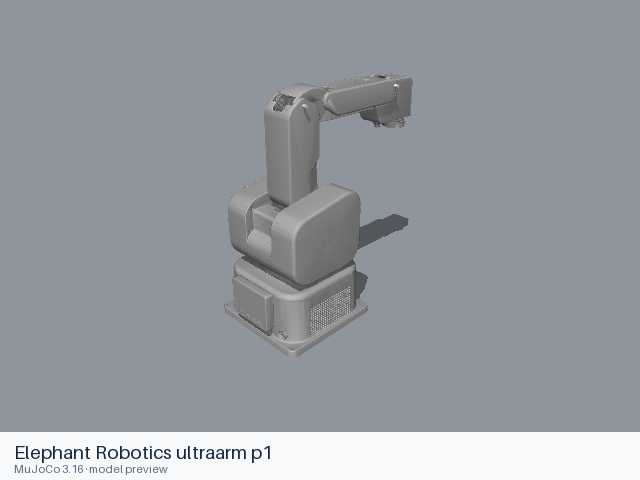](ultraarm_p1/README.md) | [Elephant Robotics ultraarm p1](ultraarm_p1/README.md) | [URDF](ultraarm_p1/urdf/arm/ultraarm_p1.urdf) | Official manufacturer repository | [mycobot_ros](https://github.com/elephantrobotics/mycobot_ros) |
| [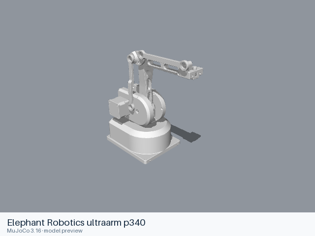](ultraarm_p340/README.md) | [Elephant Robotics ultraarm p340](ultraarm_p340/README.md) | [URDF](ultraarm_p340/urdf/arm/ultraarm_p340.urdf) | Official manufacturer repository | [mycobot_ros](https://github.com/elephantrobotics/mycobot_ros) |
