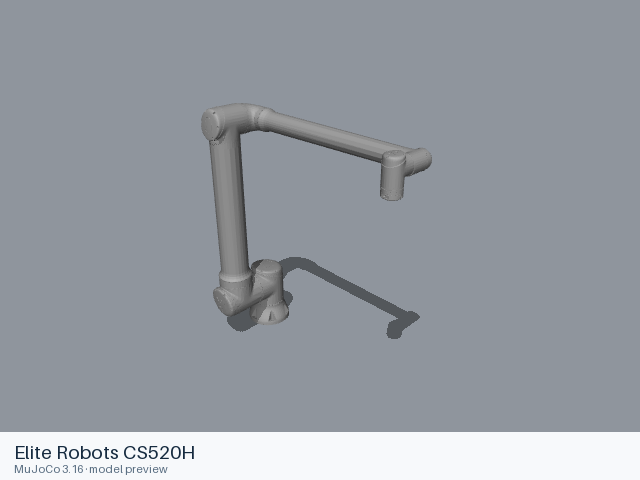
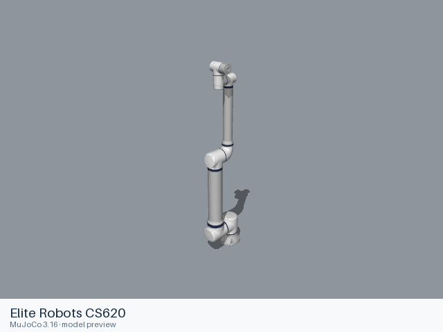
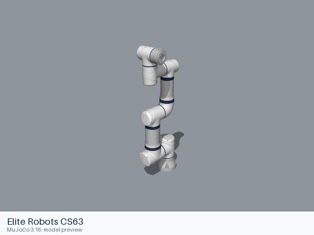
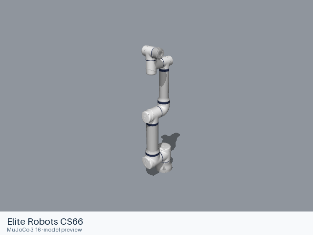

# Elite Robots models

[All manufacturers](../../README.md#models) · [Chinese index](../../README_CN.md#模型目录)

Previews are rendered with MuJoCo. See the [rendering method](../../docs/PREVIEWS.md); each model page links its exact entry and rendering record.

Official CS robot models from Elite-Robots/Elite_Robots_CS_ROS2_Driver. The selected CS63, CS66, CS612, CS620 cover the six-joint arm family; CS520H uses the manufacturer’s dedicated five-joint description. All entries use the applicable per-model default parameters.

| Preview | Model / assembly | Native entries | Upstream |
|---|---|---|---|
|  | [Elite Robots CS520H](cs520h/README.md) | [URDF](cs520h/urdf/cs520h.urdf) | [Elite_Robots_CS_ROS2_Driver](https://github.com/Elite-Robots/Elite_Robots_CS_ROS2_Driver) |
|  | [Elite Robots CS612](cs612/README.md) | [URDF](cs612/urdf/cs612.urdf) | [Elite_Robots_CS_ROS2_Driver](https://github.com/Elite-Robots/Elite_Robots_CS_ROS2_Driver) |
|  | [Elite Robots CS620](cs620/README.md) | [URDF](cs620/urdf/cs620.urdf) | [Elite_Robots_CS_ROS2_Driver](https://github.com/Elite-Robots/Elite_Robots_CS_ROS2_Driver) |
|  | [Elite Robots CS63](cs63/README.md) | [URDF](cs63/urdf/cs63.urdf) | [Elite_Robots_CS_ROS2_Driver](https://github.com/Elite-Robots/Elite_Robots_CS_ROS2_Driver) |
|  | [Elite Robots CS66](cs66/README.md) | [URDF](cs66/urdf/cs66.urdf) | [Elite_Robots_CS_ROS2_Driver](https://github.com/Elite-Robots/Elite_Robots_CS_ROS2_Driver) |

Each model README supplies the assembly, mechanical interfaces, source revision, license scope and actual loading records.
