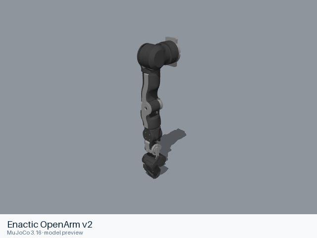

# Enactic OpenArm v2

[Manufacturer gallery](../README.md) · [All manufacturers](../../../README.md)



MuJoCo preview · [Rendering record](preview.json) · [Rendering method](../../../docs/PREVIEWS.md)

OpenArm v2 right-arm preset with seven arm joints and the native two-finger pinch gripper.

## Model entries

Entry paths are relative to the repository root.

| Purpose / assembly | Format | Entry path | Target environment and required loading options |
|---|---|---|---|
| Right-arm robot model | URDF | [`models/enactic/openarm_v2/urdf/openarm_v20.urdf`](urdf/openarm_v20.urdf) | Native URDF loader; load visual and collision resources. Use the source fixed mounting convention. |

## Mechanical information

| Item | Definition |
|---|---|
| Hardware revision and gripper | OpenArm v2, `right_arm_with_pinch_gripper` preset; pinch gripper |
| Units | Metres, kilograms and radians; native mesh scales are retained. |
| Base | `world`; the upstream preset fixes the right-arm base through its mounting frames. |
| Movable joint order | `openarm_right_joint1`, `openarm_right_joint2`, `openarm_right_joint3`, `openarm_right_joint4`, `openarm_right_joint5`, `openarm_right_joint6`, `openarm_right_joint7`, `openarm_right_finger_joint1`, `openarm_right_finger_joint2` |
| Gripper | `openarm_right_finger_joint1`: −0.7854 to 0 rad. `openarm_right_finger_joint2` mimics it with multiplier 1 and offset 0. |
| End effector / TCP | `openarm_right_ee_base_link` is the gripper base; finger links are `openarm_right_ee_link1` and `openarm_right_ee_link2`. `emit_grasp_frame=false`. |
| Included poses | No separate pose configuration is included. |

## Loading example

```python
from yourdfpy import URDF
robot = URDF.load('/absolute/path/to/awesome-robot-arm-zoo/models/enactic/openarm_v2/urdf/openarm_v20.urdf',
                  load_meshes=True, load_collision_meshes=True,
                  build_collision_scene_graph=True)
robot.update_cfg({})
```

## Sources and licensing

| Format or file scope | Upstream project | Version | Upstream file path | License file |
|---|---|---|---|---|
| URDF entry and referenced meshes | [openarm_description](https://github.com/enactic/openarm_description) | `206eb8a4cf2e5e564536b4f5366ef369843a4aa7` | [`assets/robot/openarm_v2.0/urdf/openarm_v20.urdf.xacro`](https://github.com/enactic/openarm_description/blob/206eb8a4cf2e5e564536b4f5366ef369843a4aa7/assets/robot/openarm_v2.0/urdf/openarm_v20.urdf.xacro) and referenced resources | [Apache-2.0](urdf/LICENSE); [upstream license](https://github.com/enactic/openarm_description/blob/206eb8a4cf2e5e564536b4f5366ef369843a4aa7/LICENSE.txt) |

Copyright 2025–2026 Enactic, Inc. Upstream copyright and Apache-2.0 terms are retained.

## Model preparation

The static URDF expands the upstream Xacro with xacro 2.1.1 and `robot_preset=right_arm_with_pinch_gripper`, `collapse_internal_empty_links=true`, `emit_grasp_frame=false`. Package resource paths are localized within `urdf/`. Source links, joints, inertia, mesh scales, limits and gripper mimic definitions are retained. Only resources needed by the listed entries are included.

## Loading verification

| Entry | Environment and simulator version | Verification steps | Result |
|---|---|---|---|
| [`openarm_v20.urdf`](urdf/openarm_v20.urdf) | macOS; yourdfpy 0.0.60 | Copy the entire format directory, load from an unrelated working directory, configure movable joints, inspect visual and collision bounds. | Passed; 11 links, 8 actuated joints, 29 visual and 10 collision geometries. |

## Known limitations

The generated source retains ROS 2 control metadata from the upstream bimanual entry point; the standalone URDF test exercises geometry and kinematics only. ROS hardware interfaces, control and dynamics have not been validated. Loading records establish resource completeness and native kinematics; they do not establish task or policy performance.
