# FANUC models

[All manufacturers](../../README.md#models) · [Chinese index](../../README_CN.md#模型目录)

Previews are rendered with MuJoCo. See the [rendering method](../../docs/PREVIEWS.md); each model page links its exact entry and rendering record.

Official model sources from [FANUC-CORPORATION/fanuc_description](https://github.com/FANUC-CORPORATION/fanuc_description), maintained by the manufacturer. All entries below include a standalone static URDF and their local mesh dependencies.

| Preview | Model / assembly | Native entries | Movable joints | Source license |
|---|---|---|---|---|
| [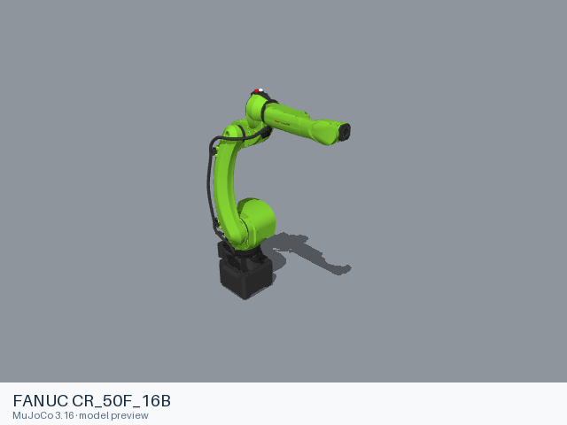](cr_50f_16b/README.md) | [FANUC CR_50F_16B](cr_50f_16b/README.md) | [URDF](cr_50f_16b/urdf/cr_50f_16b.urdf) | 6 | Apache-2.0 |
| [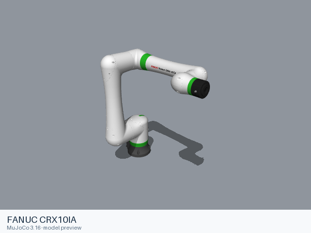](crx10ia/README.md) | [FANUC CRX10IA](crx10ia/README.md) | [URDF](crx10ia/urdf/crx10ia.urdf) | 6 | Apache-2.0 |
| [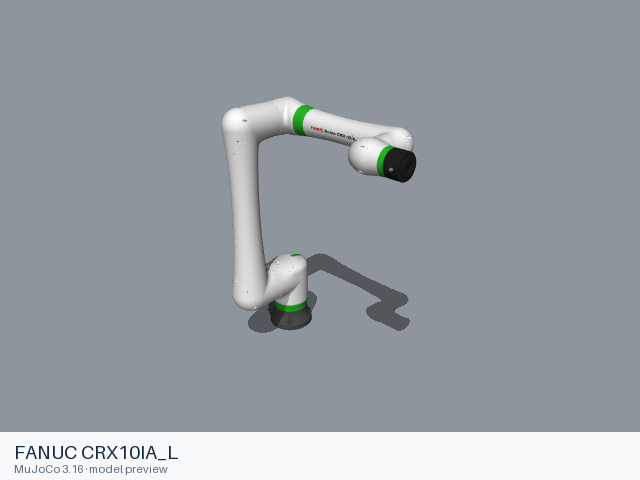](crx10ia_l/README.md) | [FANUC CRX10IA_L](crx10ia_l/README.md) | [URDF](crx10ia_l/urdf/crx10ia_l.urdf) | 6 | Apache-2.0 |
| [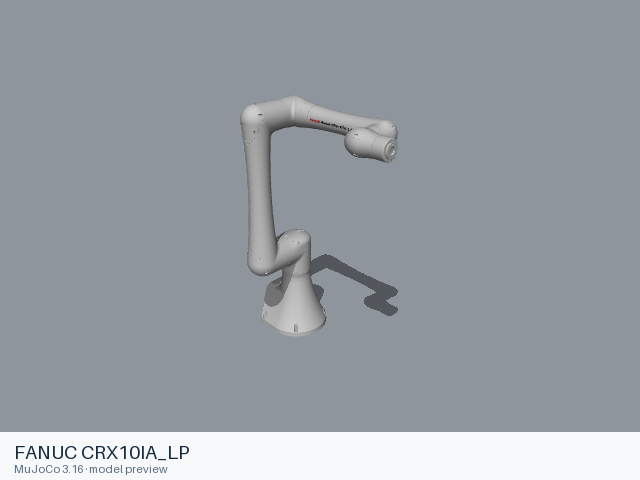](crx10ia_lp/README.md) | [FANUC CRX10IA_LP](crx10ia_lp/README.md) | [URDF](crx10ia_lp/urdf/crx10ia_lp.urdf) | 6 | Apache-2.0 |
| [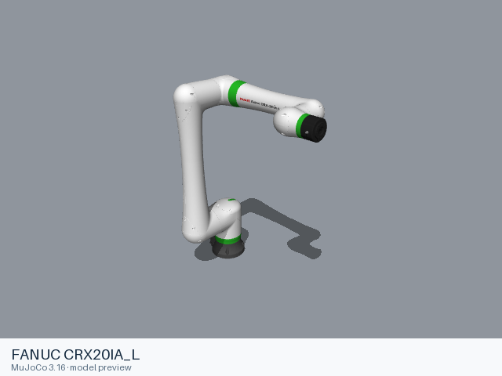](crx20ia_l/README.md) | [FANUC CRX20IA_L](crx20ia_l/README.md) | [URDF](crx20ia_l/urdf/crx20ia_l.urdf) | 6 | Apache-2.0 |
| [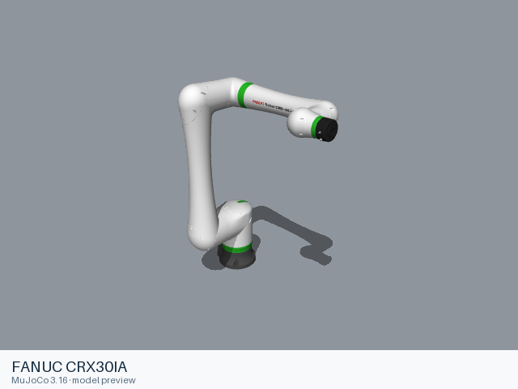](crx30ia/README.md) | [FANUC CRX30IA](crx30ia/README.md) | [URDF](crx30ia/urdf/crx30ia.urdf) | 6 | Apache-2.0 |
| [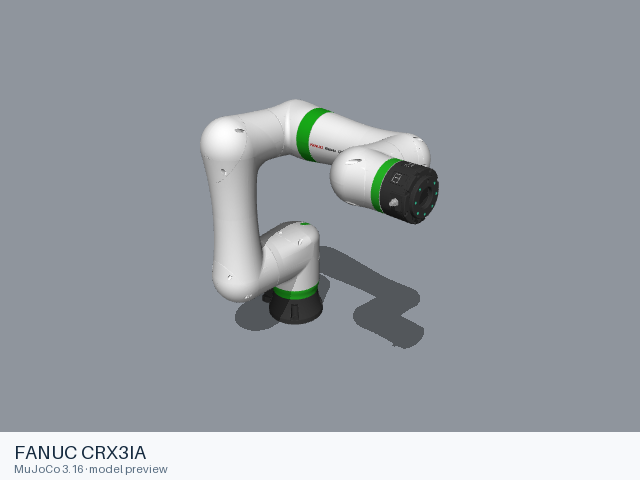](crx3ia/README.md) | [FANUC CRX3IA](crx3ia/README.md) | [URDF](crx3ia/urdf/crx3ia.urdf) | 6 | Apache-2.0 |
| [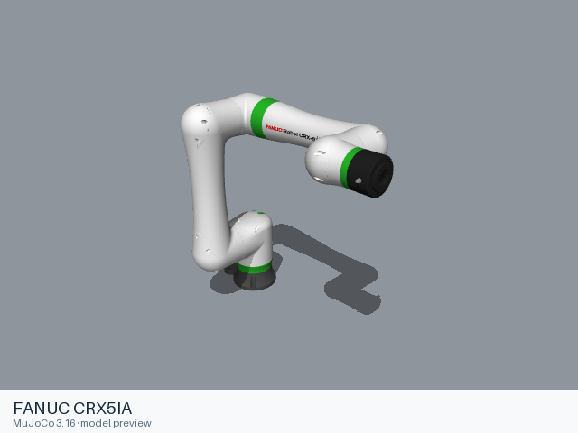](crx5ia/README.md) | [FANUC CRX5IA](crx5ia/README.md) | [URDF](crx5ia/urdf/crx5ia.urdf) | 6 | Apache-2.0 |
| [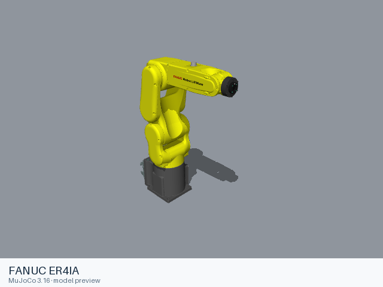](er4ia/README.md) | [FANUC ER4IA](er4ia/README.md) | [URDF](er4ia/urdf/er4ia.urdf) | 6 | Apache-2.0 |
| [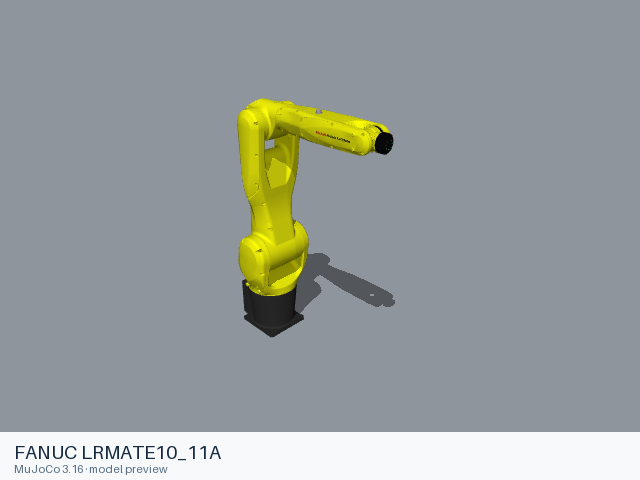](lrmate10_11a/README.md) | [FANUC LRMATE10_11A](lrmate10_11a/README.md) | [URDF](lrmate10_11a/urdf/lrmate10_11a.urdf) | 6 | Apache-2.0 |
| [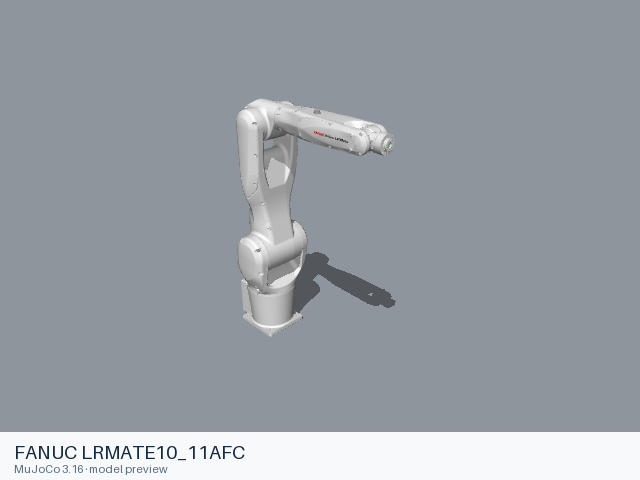](lrmate10_11afc/README.md) | [FANUC LRMATE10_11AFC](lrmate10_11afc/README.md) | [URDF](lrmate10_11afc/urdf/lrmate10_11afc.urdf) | 6 | Apache-2.0 |
| [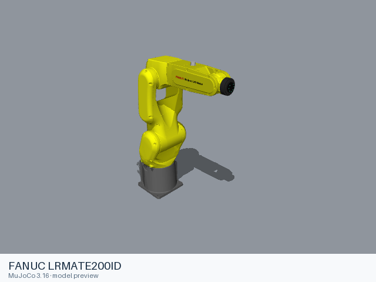](lrmate200id/README.md) | [FANUC LRMATE200ID](lrmate200id/README.md) | [URDF](lrmate200id/urdf/lrmate200id.urdf) | 6 | Apache-2.0 |
| [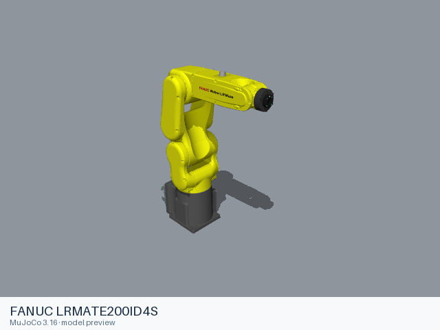](lrmate200id4s/README.md) | [FANUC LRMATE200ID4S](lrmate200id4s/README.md) | [URDF](lrmate200id4s/urdf/lrmate200id4s.urdf) | 6 | Apache-2.0 |
| [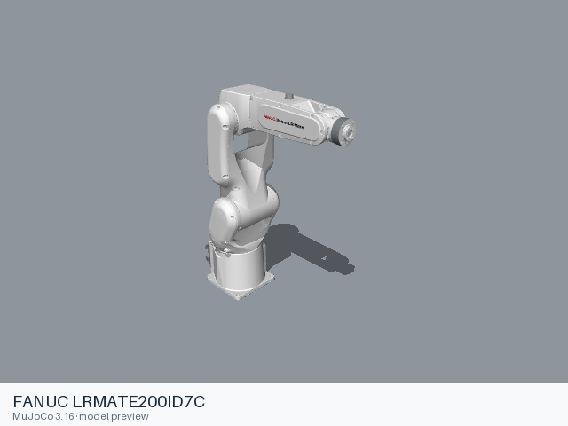](lrmate200id7c/README.md) | [FANUC LRMATE200ID7C](lrmate200id7c/README.md) | [URDF](lrmate200id7c/urdf/lrmate200id7c.urdf) | 6 | Apache-2.0 |
| [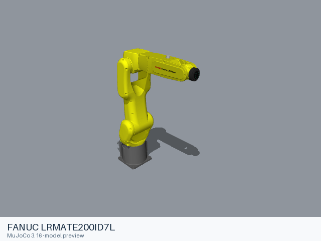](lrmate200id7l/README.md) | [FANUC LRMATE200ID7L](lrmate200id7l/README.md) | [URDF](lrmate200id7l/urdf/lrmate200id7l.urdf) | 6 | Apache-2.0 |
| [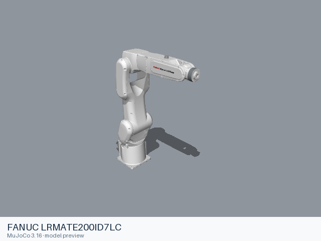](lrmate200id7lc/README.md) | [FANUC LRMATE200ID7LC](lrmate200id7lc/README.md) | [URDF](lrmate200id7lc/urdf/lrmate200id7lc.urdf) | 6 | Apache-2.0 |
| [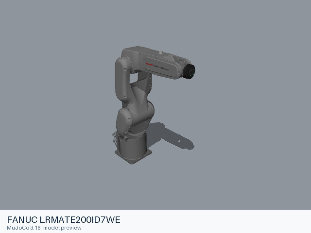](lrmate200id7we/README.md) | [FANUC LRMATE200ID7WE](lrmate200id7we/README.md) | [URDF](lrmate200id7we/urdf/lrmate200id7we.urdf) | 6 | Apache-2.0 |
| [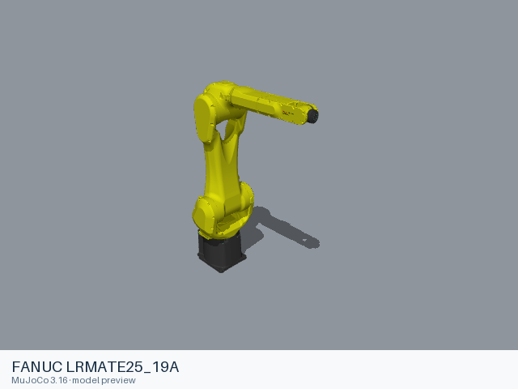](lrmate25_19a/README.md) | [FANUC LRMATE25_19A](lrmate25_19a/README.md) | [URDF](lrmate25_19a/urdf/lrmate25_19a.urdf) | 6 | Apache-2.0 |
| [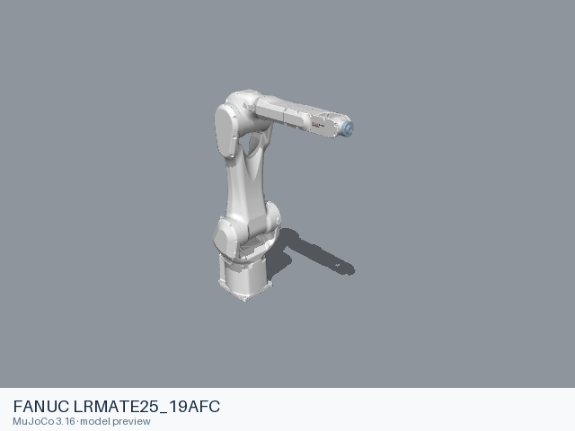](lrmate25_19afc/README.md) | [FANUC LRMATE25_19AFC](lrmate25_19afc/README.md) | [URDF](lrmate25_19afc/urdf/lrmate25_19afc.urdf) | 6 | Apache-2.0 |
| [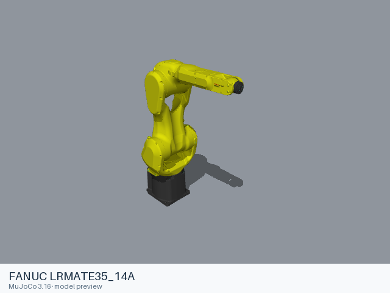](lrmate35_14a/README.md) | [FANUC LRMATE35_14A](lrmate35_14a/README.md) | [URDF](lrmate35_14a/urdf/lrmate35_14a.urdf) | 6 | Apache-2.0 |
| [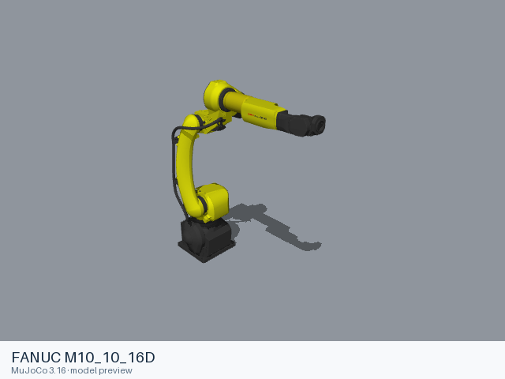](m10_10_16d/README.md) | [FANUC M10_10_16D](m10_10_16d/README.md) | [URDF](m10_10_16d/urdf/m10_10_16d.urdf) | 6 | Apache-2.0 |
| [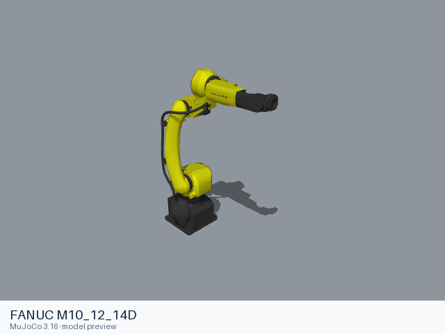](m10_12_14d/README.md) | [FANUC M10_12_14D](m10_12_14d/README.md) | [URDF](m10_12_14d/urdf/m10_12_14d.urdf) | 6 | Apache-2.0 |
| [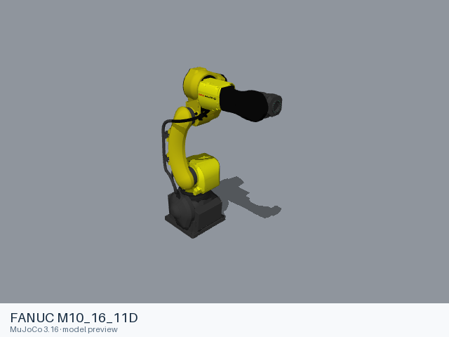](m10_16_11d/README.md) | [FANUC M10_16_11D](m10_16_11d/README.md) | [URDF](m10_16_11d/urdf/m10_16_11d.urdf) | 6 | Apache-2.0 |
| [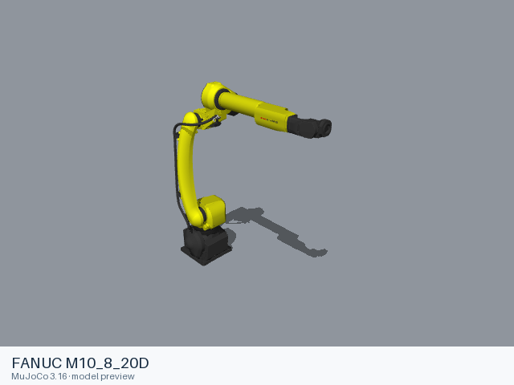](m10_8_20d/README.md) | [FANUC M10_8_20D](m10_8_20d/README.md) | [URDF](m10_8_20d/urdf/m10_8_20d.urdf) | 6 | Apache-2.0 |
| [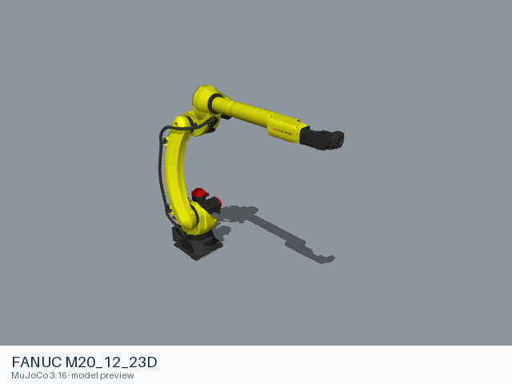](m20_12_23d/README.md) | [FANUC M20_12_23D](m20_12_23d/README.md) | [URDF](m20_12_23d/urdf/m20_12_23d.urdf) | 6 | Apache-2.0 |
|  | [FANUC M20_25_18D](m20_25_18d/README.md) | [URDF](m20_25_18d/urdf/m20_25_18d.urdf) | 6 | Apache-2.0 |
| [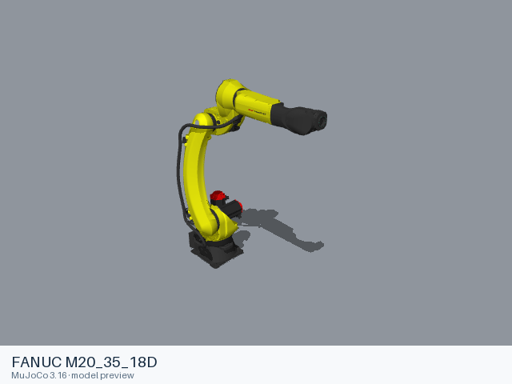](m20_35_18d/README.md) | [FANUC M20_35_18D](m20_35_18d/README.md) | [URDF](m20_35_18d/urdf/m20_35_18d.urdf) | 6 | Apache-2.0 |
| [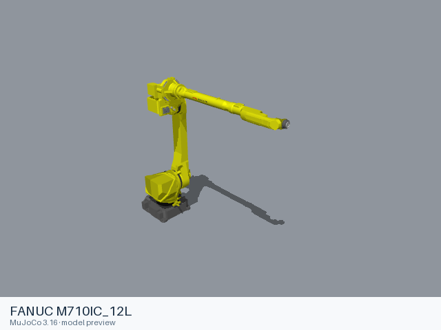](m710ic_12l/README.md) | [FANUC M710IC_12L](m710ic_12l/README.md) | [URDF](m710ic_12l/urdf/m710ic_12l.urdf) | 6 | Apache-2.0 |
| [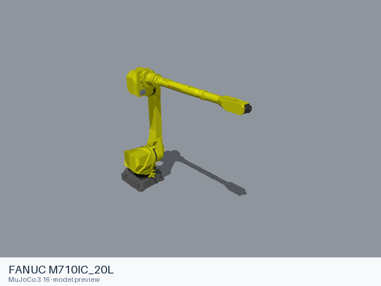](m710ic_20l/README.md) | [FANUC M710IC_20L](m710ic_20l/README.md) | [URDF](m710ic_20l/urdf/m710ic_20l.urdf) | 6 | Apache-2.0 |
| [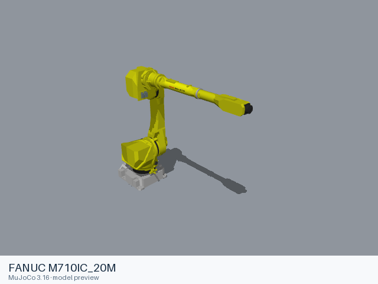](m710ic_20m/README.md) | [FANUC M710IC_20M](m710ic_20m/README.md) | [URDF](m710ic_20m/urdf/m710ic_20m.urdf) | 6 | Apache-2.0 |
| [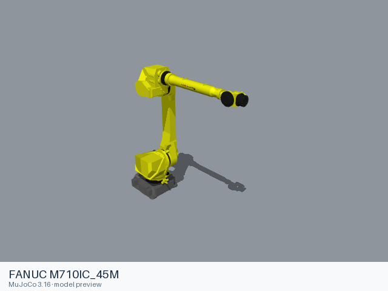](m710ic_45m/README.md) | [FANUC M710IC_45M](m710ic_45m/README.md) | [URDF](m710ic_45m/urdf/m710ic_45m.urdf) | 6 | Apache-2.0 |
| [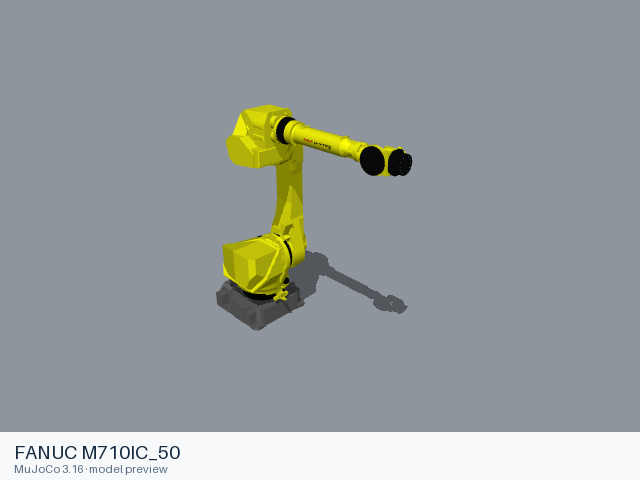](m710ic_50/README.md) | [FANUC M710IC_50](m710ic_50/README.md) | [URDF](m710ic_50/urdf/m710ic_50.urdf) | 6 | Apache-2.0 |
| [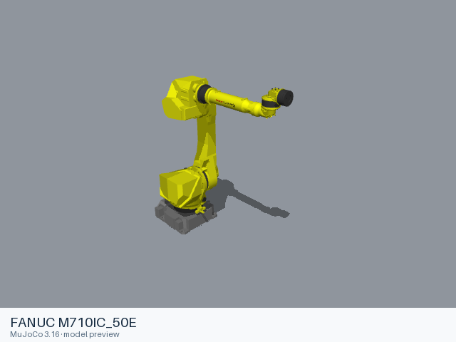](m710ic_50e/README.md) | [FANUC M710IC_50E](m710ic_50e/README.md) | [URDF](m710ic_50e/urdf/m710ic_50e.urdf) | 6 | Apache-2.0 |
|  | [FANUC M710IC_50S](m710ic_50s/README.md) | [URDF](m710ic_50s/urdf/m710ic_50s.urdf) | 6 | Apache-2.0 |
| [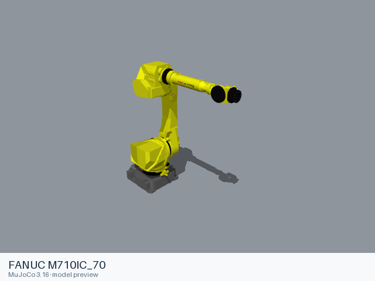](m710ic_70/README.md) | [FANUC M710IC_70](m710ic_70/README.md) | [URDF](m710ic_70/urdf/m710ic_70.urdf) | 6 | Apache-2.0 |
| [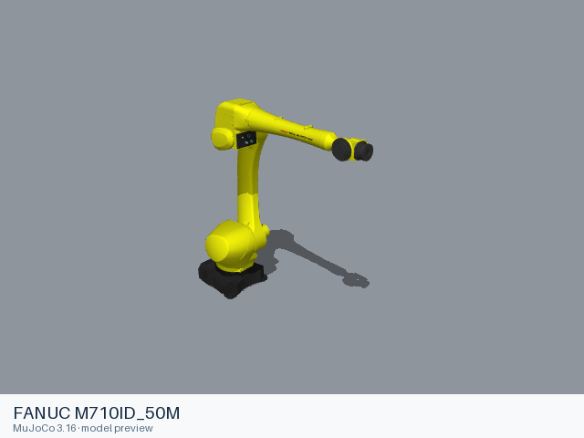](m710id_50m/README.md) | [FANUC M710ID_50M](m710id_50m/README.md) | [URDF](m710id_50m/urdf/m710id_50m.urdf) | 6 | Apache-2.0 |
| [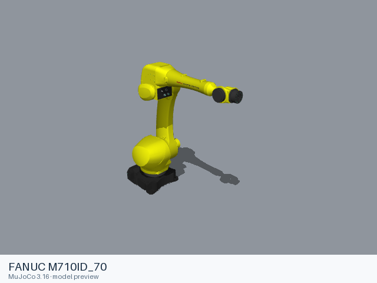](m710id_70/README.md) | [FANUC M710ID_70](m710id_70/README.md) | [URDF](m710id_70/urdf/m710id_70.urdf) | 6 | Apache-2.0 |
| [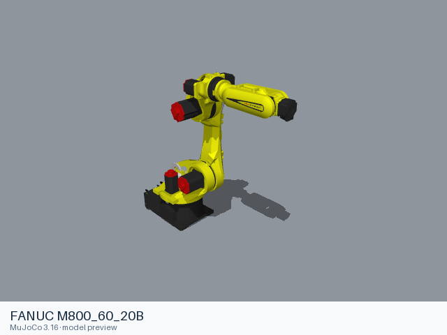](m800_60_20b/README.md) | [FANUC M800_60_20B](m800_60_20b/README.md) | [URDF](m800_60_20b/urdf/m800_60_20b.urdf) | 6 | Apache-2.0 |
| [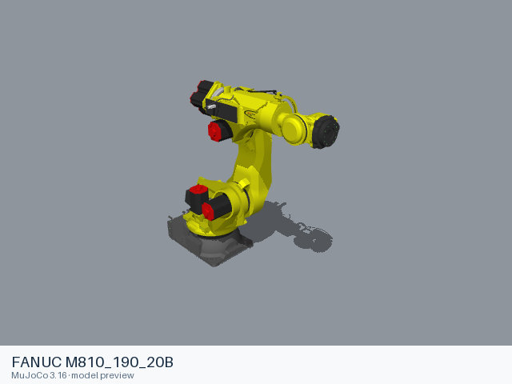](m810_190_20b/README.md) | [FANUC M810_190_20B](m810_190_20b/README.md) | [URDF](m810_190_20b/urdf/m810_190_20b.urdf) | 6 | Apache-2.0 |
| [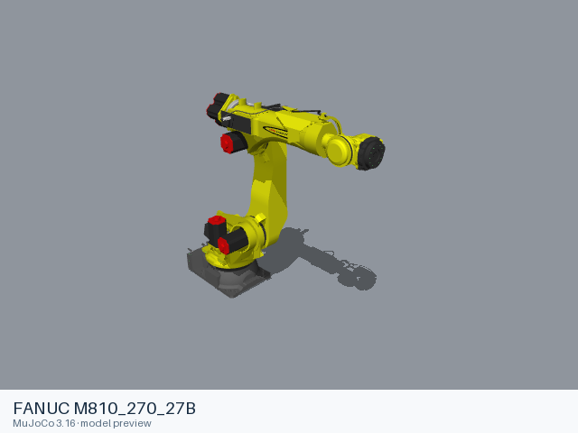](m810_270_27b/README.md) | [FANUC M810_270_27B](m810_270_27b/README.md) | [URDF](m810_270_27b/urdf/m810_270_27b.urdf) | 6 | Apache-2.0 |
|  | [FANUC P350IA_45_LH](p350ia_45_lh/README.md) | [URDF](p350ia_45_lh/urdf/p350ia_45_lh.urdf) | 6 | Apache-2.0 |
| [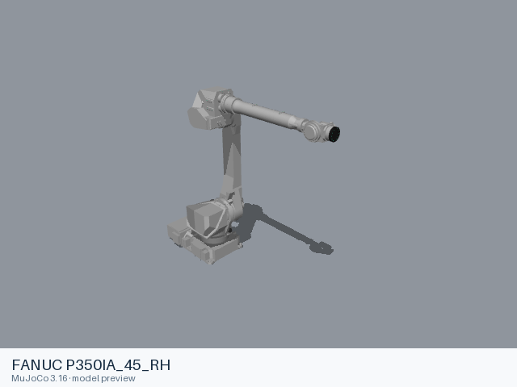](p350ia_45_rh/README.md) | [FANUC P350IA_45_RH](p350ia_45_rh/README.md) | [URDF](p350ia_45_rh/urdf/p350ia_45_rh.urdf) | 6 | Apache-2.0 |
| [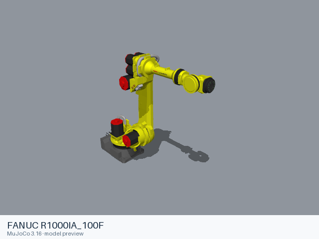](r1000ia_100f/README.md) | [FANUC R1000IA_100F](r1000ia_100f/README.md) | [URDF](r1000ia_100f/urdf/r1000ia_100f.urdf) | 6 | Apache-2.0 |
| [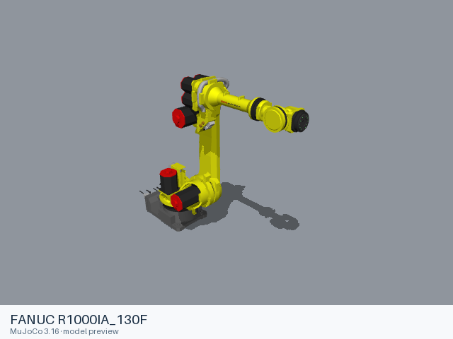](r1000ia_130f/README.md) | [FANUC R1000IA_130F](r1000ia_130f/README.md) | [URDF](r1000ia_130f/urdf/r1000ia_130f.urdf) | 6 | Apache-2.0 |
| [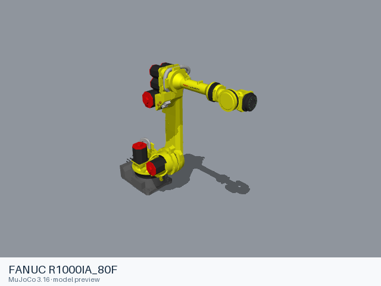](r1000ia_80f/README.md) | [FANUC R1000IA_80F](r1000ia_80f/README.md) | [URDF](r1000ia_80f/urdf/r1000ia_80f.urdf) | 6 | Apache-2.0 |
| [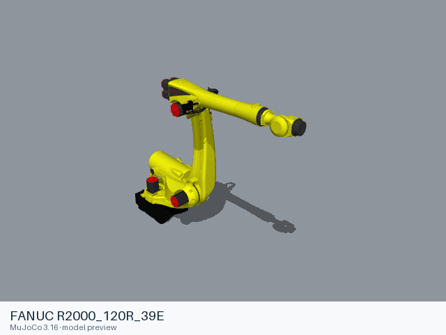](r2000_120r_39e/README.md) | [FANUC R2000_120R_39E](r2000_120r_39e/README.md) | [URDF](r2000_120r_39e/urdf/r2000_120r_39e.urdf) | 6 | Apache-2.0 |
| [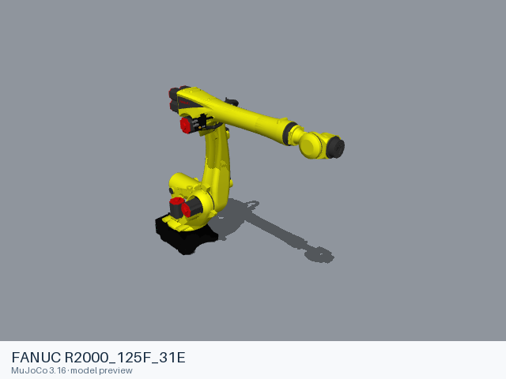](r2000_125f_31e/README.md) | [FANUC R2000_125F_31E](r2000_125f_31e/README.md) | [URDF](r2000_125f_31e/urdf/r2000_125f_31e.urdf) | 6 | Apache-2.0 |
|  | [FANUC R2000_180F_27E](r2000_180f_27e/README.md) | [URDF](r2000_180f_27e/urdf/r2000_180f_27e.urdf) | 6 | Apache-2.0 |
| [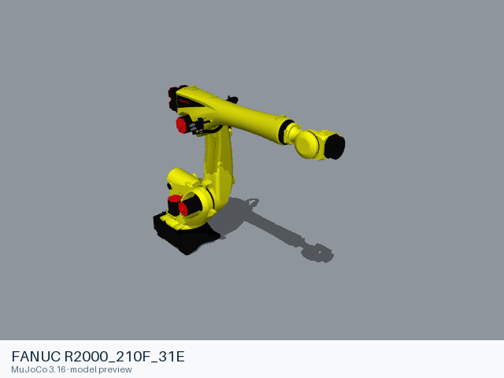](r2000_210f_31e/README.md) | [FANUC R2000_210F_31E](r2000_210f_31e/README.md) | [URDF](r2000_210f_31e/urdf/r2000_210f_31e.urdf) | 6 | Apache-2.0 |
| [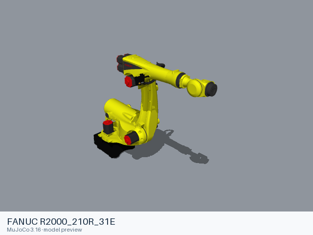](r2000_210r_31e/README.md) | [FANUC R2000_210R_31E](r2000_210r_31e/README.md) | [URDF](r2000_210r_31e/urdf/r2000_210r_31e.urdf) | 6 | Apache-2.0 |
| [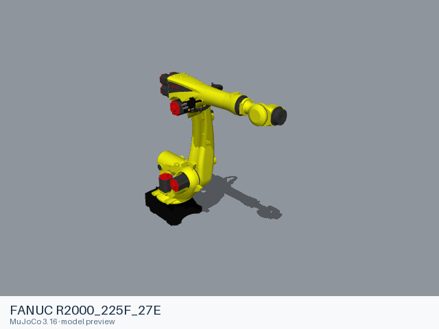](r2000_225f_27e/README.md) | [FANUC R2000_225F_27E](r2000_225f_27e/README.md) | [URDF](r2000_225f_27e/urdf/r2000_225f_27e.urdf) | 6 | Apache-2.0 |
| [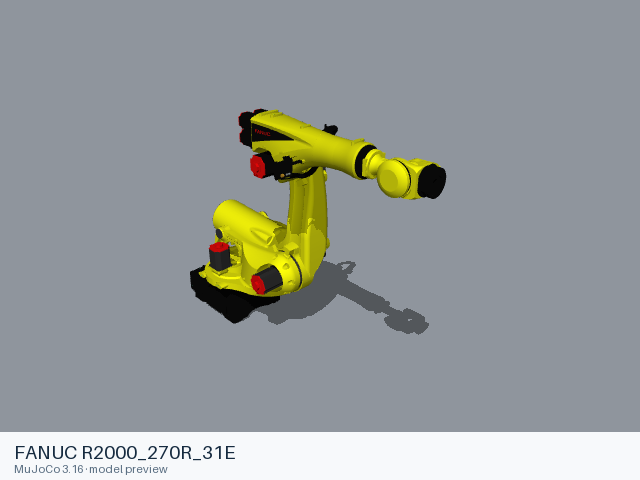](r2000_270r_31e/README.md) | [FANUC R2000_270R_31E](r2000_270r_31e/README.md) | [URDF](r2000_270r_31e/urdf/r2000_270r_31e.urdf) | 6 | Apache-2.0 |
|  | [FANUC R2000_300F_27E](r2000_300f_27e/README.md) | [URDF](r2000_300f_27e/urdf/r2000_300f_27e.urdf) | 6 | Apache-2.0 |
| [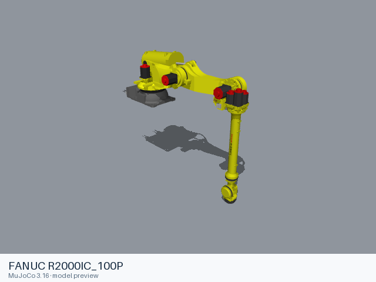](r2000ic_100p/README.md) | [FANUC R2000IC_100P](r2000ic_100p/README.md) | [URDF](r2000ic_100p/urdf/r2000ic_100p.urdf) | 6 | Apache-2.0 |
| [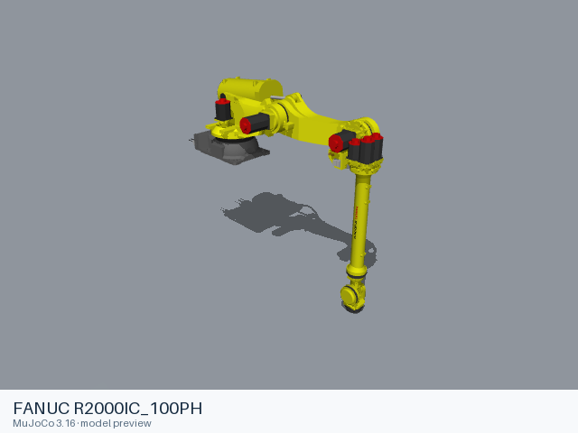](r2000ic_100ph/README.md) | [FANUC R2000IC_100PH](r2000ic_100ph/README.md) | [URDF](r2000ic_100ph/urdf/r2000ic_100ph.urdf) | 6 | Apache-2.0 |
|  | [FANUC R2000IC_125L](r2000ic_125l/README.md) | [URDF](r2000ic_125l/urdf/r2000ic_125l.urdf) | 6 | Apache-2.0 |
|  | [FANUC R2000IC_165F](r2000ic_165f/README.md) | [URDF](r2000ic_165f/urdf/r2000ic_165f.urdf) | 6 | Apache-2.0 |
|  | [FANUC R2000IC_165R](r2000ic_165r/README.md) | [URDF](r2000ic_165r/urdf/r2000ic_165r.urdf) | 6 | Apache-2.0 |
|  | [FANUC R2000IC_190S](r2000ic_190s/README.md) | [URDF](r2000ic_190s/urdf/r2000ic_190s.urdf) | 6 | Apache-2.0 |
|  | [FANUC R2000IC_190U](r2000ic_190u/README.md) | [URDF](r2000ic_190u/urdf/r2000ic_190u.urdf) | 6 | Apache-2.0 |
|  | [FANUC R2000IC_210F](r2000ic_210f/README.md) | [URDF](r2000ic_210f/urdf/r2000ic_210f.urdf) | 6 | Apache-2.0 |
|  | [FANUC R2000IC_210L](r2000ic_210l/README.md) | [URDF](r2000ic_210l/urdf/r2000ic_210l.urdf) | 6 | Apache-2.0 |
|  | [FANUC R2000IC_210R](r2000ic_210r/README.md) | [URDF](r2000ic_210r/urdf/r2000ic_210r.urdf) | 6 | Apache-2.0 |
|  | [FANUC R2000IC_210WE](r2000ic_210we/README.md) | [URDF](r2000ic_210we/urdf/r2000ic_210we.urdf) | 6 | Apache-2.0 |
|  | [FANUC R2000IC_220U](r2000ic_220u/README.md) | [URDF](r2000ic_220u/urdf/r2000ic_220u.urdf) | 6 | Apache-2.0 |
|  | [FANUC R2000IC_240F](r2000ic_240f/README.md) | [URDF](r2000ic_240f/urdf/r2000ic_240f.urdf) | 6 | Apache-2.0 |
|  | [FANUC R2000IC_270F](r2000ic_270f/README.md) | [URDF](r2000ic_270f/urdf/r2000ic_270f.urdf) | 6 | Apache-2.0 |
|  | [FANUC R2000IC_270R](r2000ic_270r/README.md) | [URDF](r2000ic_270r/urdf/r2000ic_270r.urdf) | 6 | Apache-2.0 |
|  | [FANUC R2000ID_100FH](r2000id_100fh/README.md) | [URDF](r2000id_100fh/urdf/r2000id_100fh.urdf) | 6 | Apache-2.0 |
|  | [FANUC R2000ID_165FH](r2000id_165fh/README.md) | [URDF](r2000id_165fh/urdf/r2000id_165fh.urdf) | 6 | Apache-2.0 |
|  | [FANUC R2000ID_210FH](r2000id_210fh/README.md) | [URDF](r2000id_210fh/urdf/r2000id_210fh.urdf) | 6 | Apache-2.0 |

## Known limitations

Loading support and physical-model limitations are recorded in each model README. The manufacturer name identifies the source hardware and upstream organization; inclusion here does not imply endorsement of this collection.
