# Flexiv models

[All manufacturers](../../README.md#models) · [Chinese index](../../README_CN.md#模型目录)

Previews are rendered with MuJoCo. See the [rendering method](../../docs/PREVIEWS.md); each model page links its exact entry and rendering record.

The URDF entries listed below come from manufacturer-maintained public repositories. Source versions and file scopes are recorded with each model.

| Preview | Model / assembly | Native entries | URDF source status | URDF source |
|---|---|---|---|---|
| [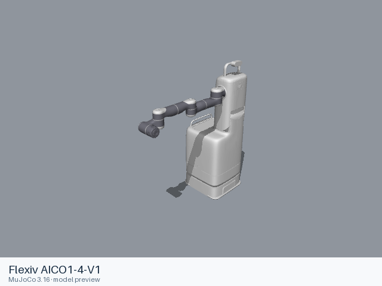](aico1_4_v1/README.md) | [Flexiv AICO1-4-V1](aico1_4_v1/README.md) | [URDF](aico1_4_v1/urdf/aico1_4_v1.urdf) | Official manufacturer repository | [flexiv_description](https://github.com/flexivrobotics/flexiv_description) |
| [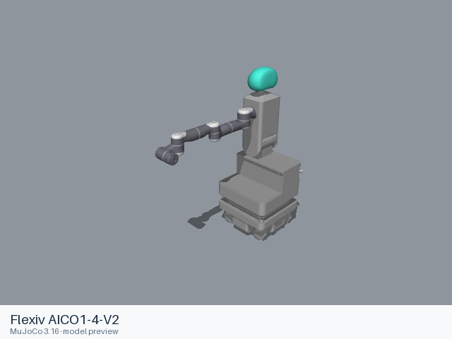](aico1_4_v2/README.md) | [Flexiv AICO1-4-V2](aico1_4_v2/README.md) | [URDF](aico1_4_v2/urdf/aico1_4_v2.urdf) | Official manufacturer repository | [flexiv_description](https://github.com/flexivrobotics/flexiv_description) |
| [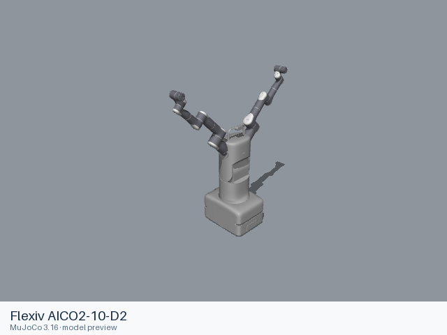](aico2_10_d2/README.md) | [Flexiv AICO2-10-D2](aico2_10_d2/README.md) | [URDF](aico2_10_d2/urdf/aico2_10_d2.urdf) | Official manufacturer repository | [flexiv_description](https://github.com/flexivrobotics/flexiv_description) |
| [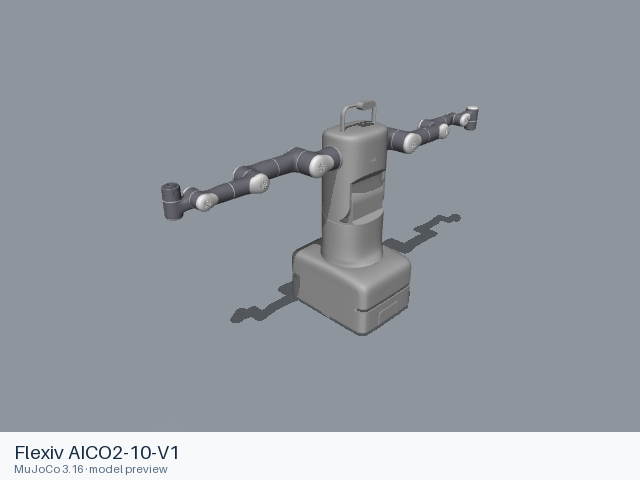](aico2_10_v1/README.md) | [Flexiv AICO2-10-V1](aico2_10_v1/README.md) | [URDF](aico2_10_v1/urdf/aico2_10_v1.urdf) | Official manufacturer repository | [flexiv_description](https://github.com/flexivrobotics/flexiv_description) |
| [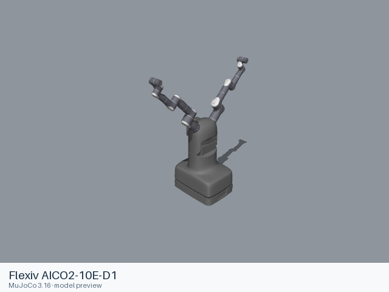](aico2_10e_d1/README.md) | [Flexiv AICO2-10E-D1](aico2_10e_d1/README.md) | [URDF](aico2_10e_d1/urdf/aico2_10e_d1.urdf) | Official manufacturer repository | [flexiv_description](https://github.com/flexivrobotics/flexiv_description) |
|  | [Flexiv AICO2-10U-D1](aico2_10u_d1/README.md) | [URDF](aico2_10u_d1/urdf/aico2_10u_d1.urdf) | Official manufacturer repository | [flexiv_description](https://github.com/flexivrobotics/flexiv_description) |
| [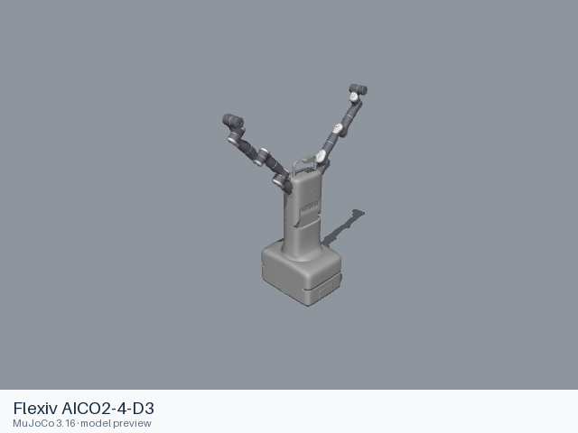](aico2_4_d3/README.md) | [Flexiv AICO2-4-D3](aico2_4_d3/README.md) | [URDF](aico2_4_d3/urdf/aico2_4_d3.urdf) | Official manufacturer repository | [flexiv_description](https://github.com/flexivrobotics/flexiv_description) |
| [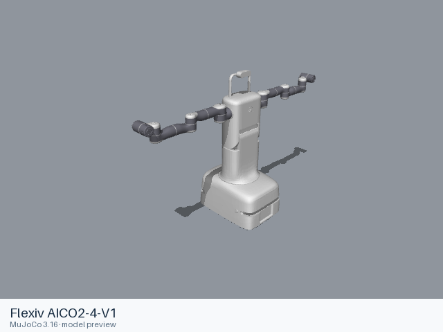](aico2_4_v1/README.md) | [Flexiv AICO2-4-V1](aico2_4_v1/README.md) | [URDF](aico2_4_v1/urdf/aico2_4_v1.urdf) | Official manufacturer repository | [flexiv_description](https://github.com/flexivrobotics/flexiv_description) |
| [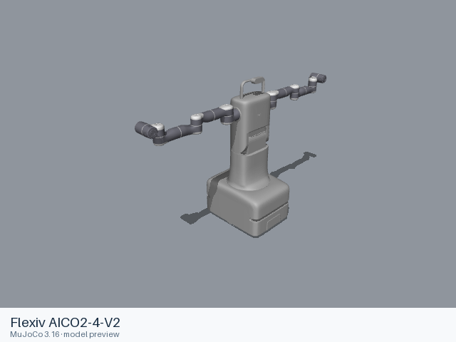](aico2_4_v2/README.md) | [Flexiv AICO2-4-V2](aico2_4_v2/README.md) | [URDF](aico2_4_v2/urdf/aico2_4_v2.urdf) | Official manufacturer repository | [flexiv_description](https://github.com/flexivrobotics/flexiv_description) |
| [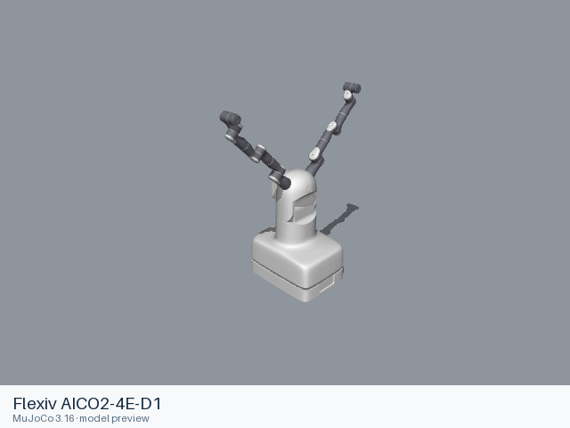](aico2_4e_d1/README.md) | [Flexiv AICO2-4E-D1](aico2_4e_d1/README.md) | [URDF](aico2_4e_d1/urdf/aico2_4e_d1.urdf) | Official manufacturer repository | [flexiv_description](https://github.com/flexivrobotics/flexiv_description) |
|  | [Flexiv AICO2-4U-D1](aico2_4u_d1/README.md) | [URDF](aico2_4u_d1/urdf/aico2_4u_d1.urdf) | Official manufacturer repository | [flexiv_description](https://github.com/flexivrobotics/flexiv_description) |
| [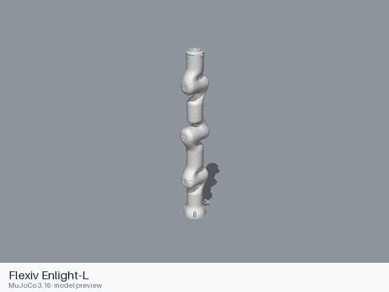](enlight_l/README.md) | [Flexiv Enlight-L](enlight_l/README.md) | [URDF](enlight_l/urdf/enlight_l.urdf) | Official manufacturer repository | [flexiv_description](https://github.com/flexivrobotics/flexiv_description) |
| [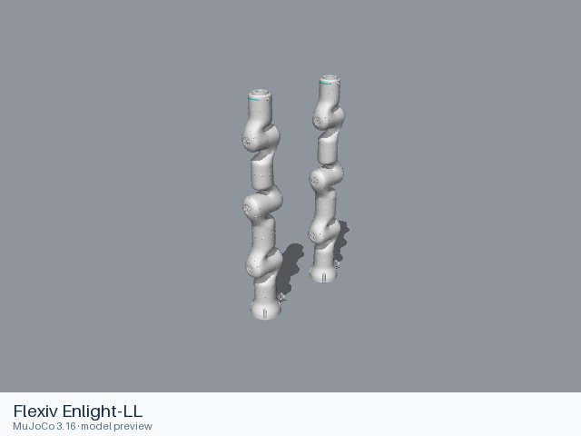](enlight_ll/README.md) | [Flexiv Enlight-LL](enlight_ll/README.md) | [URDF](enlight_ll/urdf/enlight_ll.urdf) | Official manufacturer repository | [flexiv_description](https://github.com/flexivrobotics/flexiv_description) |
| [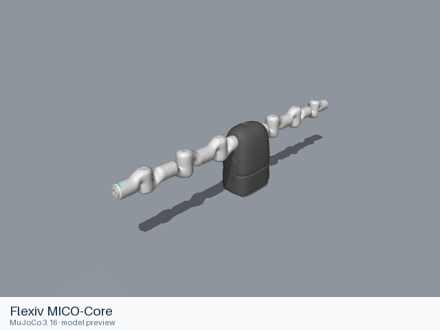](mico_core/README.md) | [Flexiv MICO-Core](mico_core/README.md) | [URDF](mico_core/urdf/mico_core.urdf) | Official manufacturer repository | [flexiv_description](https://github.com/flexivrobotics/flexiv_description) |
| [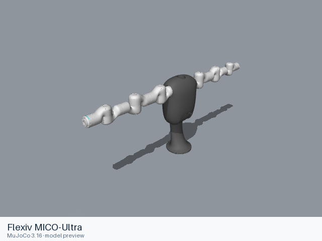](mico_ultra/README.md) | [Flexiv MICO-Ultra](mico_ultra/README.md) | [URDF](mico_ultra/urdf/mico_ultra.urdf) | Official manufacturer repository | [flexiv_description](https://github.com/flexivrobotics/flexiv_description) |
| [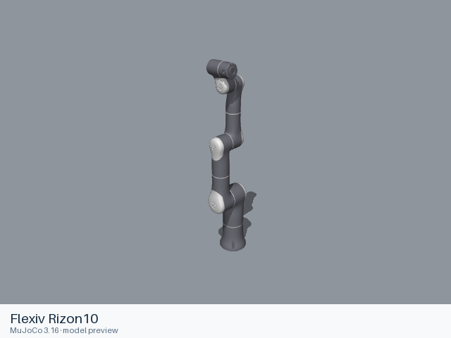](rizon10/README.md) | [Flexiv Rizon10](rizon10/README.md) | [URDF](rizon10/urdf/rizon10.urdf) | Official manufacturer repository | [flexiv_description](https://github.com/flexivrobotics/flexiv_description) |
| [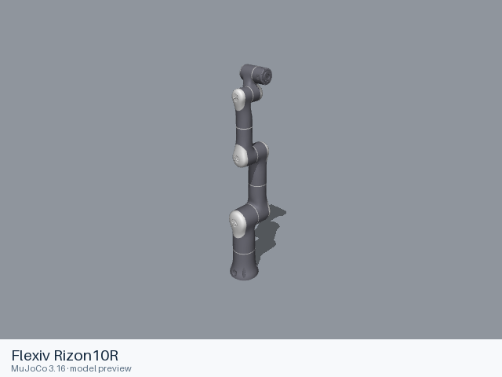](rizon10r/README.md) | [Flexiv Rizon10R](rizon10r/README.md) | [URDF](rizon10r/urdf/rizon10r.urdf) | Official manufacturer repository | [flexiv_description](https://github.com/flexivrobotics/flexiv_description) |
| [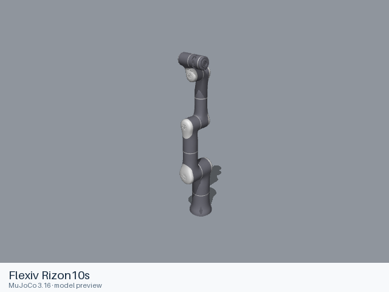](rizon10s/README.md) | [Flexiv Rizon10s](rizon10s/README.md) | [URDF](rizon10s/urdf/rizon10s.urdf) | Official manufacturer repository | [flexiv_description](https://github.com/flexivrobotics/flexiv_description) |
|  | [Flexiv Rizon4](rizon4/README.md) | [URDF](rizon4/urdf/rizon4.urdf) [MJCF](rizon4/mjcf/menagerie/flexiv_rizon4.xml) [All 3 entries](rizon4/README.md#model-entries) | Official manufacturer repository | [flexiv_description](https://github.com/flexivrobotics/flexiv_description) |
| [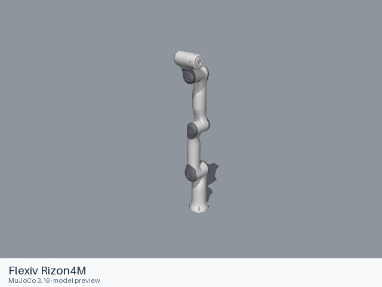](rizon4m/README.md) | [Flexiv Rizon4M](rizon4m/README.md) | [URDF](rizon4m/urdf/rizon4m.urdf) | Official manufacturer repository | [flexiv_description](https://github.com/flexivrobotics/flexiv_description) |
| [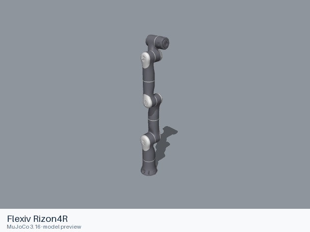](rizon4r/README.md) | [Flexiv Rizon4R](rizon4r/README.md) | [URDF](rizon4r/urdf/rizon4r.urdf) | Official manufacturer repository | [flexiv_description](https://github.com/flexivrobotics/flexiv_description) |
| [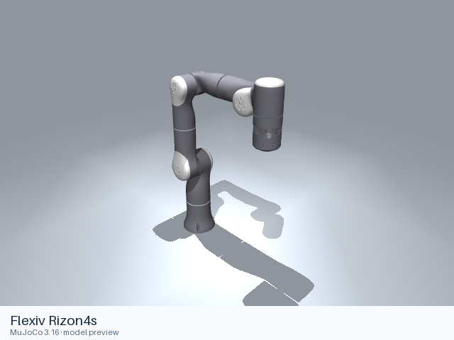](rizon4s/README.md) | [Flexiv Rizon4s](rizon4s/README.md) | [URDF](rizon4s/urdf/rizon4s.urdf) [MJCF](rizon4s/mjcf/menagerie/flexiv_rizon4s.xml) [All 3 entries](rizon4s/README.md#model-entries) | Official manufacturer repository | [flexiv_description](https://github.com/flexivrobotics/flexiv_description) |
| [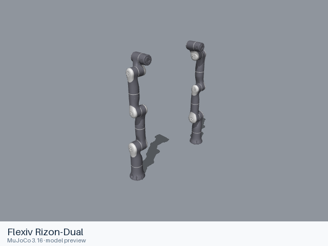](rizon_dual/README.md) | [Flexiv Rizon-Dual](rizon_dual/README.md) | [URDF](rizon_dual/urdf/rizon_dual.urdf) | Official manufacturer repository | [flexiv_description](https://github.com/flexivrobotics/flexiv_description) |

## Curated MuJoCo entries

The following MJCF files come from the Google DeepMind-maintained MuJoCo Menagerie collection. Their model-specific licenses and source versions are recorded with each entry.

| Model | Format notes | Model documentation |
|---|---|---|
| Flexiv Rizon 4 | [MJCF](rizon4/mjcf/README.md) | [Model notes](rizon4/README.md) |
| Flexiv Rizon 4s | [MJCF](rizon4s/mjcf/README.md) | [Model notes](rizon4s/README.md) |
