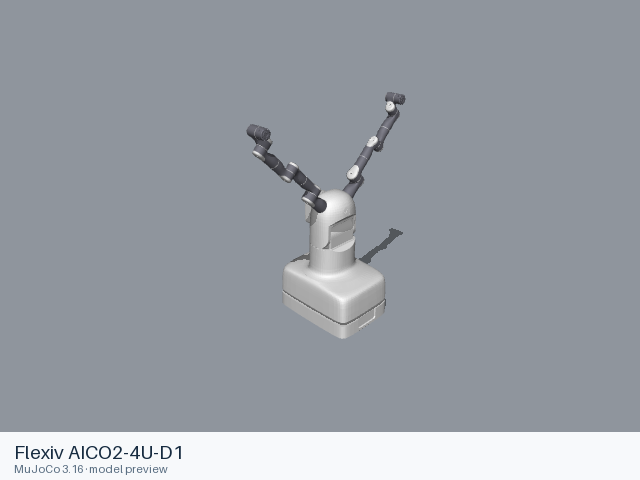

# Flexiv AICO2-4U-D1

[Manufacturer gallery](../README.md) · [All manufacturers](../../../README.md)



MuJoCo preview · [Rendering record](preview.json) · [Rendering method](../../../docs/PREVIEWS.md)

Official manufacturer model files for the assembly identified below.

## Model entries

Entry paths are relative to the repository root.

| Purpose / assembly | Format | Entry path | Target environment and required loading options |
|---|---|---|---|
| Complete assembly | URDF | [`models/flexiv/aico2_4u_d1/urdf/aico2_4u_d1.urdf`](urdf/aico2_4u_d1.urdf) | Local file loader; use a fixed base for mounted arms. |

## Mechanical information

### Flexiv AICO2-4U-D1

| Item | Definition |
|---|---|
| Hardware revision and gripper | Flexiv AICO2-4U-D1; configuration represented by the entry. |
| Units | URDF SI conventions: metres, kilograms, radians. Mesh scaling is retained from upstream. |
| Base | `world`; attach this root frame to the consuming scene. |
| Movable joint order | `aico2_4u_d1_joint1`, `aico2_4u_d1_joint2`, `left_left_joint1`, `left_left_joint2`, `left_left_joint3`, `left_left_joint4`, `left_left_joint5`, `left_left_joint6`, `left_left_joint7`, `right_right_joint1`, `right_right_joint2`, `right_right_joint3`, `right_right_joint4`, `right_right_joint5`, `right_right_joint6`, `right_right_joint7` (upstream declaration order; fixed joints omitted). |
| Gripper | No mimic coupling is declared. Any gripper joint limits remain in the entry. |
| End effector / TCP | Leaf frames: `left_left_flange`, `right_right_flange`. Their upstream transforms are retained. |
| Included poses | No separate pose configuration is included. |

### URDF joint limits

| Joint | Type | Lower | Upper | Units |
|---|---|---|---|---|
| `aico2_4u_d1_joint1` | revolute | -1.5708 | 1.5708 | radians |
| `aico2_4u_d1_joint2` | revolute | 0 | 1.5708 | radians |
| `left_left_joint1` | revolute | -2.8798 | 2.8798 | radians |
| `left_left_joint2` | revolute | -2.3562 | 2.3562 | radians |
| `left_left_joint3` | revolute | -3.0543 | 3.0543 | radians |
| `left_left_joint4` | revolute | -1.9548 | 2.7751 | radians |
| `left_left_joint5` | revolute | -3.0543 | 3.0543 | radians |
| `left_left_joint6` | revolute | -1.4835 | 4.6251 | radians |
| `left_left_joint7` | revolute | -3.0543 | 3.0543 | radians |
| `right_right_joint1` | revolute | -2.8798 | 2.8798 | radians |
| `right_right_joint2` | revolute | -2.3562 | 2.3562 | radians |
| `right_right_joint3` | revolute | -3.0543 | 3.0543 | radians |
| `right_right_joint4` | revolute | -1.9548 | 2.7751 | radians |
| `right_right_joint5` | revolute | -3.0543 | 3.0543 | radians |
| `right_right_joint6` | revolute | -1.4835 | 4.6251 | radians |
| `right_right_joint7` | revolute | -3.0543 | 3.0543 | radians |

## Loading example

```python
from yourdfpy import URDF

robot = URDF.load(
    '/absolute/path/to/awesome-robot-arm-zoo/models/flexiv/aico2_4u_d1/urdf/aico2_4u_d1.urdf',
    load_meshes=True, load_collision_meshes=True,
    build_collision_scene_graph=True,
)
```

## Sources and licensing

| Format or file scope | Upstream project | Version | Upstream file path | License file |
|---|---|---|---|---|
| URDF entry and referenced resources | [flexiv_description](https://github.com/flexivrobotics/flexiv_description) | `6d5145ea74bce2a7f61867a7ae3de3823ec6154f` | `urdf/flexiv.urdf.xacro` | [LICENSE](urdf/LICENSE), [NOTICES](urdf/NOTICES) |

License: Apache-2.0. The license and attribution notices apply to the model entry and copied dependencies from the stated project.

## Model preparation

 Xacro 2.1.1 expansion mappings: `{"arm_prefix": "", "arm_type": "", "arm_type_left": "", "arm_type_right": "", "dual_mounting_file": "/Users/jacksonhuang/Documents/ChatGPT/RoboTakumi\u9879\u76ee\u5f00\u53d1/sources/robot-zoo-upstreams/flexiv_description/config/dual_robot_mounting.yaml", "external_axis_prefix": "", "gripper_name": "Flexiv-GN01", "gripper_name_left": "Flexiv-GN01", "gripper_name_right": "Flexiv-GN01", "inertia_parameters_file": "/Users/jacksonhuang/Documents/ChatGPT/RoboTakumi\u9879\u76ee\u5f00\u53d1/sources/robot-zoo-upstreams/flexiv_description/config/AICO2-4U-D1/inertia_parameters.yaml", "joint_limits_parameters_file": "/Users/jacksonhuang/Documents/ChatGPT/RoboTakumi\u9879\u76ee\u5f00\u53d1/sources/robot-zoo-upstreams/flexiv_description/config/AICO2-4U-D1/joint_limits.yaml", "kinematics_parameters_file": "", "kinematics_parameters_file_left": "", "kinematics_parameters_file_right": "", "load_gripper": "false", "load_gripper_left": "false", "load_gripper_right": "false", "load_mounted_ft_sensor": "false", "load_mounted_ft_sensor_left": "false", "load_mounted_ft_sensor_right": "false", "mounting_file": "/Users/jacksonhuang/Documents/ChatGPT/RoboTakumi\u9879\u76ee\u5f00\u53d1/sources/robot-zoo-upstreams/flexiv_description/config/single_robot_mounting.yaml", "paired_mounting_file": "/Users/jacksonhuang/Documents/ChatGPT/RoboTakumi\u9879\u76ee\u5f00\u53d1/sources/robot-zoo-upstreams/flexiv_description/config/dual_arm_mounting.yaml", "robot_sn": "", "robot_sn_left": "left", "robot_sn_right": "right", "robot_type": "AICO2-4U-D1", "visual_parameters_file": "/Users/jacksonhuang/Documents/ChatGPT/RoboTakumi\u9879\u76ee\u5f00\u53d1/sources/robot-zoo-upstreams/flexiv_description/config/AICO2-4U-D1/visual_parameters.yaml"}`. Referenced resources are stored inside the format directory and resource URIs are relative to the entry. Joint limits, inertial values, visual and collision geometry retain their upstream definitions.

## Loading verification

Checks performed on 2026-10-15. The complete format directory was copied to a temporary location and loaded by absolute path from a separate working directory.

| Entry | Environment and loader version | Verification steps | Result |
|---|---|---|---|
| `models/flexiv/aico2_4u_d1/urdf/aico2_4u_d1.urdf` | macOS 27.2, arm64, Python 3.12.14; yourdfpy 0.0.60 | Load visual/collision geometry and update the joint configuration. | Passed, including resource relocation. |

## Known limitations

Dynamic task execution, controller performance and training behavior have not been validated.

- ROS and Gazebo control extensions, when present, retain their upstream metadata; their external runtime plugins are not included.
- Upstream hardware or revision distinctions beyond the source filename are not independently established.
- The URDF has no inertial element for `world`, `left_left_base_link`, `left_left_link1`, `left_left_link2`, `left_left_link3`, `left_left_link4`, `left_left_link5`, `left_left_link6`, `left_left_link7`, `left_left_flange`, `right_right_base_link`, `right_right_link1`, `right_right_link2`, `right_right_link3`, `right_right_link4`, `right_right_link5`, `right_right_link6`, `right_right_link7`, `right_right_flange`.
