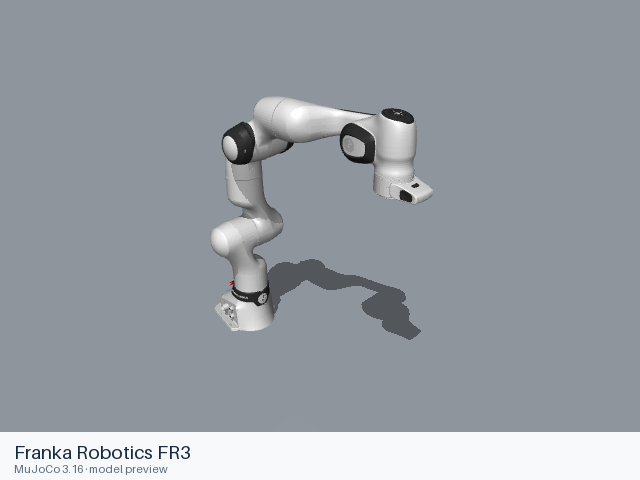
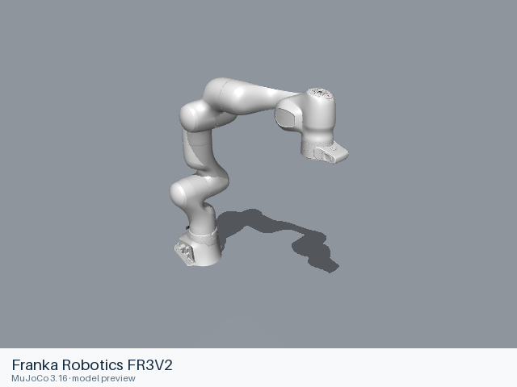
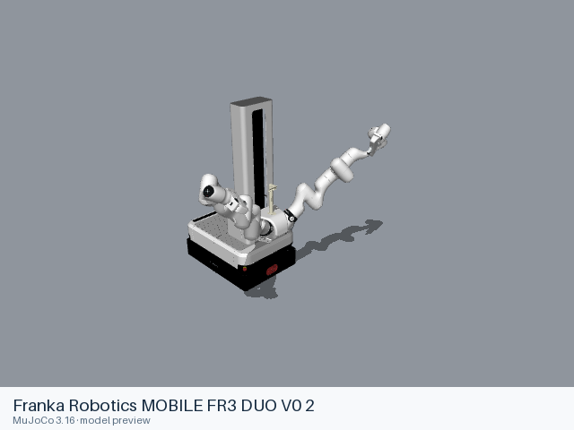

# Franka Robotics models

[All manufacturers](../../README.md#models) · [Chinese index](../../README_CN.md#模型目录)

Previews are rendered with MuJoCo. See the [rendering method](../../docs/PREVIEWS.md); each model page links its exact entry and rendering record.

Official URDF models from Franka Robotics GmbH for Panda, FR3, FR3v2, the fixed dual-arm FR3 Duo and the Mobile FR3 Duo. Each assembly includes the upstream Franka Hand configuration. FER/Panda remains available in the source but is no longer supported upstream.

| Preview | Model / assembly | Native entries | URDF upstream |
|---|---|---|---|
|  | [Franka Robotics FR3](fr3/README.md) | [URDF](fr3/urdf/fr3.urdf) [MJCF](fr3/mjcf/menagerie/fr3.xml) [All 3 entries](fr3/README.md#model-entries) | [franka_description](https://github.com/frankarobotics/franka_description) |
|  | [Franka Robotics FR3 DUO](fr3_duo/README.md) | [URDF](fr3_duo/urdf/fr3_duo.urdf) | [franka_description](https://github.com/frankarobotics/franka_description) |
|  | [Franka Robotics FR3V2](fr3v2/README.md) | [URDF](fr3v2/urdf/fr3v2.urdf) [MJCF](fr3v2/mjcf/menagerie/fr3v2.xml) [All 3 entries](fr3v2/README.md#model-entries) | [franka_description](https://github.com/frankarobotics/franka_description) |
|  | [Franka Robotics MOBILE FR3 DUO V0 2](mobile_fr3_duo_v0_2/README.md) | [URDF](mobile_fr3_duo_v0_2/urdf/mobile_fr3_duo_v0_2.urdf) | [franka_description](https://github.com/frankarobotics/franka_description) |
|  | [Franka Robotics Panda / FER](panda/README.md) | [URDF](panda/urdf/panda.urdf) [MJCF](panda/mjcf/menagerie/panda.xml) [All 3 entries](panda/README.md#model-entries) | [franka_description](https://github.com/frankarobotics/franka_description) |

Each model contains a static entry, the resources it references, and its applicable license files. Mechanical details and loading records are in the model READMEs.

## Curated MuJoCo entries

The following MJCF files come from the Google DeepMind-maintained MuJoCo Menagerie collection. Their model-specific licenses and source versions are recorded with each entry.

| Model | Format notes | Model documentation |
|---|---|---|
| Franka Emika Panda | [MJCF](panda/mjcf/README.md) | [Model notes](panda/README.md) |
| Franka Research 3 | [MJCF](fr3/mjcf/README.md) | [Model notes](fr3/README.md) |
| Franka Research 3 v2 | [MJCF](fr3v2/mjcf/README.md) | [Model notes](fr3v2/README.md) |
