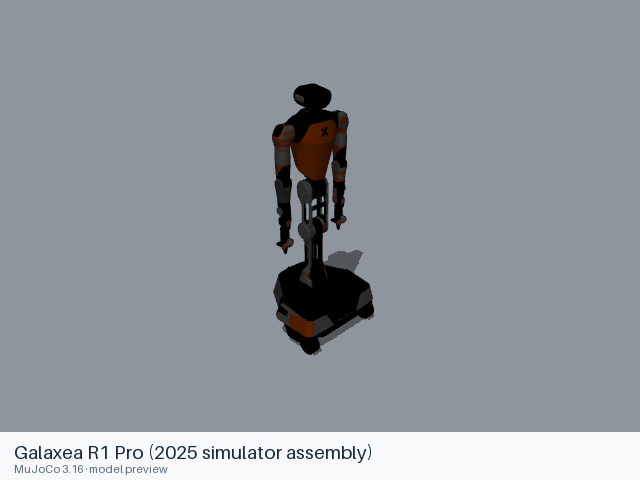

# Galaxea R1 Pro (2025 simulator assembly)

[Manufacturer gallery](../README.md) · [All manufacturers](../../../README.md)



MuJoCo preview · [Rendering record](preview.json) · [Rendering method](../../../docs/PREVIEWS.md)

Mobile R1 Pro assembly from the August 2025 GalaxeaManipSim release, with two seven-axis arms, parallel grippers, torso, base and camera frames.

## Model entries

Entry paths are relative to the repository root.

| Purpose / assembly | Format | Entry path | Target environment and required loading options |
|---|---|---|---|
| Complete mobile dual-arm assembly | URDF | [`models/galaxea/r1_pro/urdf/manipsim_2025/robot.urdf`](urdf/manipsim_2025/robot.urdf) | yourdfpy; full visual and collision meshes. Fix the root when mounted. |

## Mechanical information

### manipsim_2025

| Item | Definition |
|---|---|
| Hardware revision and gripper | Mobile R1 Pro assembly from the August 2025 GalaxeaManipSim release, with two seven-axis arms, parallel grippers, torso, base and camera frames. |
| Units | Metres, kilograms and radians; source mesh scales are retained. |
| Base | `base_link`; root frame retained from the source. |
| Movable joint order | `torso_joint1`, `torso_joint2`, `torso_joint3`, `torso_joint4`, `left_arm_joint1`, `left_arm_joint2`, `left_arm_joint3`, `left_arm_joint4`, `left_arm_joint5`, `left_arm_joint6`, `left_arm_joint7`, `left_gripper_finger_joint1`, `left_gripper_finger_joint2`, `right_arm_joint1`, `right_arm_joint2`, `right_arm_joint3`, `right_arm_joint4`, `right_arm_joint5`, `right_arm_joint6`, `right_arm_joint7`, `right_gripper_finger_joint1`, `right_gripper_finger_joint2` (source declaration order). |
| End effector / TCP | Leaf frames: `left_gripper_finger_link1`, `left_gripper_finger_link2`, `left_realsense_link`, `right_gripper_finger_link1`, `right_gripper_finger_link2`, `right_realsense_link`, `wheel_motor_link1`, `wheel_motor_link2`, `wheel_motor_link3`, `zed_link`. Source transforms are retained. |
| Included poses | No separate pose configuration is included. |
| Gripper coupling | No mimic constraint is declared; source movable joints remain independent. |

| Joint | Type | Lower | Upper | Units |
|---|---|---|---|---|
| `torso_joint1` | revolute | -1.1345 | 1.8326 | radians |
| `torso_joint2` | revolute | -2.7925 | 2.5307 | radians |
| `torso_joint3` | revolute | -1.8326 | 1.5708 | radians |
| `torso_joint4` | revolute | -3.0543 | 3.0543 | radians |
| `left_arm_joint1` | revolute | -4.4506 | 1.3090 | radians |
| `left_arm_joint2` | revolute | -0.1745 | 3.1416 | radians |
| `left_arm_joint3` | revolute | -2.356196 | 2.356196 | radians |
| `left_arm_joint4` | revolute | -1.7453 | 0.3491 | radians |
| `left_arm_joint5` | revolute | -2.356196 | 2.356196 | radians |
| `left_arm_joint6` | revolute | -1.047198 | 1.047198 | radians |
| `left_arm_joint7` | revolute | -1.5708 | 1.5708 | radians |
| `left_gripper_finger_joint1` | prismatic | 0 | 0.05 | metres |
| `left_gripper_finger_joint2` | prismatic | 0 | 0.05 | metres |
| `right_arm_joint1` | revolute | -4.4506 | 1.3090 | radians |
| `right_arm_joint2` | revolute | -3.1416 | 0.1745 | radians |
| `right_arm_joint3` | revolute | -2.356196 | 2.356196 | radians |
| `right_arm_joint4` | revolute | -1.7453 | 0.3491 | radians |
| `right_arm_joint5` | revolute | -2.356196 | 2.356196 | radians |
| `right_arm_joint6` | revolute | -1.047198 | 1.047198 | radians |
| `right_arm_joint7` | revolute | -1.5708 | 1.5708 | radians |
| `right_gripper_finger_joint1` | prismatic | 0 | 0.05 | metres |
| `right_gripper_finger_joint2` | prismatic | 0 | 0.05 | metres |

## Loading example

```python
from yourdfpy import URDF

robot = URDF.load(
    '/absolute/path/to/awesome-robot-arm-zoo/models/galaxea/r1_pro/urdf/manipsim_2025/robot.urdf',
    load_meshes=True, load_collision_meshes=True,
    build_collision_scene_graph=True,
)
```

## Sources and licensing

| Format or file scope | Upstream project | Version | Upstream file path | License file |
|---|---|---|---|---|
| Entry and complete resource closure | [Upstream project](https://github.com/OpenGalaxea/GalaxeaManipSim) | `abe7f5161eeaa150e6eaffdf443af5df7f23f356` | `galaxea_sim/assets/r1_pro/robot.urdf` | [LICENSE](urdf/manipsim_2025/LICENSE), [NOTICE](urdf/manipsim_2025/NOTICE), [NOTICES](urdf/manipsim_2025/NOTICES) |

The copied URDF/mesh/material/texture resources are covered by the source repository’s Apache-2.0 LICENSE (Copyright 2025 Galaxea). Its NOTICE also preserves MIT terms for original portions, Copyright 2025 Tianxing Chen. Both files are included with each entry.

## Model preparation

URDF, OBJ visuals, STL collisions and MTL materials retain the upstream hierarchy and definitions. Only the runtime resource closure is included.

## Loading verification

The complete format directory was copied to a temporary location and each absolute entry path was loaded from a different working directory on 2026-10-16.

| Entry | Environment and loader version | Verification steps | Result |
|---|---|---|---|
| `models/galaxea/r1_pro/urdf/manipsim_2025/robot.urdf` | macOS 27.2, arm64, Python 3.12.14; yourdfpy 0.0.60 | Load visual and collision meshes; update every actuated joint to a value within its limits; check finite bounds. | Passed, including relocation and joint configuration. |

## Known limitations

Dynamic task execution, controller performance and training behavior have not been validated. ROS, Gazebo, SAPIEN and Isaac Sim execution have not been tested.

Wheel and steering joints are fixed in the source URDF; the base has no movable wheel articulation. The 2025 label identifies the simulator source revision. The source does not provide a manufacturing serial or a complete hardware bill of materials.
