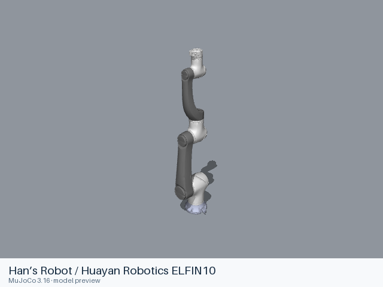
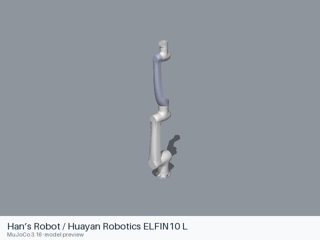
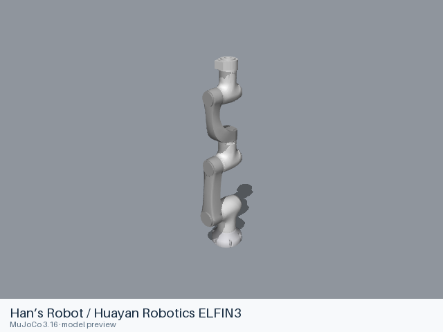
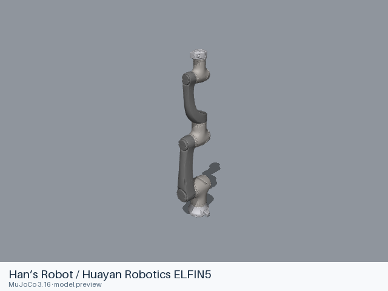
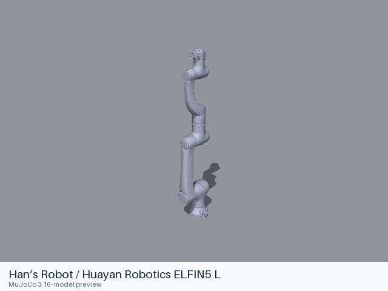

# Han’s Robot / Huayan Robotics models

[All manufacturers](../../README.md#models) · [Chinese index](../../README_CN.md#模型目录)

Previews are rendered with MuJoCo. See the [rendering method](../../docs/PREVIEWS.md); each model page links its exact entry and rendering record.

Official Elfin arm models from Huayan Robotics, formerly Han’s Robot. The original https://github.com/hans-robot/elfin_robot URL redirects to huayan-robotics/elfin_robot. The upstream BSD-3-Clause notice identifies Han’s Robot Co., Ltd.; the collection includes Elfin3, Elfin5, Elfin10, Elfin15 and the supplied L variants.

| Preview | Model / assembly | Native entries | Upstream |
|---|---|---|---|
|  | [Han’s Robot / Huayan Robotics ELFIN10](elfin10/README.md) | [URDF](elfin10/urdf/elfin10.urdf) | [elfin_robot](https://github.com/huayan-robotics/elfin_robot) |
|  | [Han’s Robot / Huayan Robotics ELFIN10 L](elfin10_l/README.md) | [URDF](elfin10_l/urdf/elfin10_l.urdf) | [elfin_robot](https://github.com/huayan-robotics/elfin_robot) |
|  | [Han’s Robot / Huayan Robotics ELFIN15](elfin15/README.md) | [URDF](elfin15/urdf/elfin15.urdf) | [elfin_robot](https://github.com/huayan-robotics/elfin_robot) |
|  | [Han’s Robot / Huayan Robotics ELFIN3](elfin3/README.md) | [URDF](elfin3/urdf/elfin3.urdf) | [elfin_robot](https://github.com/huayan-robotics/elfin_robot) |
|  | [Han’s Robot / Huayan Robotics ELFIN5](elfin5/README.md) | [URDF](elfin5/urdf/elfin5.urdf) | [elfin_robot](https://github.com/huayan-robotics/elfin_robot) |
|  | [Han’s Robot / Huayan Robotics ELFIN5 L](elfin5_l/README.md) | [URDF](elfin5_l/urdf/elfin5_l.urdf) | [elfin_robot](https://github.com/huayan-robotics/elfin_robot) |

Each model README supplies the assembly, mechanical interfaces, source revision, license scope and actual loading records.
