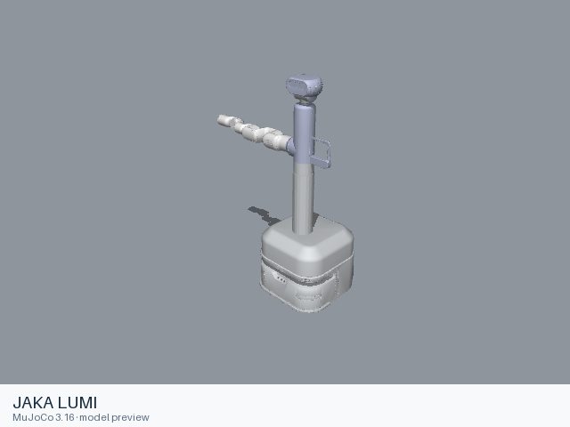

# JAKA LUMI

[Manufacturer gallery](../README.md) · [All manufacturers](../../../README.md)



MuJoCo preview · [Rendering record](preview.json) · [Rendering method](../../../docs/PREVIEWS.md)

Lumi mobile manipulator with a six-joint arm, articulated body and two modeled wheels. The entry preserves the upstream kinematic, visual, collision, inertial and joint-limit definitions.

## Model entries

Entry paths are relative to the repository root.

| Purpose / assembly | Format | Entry path | Target environment and required loading options |
|---|---|---|---|
| Complete assembly: Lumi mobile manipulator with a six-joint arm, articulated body and two modeled wheels | URDF | [`models/jaka/lumi/urdf/lumi.urdf`](urdf/lumi.urdf) | A native URDF loader with relative mesh resolution; attach the base to the consuming scene. |

## Mechanical information

| Item | Definition |
|---|---|
| Hardware revision and gripper | Lumi mobile manipulator with a six-joint arm, articulated body and two modeled wheels |
| Units | Metres, kilograms, radians; revolute joint effort in N·m and prismatic effort in N. Mesh scale attributes remain as supplied upstream. |
| Base | `world`; root of the URDF tree. Any supplied fixed base transform is retained. |
| Arm joint order | `l_a1` → `l_a2` → `l_a3` → `l_a4` → `l_a5` → `l_a6` |
| Body and base joints | `l_1` is the body prismatic lift; `l_2`, `l_3`, `l_4` are body revolute joints; `w_r` and `w_l` are continuous wheel joints. |
| Gripper | No gripper is included. |
| End effector / TCP | `link_at`, fixed to `link_a6` by the upstream tool transform. |
| Included poses | No named poses are defined by this URDF entry. |

## Loading example

```python
from yourdfpy import URDF

robot = URDF.load(
    '/absolute/path/to/awesome-robot-arm-zoo/models/jaka/lumi/urdf/lumi.urdf',
    load_meshes=True, load_collision_meshes=True,
    build_collision_scene_graph=True,
)
```

## Sources and licensing

| Format or file scope | Upstream project | Version | Upstream file path | License file |
|---|---|---|---|---|
| Static URDF and its bundled resources (jaka_lumi_description) | [https://github.com/JAKARobotics/JAKA_Lumi](https://github.com/JAKARobotics/JAKA_Lumi) | `2b3f730315e1160e8a9cae6dded05aa761e548fa` | `jaka_lumi_ros/src/jaka_lumi_description/urdf/jaka_lumi.urdf`; model mesh paths under the named packages | [LICENSE](urdf/LICENSE) |

Bundled upstream resource directories: `jaka_lumi_ros/src/jaka_lumi_description/meshes`.

License scope: Apache-2.0 under the JAKA_Lumi repository LICENSE; the included description-package metadata additionally declares BSD in [`package.xml`](urdf/package.xml). The complete upstream license texts and notices accompany this format directory.

## Model preparation

The upstream static URDF is retained with local resource references. Resources were copied only when referenced by the entry or by one of its mesh/material files. Resource references are local relative paths. Mesh contents and physical parameters retain the upstream definitions. The upstream static URDF is retained with local resource paths. Its fixed world-to-base attachment is preserved.

## Loading verification

Checks performed on 2026-10-15. The complete format directory was copied to a temporary location and loaded by absolute path from a separate working directory.

| Entry | Environment and loader version | Verification steps | Result |
|---|---|---|---|
| `models/jaka/lumi/urdf/lumi.urdf` | macOS 27.2, arm64, Python 3.12.14; yourdfpy 0.0.60 | Load visual/collision geometry and update the joint configuration. | Passed, including resource relocation. |

## Known limitations

Dynamic task execution, controller performance and training behavior have not been validated.

ROS, Gazebo and physics simulators have not been verified for this entry. The included entry fixes the base to world despite modeling wheel joints; the consuming project selects its base dynamics and controller. The description package metadata declares BSD while the repository LICENSE supplies Apache-2.0 terms; both declarations are retained.

The source sets zero velocity or effort limits on `l_1`, `l_2`, `l_3`, `l_4`, `l_a1`, `l_a2`, `l_a3`, `l_a4`, `l_a5`, `l_a6`. These source values are preserved; the entry is suitable for kinematic inspection without an inferred actuator capability.
