# Kinova

[All manufacturers](../../README.md#models) · [Chinese index](../../README_CN.md#模型目录)

Previews are rendered with MuJoCo. See the [rendering method](../../docs/PREVIEWS.md); each model page links its exact entry and rendering record.

Models and resources are extracted from the linked official manufacturer repositories. Each format directory retains its applicable upstream license.

| Preview | Model / assembly | Native entries |
|---|---|---|
| [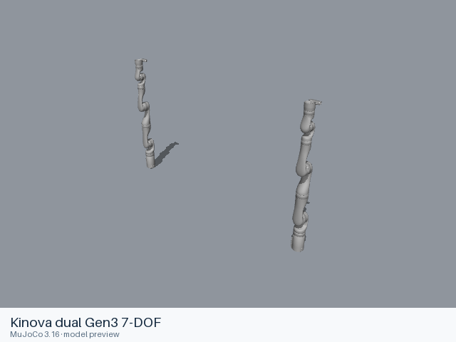](dual_gen3_7dof/README.md) | [Kinova dual Gen3 7-DOF](dual_gen3_7dof/README.md) | [URDF](dual_gen3_7dof/urdf/dual_gen3_7dof.urdf) |
|  | [Kinova dual jaco2 example](dual_jaco2_example/README.md) | [URDF](dual_jaco2_example/urdf/dual_jaco2_example.urdf) |
| [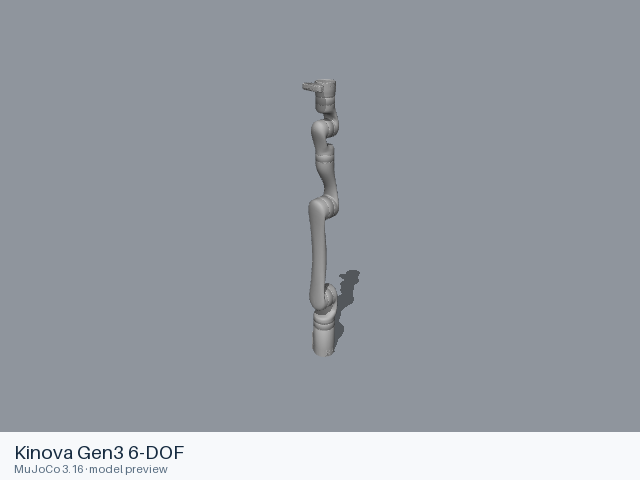](gen3_6dof/README.md) | [Kinova Gen3 6-DOF](gen3_6dof/README.md) | [URDF](gen3_6dof/urdf/gen3_6dof.urdf) |
| [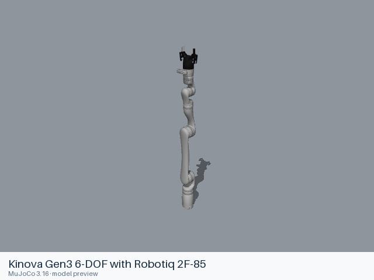](gen3_6dof_robotiq_2f_85/README.md) | [Kinova Gen3 6-DOF with Robotiq 2F-85](gen3_6dof_robotiq_2f_85/README.md) | [URDF](gen3_6dof_robotiq_2f_85/urdf/gen3_6dof_robotiq_2f_85.urdf) |
|  | [Kinova Gen3 7-DOF](gen3_7dof/README.md) | [URDF](gen3_7dof/urdf/gen3_7dof.urdf) [MJCF](gen3_7dof/mjcf/menagerie/gen3.xml) [All 3 entries](gen3_7dof/README.md#model-entries) |
| [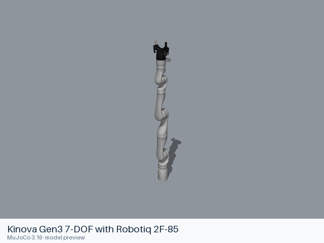](gen3_7dof_robotiq_2f_85/README.md) | [Kinova Gen3 7-DOF with Robotiq 2F-85](gen3_7dof_robotiq_2f_85/README.md) | [URDF](gen3_7dof_robotiq_2f_85/urdf/gen3_7dof_robotiq_2f_85.urdf) |
| [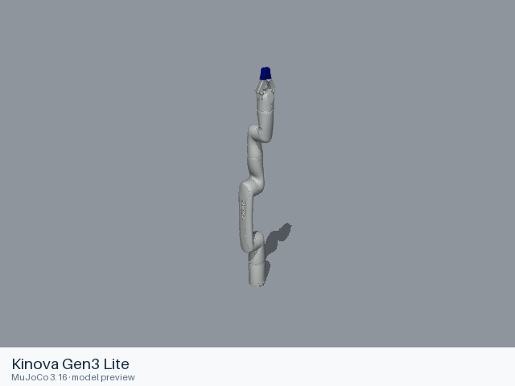](gen3_lite/README.md) | [Kinova Gen3 Lite](gen3_lite/README.md) | [URDF](gen3_lite/urdf/gen3_lite.urdf) |
| [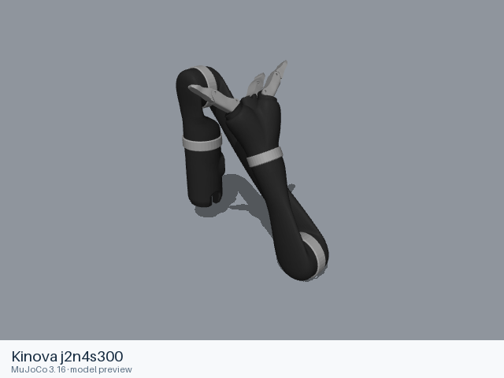](j2n4s300/README.md) | [Kinova j2n4s300](j2n4s300/README.md) | [URDF](j2n4s300/urdf/j2n4s300.urdf) |
| [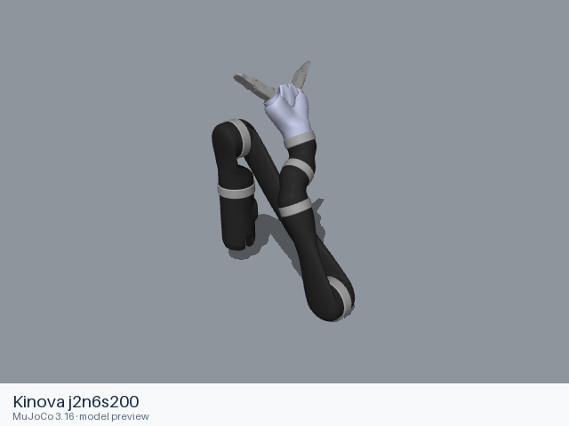](j2n6s200/README.md) | [Kinova j2n6s200](j2n6s200/README.md) | [URDF](j2n6s200/urdf/j2n6s200.urdf) |
| [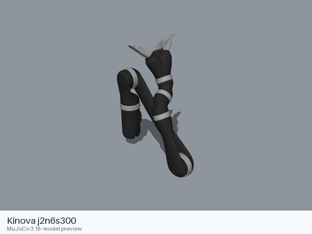](j2n6s300/README.md) | [Kinova j2n6s300](j2n6s300/README.md) | [URDF](j2n6s300/urdf/j2n6s300.urdf) |
| [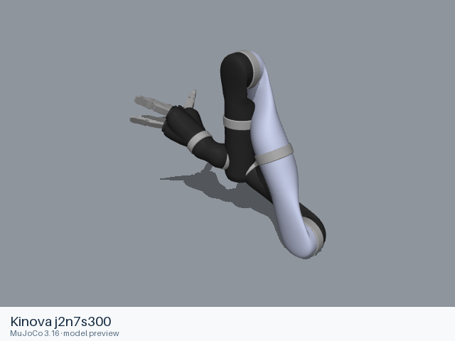](j2n7s300/README.md) | [Kinova j2n7s300](j2n7s300/README.md) | [URDF](j2n7s300/urdf/j2n7s300.urdf) |
| [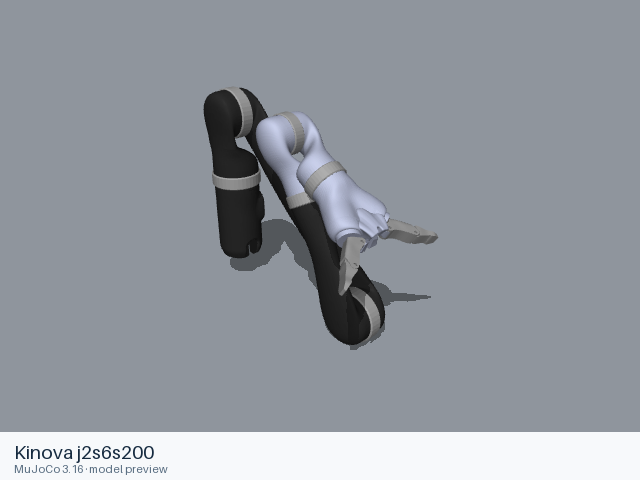](j2s6s200/README.md) | [Kinova j2s6s200](j2s6s200/README.md) | [URDF](j2s6s200/urdf/j2s6s200.urdf) |
| [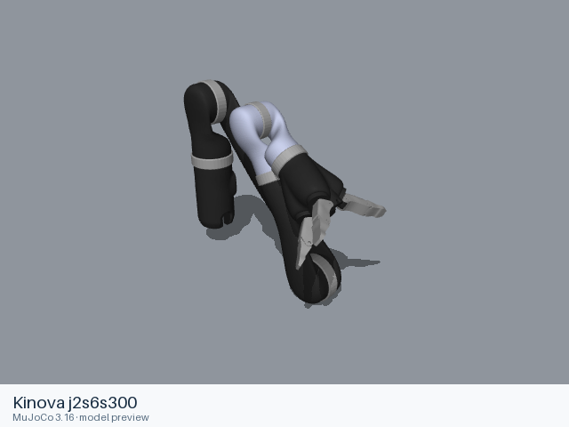](j2s6s300/README.md) | [Kinova j2s6s300](j2s6s300/README.md) | [URDF](j2s6s300/urdf/j2s6s300.urdf) |
| [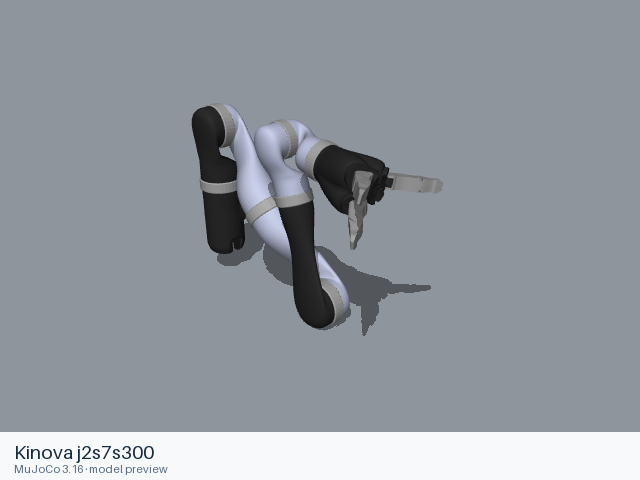](j2s7s300/README.md) | [Kinova j2s7s300](j2s7s300/README.md) | [URDF](j2s7s300/urdf/j2s7s300.urdf) |
| [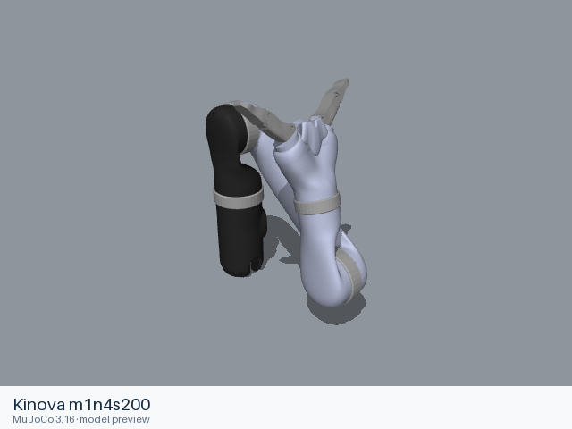](m1n4s200/README.md) | [Kinova m1n4s200](m1n4s200/README.md) | [URDF](m1n4s200/urdf/m1n4s200.urdf) |
| [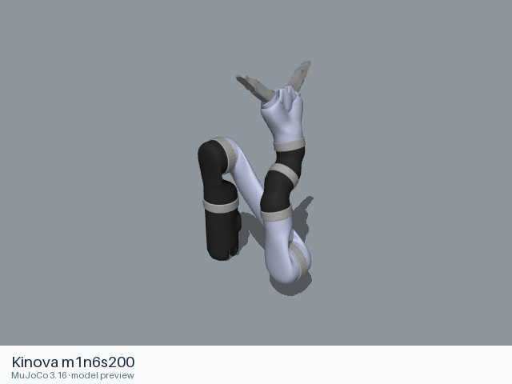](m1n6s200/README.md) | [Kinova m1n6s200](m1n6s200/README.md) | [URDF](m1n6s200/urdf/m1n6s200.urdf) |
| [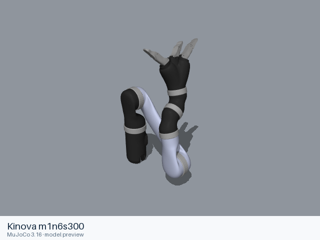](m1n6s300/README.md) | [Kinova m1n6s300](m1n6s300/README.md) | [URDF](m1n6s300/urdf/m1n6s300.urdf) |

## Sources and licensing

- [Official upstream](https://github.com/Kinovarobotics/kinova-ros). Exact revisions and file scopes are recorded in each model README.
- [Official upstream](https://github.com/Kinovarobotics/ros_kortex). Exact revisions and file scopes are recorded in each model README.

## Curated MuJoCo entries

The following MJCF files come from the Google DeepMind-maintained MuJoCo Menagerie collection. Their model-specific licenses and source versions are recorded with each entry.

| Model | Format notes | Model documentation |
|---|---|---|
| Kinova Gen3 7-DOF | [MJCF](gen3_7dof/mjcf/README.md) | [Model notes](gen3_7dof/README.md) |
