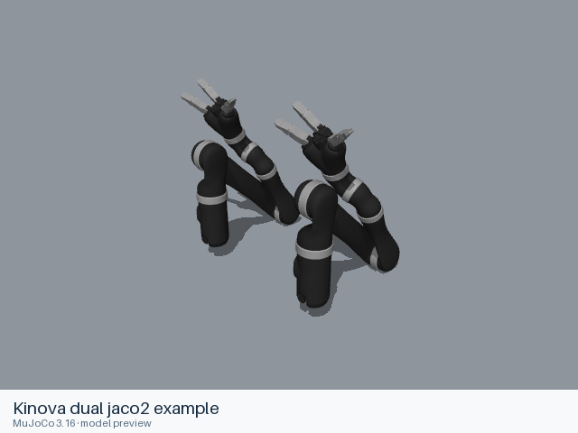

# Kinova dual jaco2 example

[Manufacturer gallery](../README.md) · [All manufacturers](../../../README.md)



MuJoCo preview · [Rendering record](preview.json) · [Rendering method](../../../docs/PREVIEWS.md)

Upstream dual-arm example. Native Kinova assembly.

## Model entries

Entry paths are relative to the repository root.

| Purpose / assembly | Format | Entry path | Target environment and required loading options |
|---|---|---|---|
| Upstream dual-arm example | URDF | [`models/kinova/dual_jaco2_example/urdf/dual_jaco2_example.urdf`](urdf/dual_jaco2_example.urdf) | Native URDF loaders; select a fixed base in the consuming simulator when required. |

## Mechanical information

| Item | Definition |
|---|---|
| Hardware revision and gripper | Kinova dual jaco2 example; Native Kinova assembly |
| Units | Metres, kilograms, radians; native mesh scales are retained. |
| Base | `root` |
| Movable joint order | `left_joint_1`, `left_joint_2`, `left_joint_3`, `left_joint_4`, `left_joint_5`, `left_joint_6`, `left_joint_finger_1`, `left_joint_finger_tip_1`, `left_joint_finger_2`, `left_joint_finger_tip_2`, `left_joint_finger_3`, `left_joint_finger_tip_3`, `right_joint_1`, `right_joint_2`, `right_joint_3`, `right_joint_4`, `right_joint_5`, `right_joint_6`, `right_joint_finger_1`, `right_joint_finger_tip_1`, `right_joint_finger_2`, `right_joint_finger_tip_2`, `right_joint_finger_3`, `right_joint_finger_tip_3` |
| Gripper relationships | No URDF mimic relationships are declared. |
| End effector / TCP | `left_end_effector`, `right_end_effector` |
| Included poses | No separate pose configuration is included. |

## Loading example

```python
from yourdfpy import URDF

robot = URDF.load(
    '/absolute/path/to/awesome-robot-arm-zoo/models/kinova/dual_jaco2_example/urdf/dual_jaco2_example.urdf',
    load_meshes=True, load_collision_meshes=True,
    build_collision_scene_graph=True,
)
```

## Sources and licensing

| Format or file scope | Upstream project | Version | Upstream file path | License file |
|---|---|---|---|---|
| URDF and its referenced resources | [Official manufacturer repository](https://github.com/Kinovarobotics/kinova-ros) | `924781d3dfe241b2b94b3c72a804b80d3658cf02` | `kinova_description/urdf/two_arm_robot_example_standalone.xacro` and referenced model resources | [Upstream terms](urdf/LICENSE) |

Upstream copyright notices and redistribution terms are retained. Any independently licensed resource notices used by this assembly are preserved under `urdf/licenses/`.

## Model preparation

The static URDF retains the upstream links, joints, inertia, limits, collision shapes and mesh scales. Resource references resolve within the format directory. Xacro sources are expanded with xacro 2.1.1 where applicable. Source argument values: `{}`. The MuJoCo-specific mesh-directory override, when present in the source, is omitted so that the prepared mesh paths are used.

## Loading verification

Checks performed on 2026-10-15. The complete format directory was copied to a temporary location and loaded by absolute path from a separate working directory.

| Entry | Environment and loader version | Verification steps | Result |
|---|---|---|---|
| `models/kinova/dual_jaco2_example/urdf/dual_jaco2_example.urdf` | macOS 27.2, arm64, Python 3.12.14; yourdfpy 0.0.60 | Load visual/collision geometry and update the joint configuration. | Passed, including resource relocation. |

## Known limitations

Dynamic task execution, controller performance and training behavior have not been validated.

ROS/Gazebo extensions in the source model require the corresponding runtime if used; direct URDF geometry loading does not execute those plugins. The consuming project supplies its controller and task configuration.
