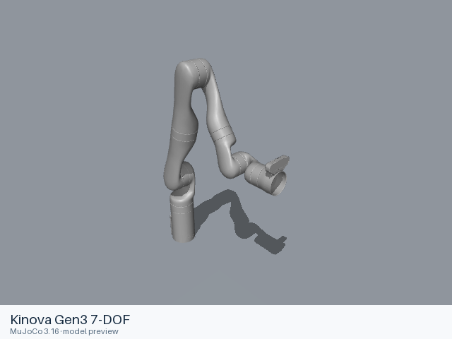

# Kinova Gen3 7-DOF

[Manufacturer gallery](../README.md) · [All manufacturers](../../../README.md)



MuJoCo preview · [Rendering record](preview.json) · [Rendering method](../../../docs/PREVIEWS.md)

Single arm. Vision module, bare flange.

## Model entries

Entry paths are relative to the repository root.

| Purpose / assembly | Format | Entry path | Target environment and required loading options |
|---|---|---|---|
| Single arm | URDF | [`models/kinova/gen3_7dof/urdf/gen3_7dof.urdf`](urdf/gen3_7dof.urdf) | Native URDF loaders; select a fixed base in the consuming simulator when required. |
| Robot model — Upstream robot assembly | MJCF | [`models/kinova/gen3_7dof/mjcf/menagerie/gen3.xml`](mjcf/menagerie/gen3.xml) | MuJoCo; complete relative resources are included. |
| Demonstration scene — Robot with floor, skybox and lighting | MJCF | [`models/kinova/gen3_7dof/mjcf/menagerie/scene.xml`](mjcf/menagerie/scene.xml) | MuJoCo; complete relative resources are included. |

## Mechanical information

The URDF information below describes its manufacturer or maintainer assembly. For the separate curated MJCF assembly, joint names and actuators, see [MJCF model notes](mjcf/README.md).

| Item | Definition |
|---|---|
| Hardware revision and gripper | Kinova Gen3 7-DOF; Vision module, bare flange |
| Units | Metres, kilograms, radians; native mesh scales are retained. |
| Base | `base_link` |
| Movable joint order | `joint_1`, `joint_2`, `joint_3`, `joint_4`, `joint_5`, `joint_6`, `joint_7` |
| Gripper relationships | No URDF mimic relationships are declared. |
| End effector / TCP | `end_effector_link`, `tool_frame` |
| Included poses | No separate pose configuration is included. |

## Loading example

```python
from yourdfpy import URDF

robot = URDF.load(
    '/absolute/path/to/awesome-robot-arm-zoo/models/kinova/gen3_7dof/urdf/gen3_7dof.urdf',
    load_meshes=True, load_collision_meshes=True,
    build_collision_scene_graph=True,
)
```

```python
import mujoco

model = mujoco.MjModel.from_xml_path(
    '/absolute/path/to/awesome-robot-arm-zoo/models/kinova/gen3_7dof/mjcf/menagerie/gen3.xml'
)
data = mujoco.MjData(model)
mujoco.mj_forward(model, data)
```

## Sources and licensing

| Format or file scope | Upstream project | Version | Upstream file path | License file |
|---|---|---|---|---|
| URDF and its referenced resources | [Official manufacturer repository](https://github.com/Kinovarobotics/ros_kortex) | `c3280d8a6a6b5d96590d51538e3f265710a6c77d` | `kortex_description/robots/gen3.xacro` and referenced model resources | [Upstream terms](urdf/LICENSE) |
| Curated MJCF and referenced assets | [Google DeepMind MuJoCo Menagerie](https://github.com/google-deepmind/mujoco_menagerie) | `6da8b971844845de6ab27315aacc3a3fea4ddb8e` | `kinova_gen3/` | [Model license](mjcf/menagerie/LICENSE), [notices](mjcf/menagerie/NOTICES) |

Upstream copyright notices and redistribution terms are retained. Any independently licensed resource notices used by this assembly are preserved under `urdf/licenses/`.

## Model preparation

The MJCF entries and dependencies retain the curator’s model definitions and relative paths. [MJCF model notes](mjcf/README.md) describe that format separately.

The static URDF retains the upstream links, joints, inertia, limits, collision shapes and mesh scales. Resource references resolve within the format directory. Xacro sources are expanded with xacro 2.1.1 where applicable. Source argument values: `{"arm": "gen3", "dof": "7", "gripper": "", "prefix": "", "sim": "false", "vision": "true"}`. The MuJoCo-specific mesh-directory override, when present in the source, is omitted so that the prepared mesh paths are used.

## Loading verification

Checks performed on 2026-10-15. The complete format directory was copied to a temporary location and loaded by absolute path from a separate working directory.

| Entry | Environment and loader version | Verification steps | Result |
|---|---|---|---|
| `models/kinova/gen3_7dof/urdf/gen3_7dof.urdf` | macOS 27.2, arm64, Python 3.12.14; yourdfpy 0.0.60 | Load visual/collision geometry and update the joint configuration. | Passed, including resource relocation. |
| `models/kinova/gen3_7dof/mjcf/menagerie/gen3.xml` | macOS 27.2, arm64, Python 3.12.14; MuJoCo 3.16.0 | Compile the model, construct MjData and run mj_forward. | Passed, including resource relocation. |
| `models/kinova/gen3_7dof/mjcf/menagerie/scene.xml` | macOS 27.2, arm64, Python 3.12.14; MuJoCo 3.16.0 | Compile the model, construct MjData and run mj_forward. | Passed, including resource relocation. |

## Known limitations

Dynamic task execution, controller performance and training behavior have not been validated.

ROS/Gazebo extensions in the source model require the corresponding runtime if used; direct URDF geometry loading does not execute those plugins. The consuming project supplies its controller and task configuration.
