# KUKA models

[All manufacturers](../../README.md#models) · [Chinese index](../../README_CN.md#模型目录)

Previews are rendered with MuJoCo. See the [rendering method](../../docs/PREVIEWS.md); each model page links its exact entry and rendering record.

Manufacturer-affiliated models from the KUKA ROS organization, using its `kuka_robot_descriptions` support packages. The packages preserve ROS-Industrial lineage for common resources and earlier Agilus models.

| Preview | Model / assembly | Native entries | URDF upstream |
|---|---|---|---|
|  | [KUKA KR10 R1100 2](kr10_r1100_2/README.md) | [URDF](kr10_r1100_2/urdf/kr10_r1100_2.urdf) | [kuka_robot_descriptions](https://github.com/kuka-ros/kuka_robot_descriptions) |
| [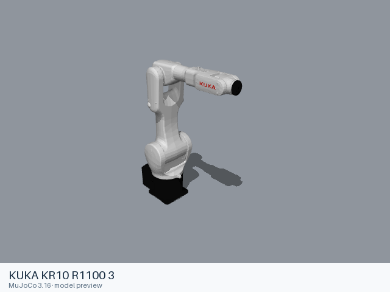](kr10_r1100_3/README.md) | [KUKA KR10 R1100 3](kr10_r1100_3/README.md) | [URDF](kr10_r1100_3/urdf/kr10_r1100_3.urdf) | [kuka_robot_descriptions](https://github.com/kuka-ros/kuka_robot_descriptions) |
|  | [KUKA KR10 R900 2](kr10_r900_2/README.md) | [URDF](kr10_r900_2/urdf/kr10_r900_2.urdf) | [kuka_robot_descriptions](https://github.com/kuka-ros/kuka_robot_descriptions) |
| [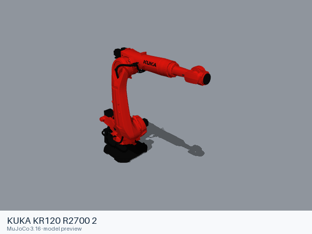](kr120_r2700_2/README.md) | [KUKA KR120 R2700 2](kr120_r2700_2/README.md) | [URDF](kr120_r2700_2/urdf/kr120_r2700_2.urdf) | [kuka_robot_descriptions](https://github.com/kuka-ros/kuka_robot_descriptions) |
| [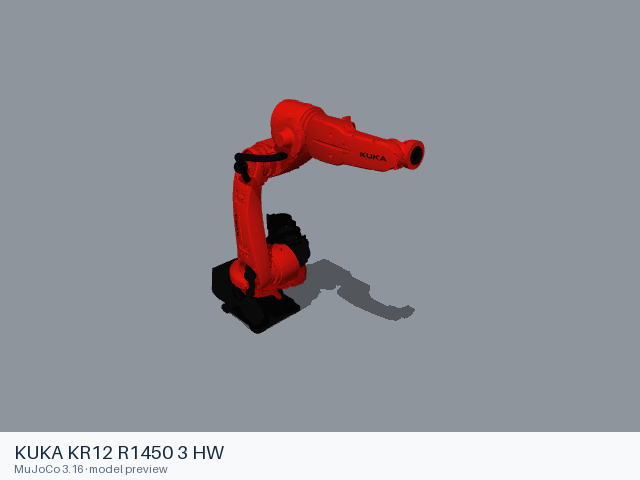](kr12_r1450_3_hw/README.md) | [KUKA KR12 R1450 3 HW](kr12_r1450_3_hw/README.md) | [URDF](kr12_r1450_3_hw/urdf/kr12_r1450_3_hw.urdf) | [kuka_robot_descriptions](https://github.com/kuka-ros/kuka_robot_descriptions) |
| [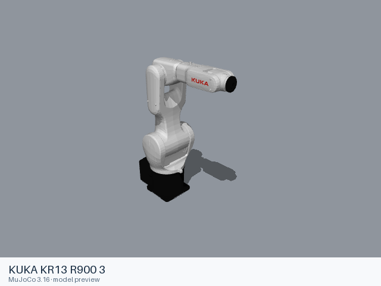](kr13_r900_3/README.md) | [KUKA KR13 R900 3](kr13_r900_3/README.md) | [URDF](kr13_r900_3/urdf/kr13_r900_3.urdf) | [kuka_robot_descriptions](https://github.com/kuka-ros/kuka_robot_descriptions) |
| [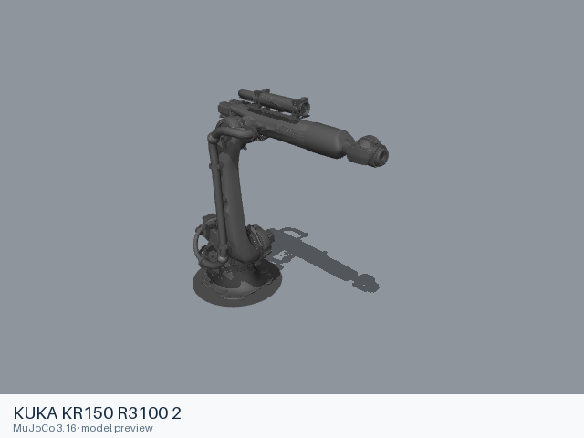](kr150_r3100_2/README.md) | [KUKA KR150 R3100 2](kr150_r3100_2/README.md) | [URDF](kr150_r3100_2/urdf/kr150_r3100_2.urdf) | [kuka_robot_descriptions](https://github.com/kuka-ros/kuka_robot_descriptions) |
| [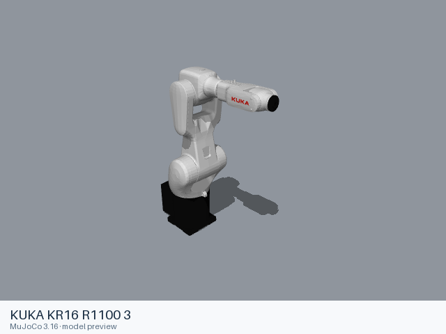](kr16_r1100_3/README.md) | [KUKA KR16 R1100 3](kr16_r1100_3/README.md) | [URDF](kr16_r1100_3/urdf/kr16_r1100_3.urdf) | [kuka_robot_descriptions](https://github.com/kuka-ros/kuka_robot_descriptions) |
| [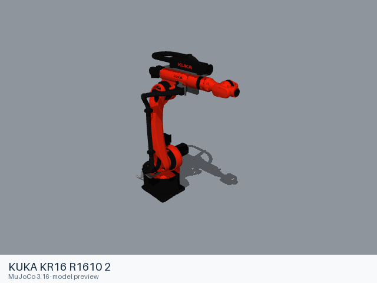](kr16_r1610_2/README.md) | [KUKA KR16 R1610 2](kr16_r1610_2/README.md) | [URDF](kr16_r1610_2/urdf/kr16_r1610_2.urdf) | [kuka_robot_descriptions](https://github.com/kuka-ros/kuka_robot_descriptions) |
| [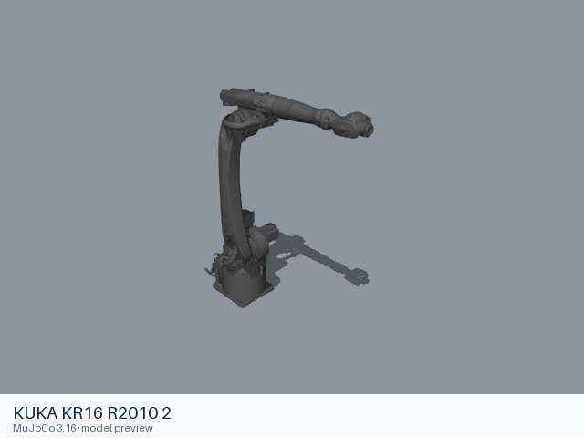](kr16_r2010_2/README.md) | [KUKA KR16 R2010 2](kr16_r2010_2/README.md) | [URDF](kr16_r2010_2/urdf/kr16_r2010_2.urdf) | [kuka_robot_descriptions](https://github.com/kuka-ros/kuka_robot_descriptions) |
| [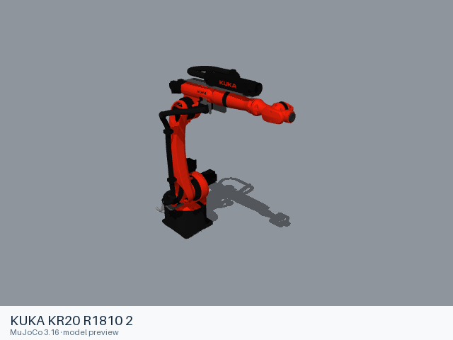](kr20_r1810_2/README.md) | [KUKA KR20 R1810 2](kr20_r1810_2/README.md) | [URDF](kr20_r1810_2/urdf/kr20_r1810_2.urdf) | [kuka_robot_descriptions](https://github.com/kuka-ros/kuka_robot_descriptions) |
| [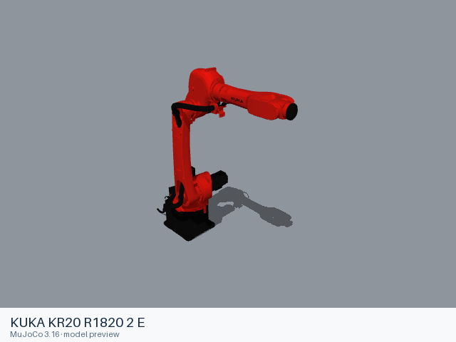](kr20_r1820_2_e/README.md) | [KUKA KR20 R1820 2 E](kr20_r1820_2_e/README.md) | [URDF](kr20_r1820_2_e/urdf/kr20_r1820_2_e.urdf) | [kuka_robot_descriptions](https://github.com/kuka-ros/kuka_robot_descriptions) |
| [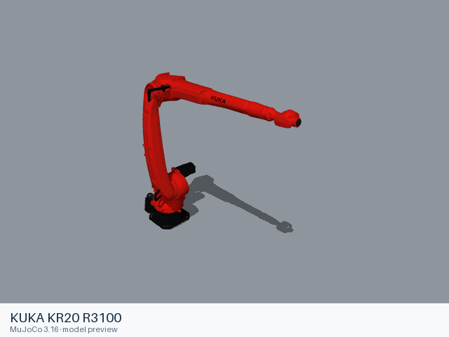](kr20_r3100/README.md) | [KUKA KR20 R3100](kr20_r3100/README.md) | [URDF](kr20_r3100/urdf/kr20_r3100.urdf) | [kuka_robot_descriptions](https://github.com/kuka-ros/kuka_robot_descriptions) |
| [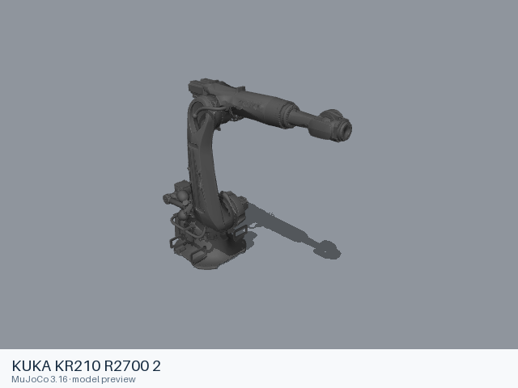](kr210_r2700_2/README.md) | [KUKA KR210 R2700 2](kr210_r2700_2/README.md) | [URDF](kr210_r2700_2/urdf/kr210_r2700_2.urdf) | [kuka_robot_descriptions](https://github.com/kuka-ros/kuka_robot_descriptions) |
| [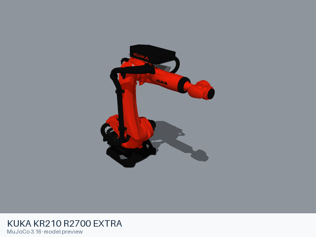](kr210_r2700_extra/README.md) | [KUKA KR210 R2700 EXTRA](kr210_r2700_extra/README.md) | [URDF](kr210_r2700_extra/urdf/kr210_r2700_extra.urdf) | [kuka_robot_descriptions](https://github.com/kuka-ros/kuka_robot_descriptions) |
|  | [KUKA KR210 R3100 2](kr210_r3100_2/README.md) | [URDF](kr210_r3100_2/urdf/kr210_r3100_2.urdf) | [kuka_robot_descriptions](https://github.com/kuka-ros/kuka_robot_descriptions) |
| [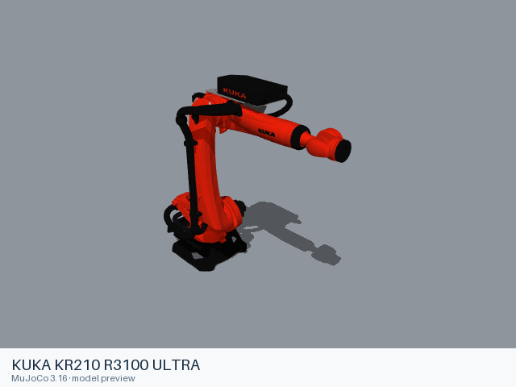](kr210_r3100_ultra/README.md) | [KUKA KR210 R3100 ULTRA](kr210_r3100_ultra/README.md) | [URDF](kr210_r3100_ultra/urdf/kr210_r3100_ultra.urdf) | [kuka_robot_descriptions](https://github.com/kuka-ros/kuka_robot_descriptions) |
| [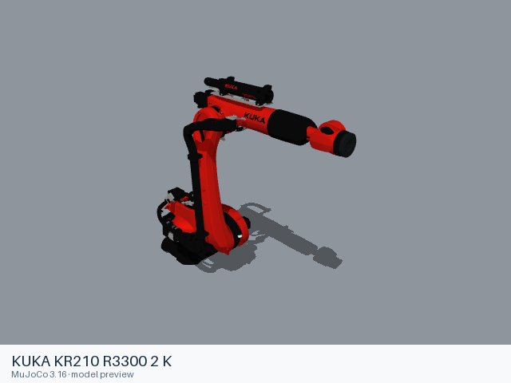](kr210_r3300_2_k/README.md) | [KUKA KR210 R3300 2 K](kr210_r3300_2_k/README.md) | [URDF](kr210_r3300_2_k/urdf/kr210_r3300_2_k.urdf) | [kuka_robot_descriptions](https://github.com/kuka-ros/kuka_robot_descriptions) |
| [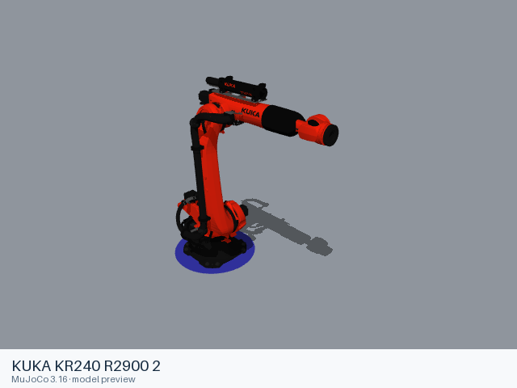](kr240_r2900_2/README.md) | [KUKA KR240 R2900 2](kr240_r2900_2/README.md) | [URDF](kr240_r2900_2/urdf/kr240_r2900_2.urdf) | [kuka_robot_descriptions](https://github.com/kuka-ros/kuka_robot_descriptions) |
| [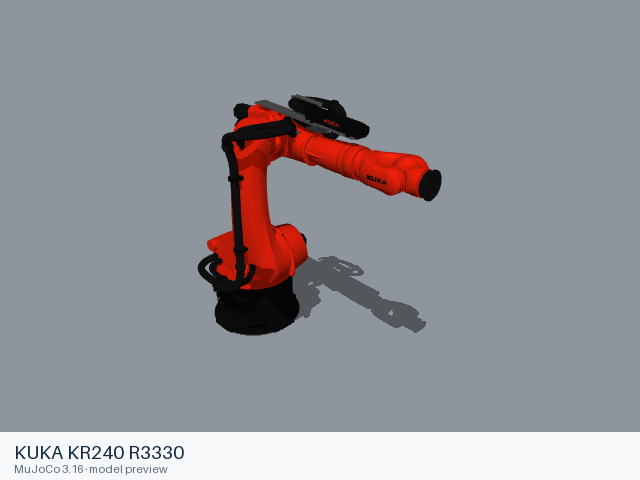](kr240_r3330/README.md) | [KUKA KR240 R3330](kr240_r3330/README.md) | [URDF](kr240_r3330/urdf/kr240_r3330.urdf) | [kuka_robot_descriptions](https://github.com/kuka-ros/kuka_robot_descriptions) |
| [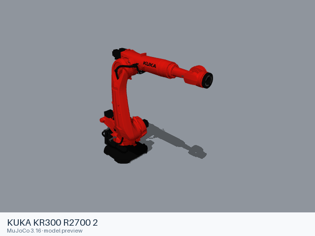](kr300_r2700_2/README.md) | [KUKA KR300 R2700 2](kr300_r2700_2/README.md) | [URDF](kr300_r2700_2/urdf/kr300_r2700_2.urdf) | [kuka_robot_descriptions](https://github.com/kuka-ros/kuka_robot_descriptions) |
| [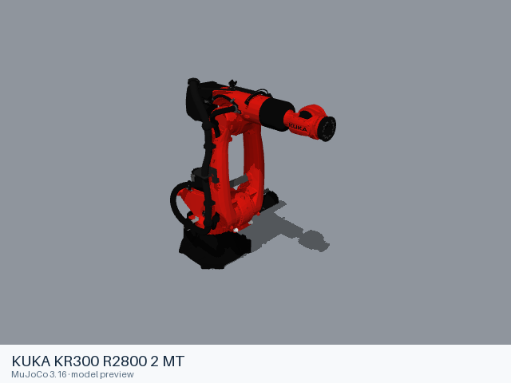](kr300_r2800_2_mt/README.md) | [KUKA KR300 R2800 2 MT](kr300_r2800_2_mt/README.md) | [URDF](kr300_r2800_2_mt/urdf/kr300_r2800_2_mt.urdf) | [kuka_robot_descriptions](https://github.com/kuka-ros/kuka_robot_descriptions) |
| [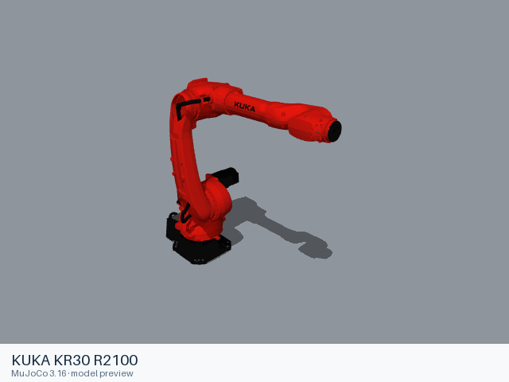](kr30_r2100/README.md) | [KUKA KR30 R2100](kr30_r2100/README.md) | [URDF](kr30_r2100/urdf/kr30_r2100.urdf) | [kuka_robot_descriptions](https://github.com/kuka-ros/kuka_robot_descriptions) |
| [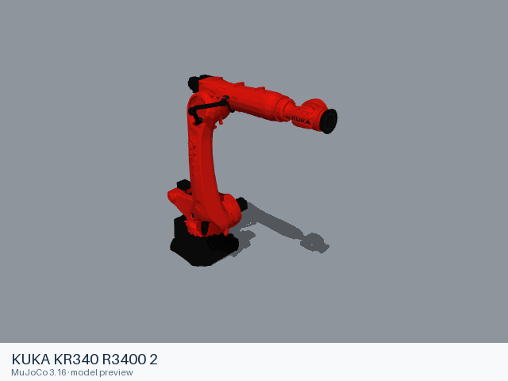](kr340_r3400_2/README.md) | [KUKA KR340 R3400 2](kr340_r3400_2/README.md) | [URDF](kr340_r3400_2/urdf/kr340_r3400_2.urdf) | [kuka_robot_descriptions](https://github.com/kuka-ros/kuka_robot_descriptions) |
| [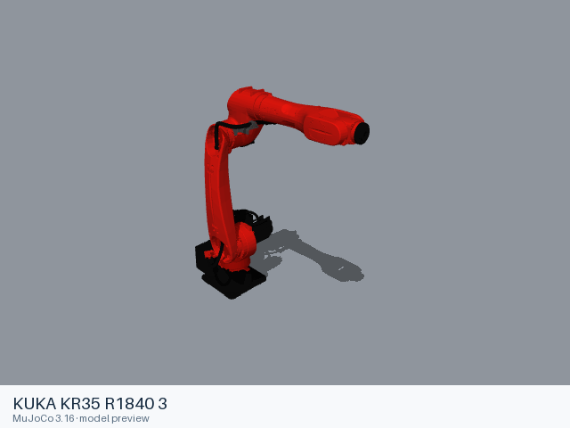](kr35_r1840_3/README.md) | [KUKA KR35 R1840 3](kr35_r1840_3/README.md) | [URDF](kr35_r1840_3/urdf/kr35_r1840_3.urdf) | [kuka_robot_descriptions](https://github.com/kuka-ros/kuka_robot_descriptions) |
| [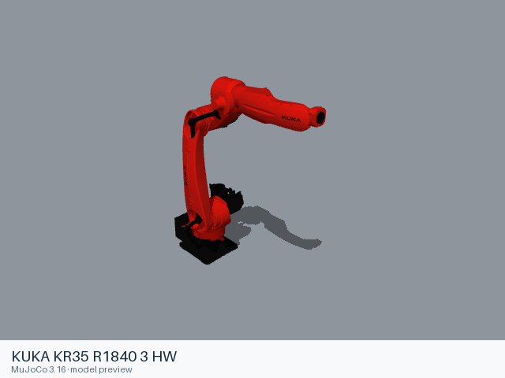](kr35_r1840_3_hw/README.md) | [KUKA KR35 R1840 3 HW](kr35_r1840_3_hw/README.md) | [URDF](kr35_r1840_3_hw/urdf/kr35_r1840_3_hw.urdf) | [kuka_robot_descriptions](https://github.com/kuka-ros/kuka_robot_descriptions) |
| [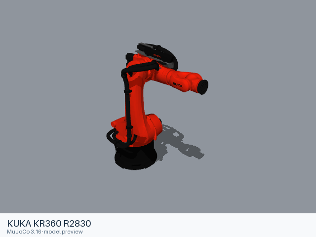](kr360_r2830/README.md) | [KUKA KR360 R2830](kr360_r2830/README.md) | [URDF](kr360_r2830/urdf/kr360_r2830.urdf) | [kuka_robot_descriptions](https://github.com/kuka-ros/kuka_robot_descriptions) |
| [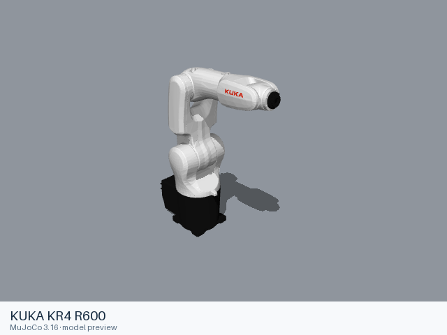](kr4_r600/README.md) | [KUKA KR4 R600](kr4_r600/README.md) | [URDF](kr4_r600/urdf/kr4_r600.urdf) | [kuka_robot_descriptions](https://github.com/kuka-ros/kuka_robot_descriptions) |
| [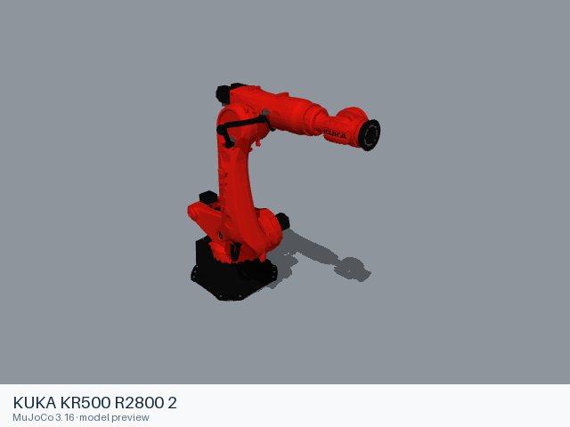](kr500_r2800_2/README.md) | [KUKA KR500 R2800 2](kr500_r2800_2/README.md) | [URDF](kr500_r2800_2/urdf/kr500_r2800_2.urdf) | [kuka_robot_descriptions](https://github.com/kuka-ros/kuka_robot_descriptions) |
|  | [KUKA KR50 R2100](kr50_r2100/README.md) | [URDF](kr50_r2100/urdf/kr50_r2100.urdf) | [kuka_robot_descriptions](https://github.com/kuka-ros/kuka_robot_descriptions) |
| [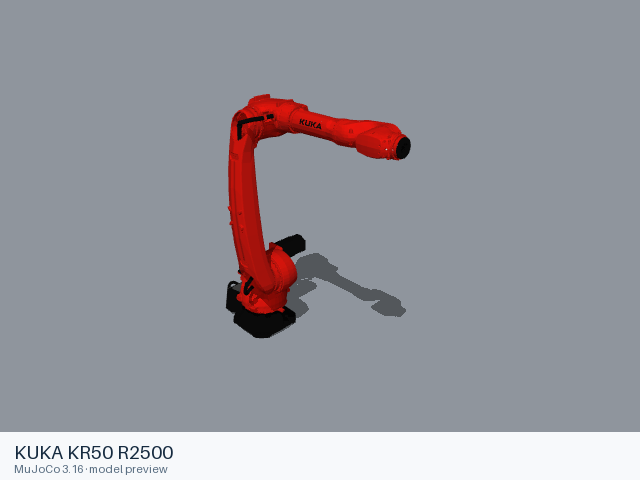](kr50_r2500/README.md) | [KUKA KR50 R2500](kr50_r2500/README.md) | [URDF](kr50_r2500/urdf/kr50_r2500.urdf) | [kuka_robot_descriptions](https://github.com/kuka-ros/kuka_robot_descriptions) |
| [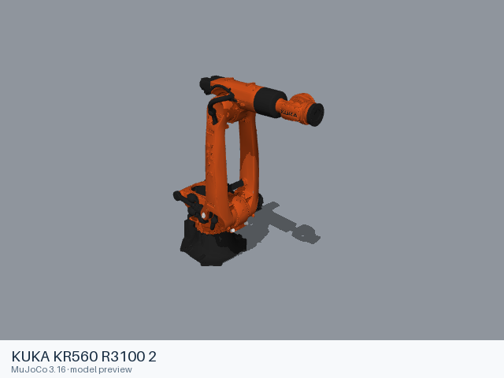](kr560_r3100_2/README.md) | [KUKA KR560 R3100 2](kr560_r3100_2/README.md) | [URDF](kr560_r3100_2/urdf/kr560_r3100_2.urdf) | [kuka_robot_descriptions](https://github.com/kuka-ros/kuka_robot_descriptions) |
| [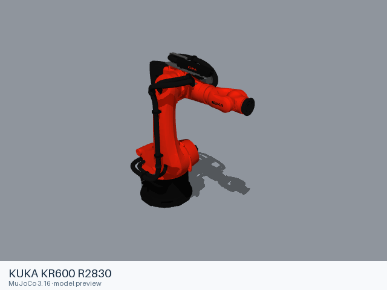](kr600_r2830/README.md) | [KUKA KR600 R2830](kr600_r2830/README.md) | [URDF](kr600_r2830/urdf/kr600_r2830.urdf) | [kuka_robot_descriptions](https://github.com/kuka-ros/kuka_robot_descriptions) |
| [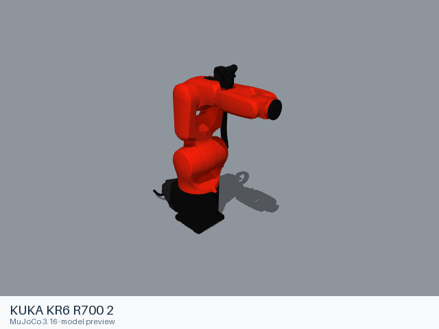](kr6_r700_2/README.md) | [KUKA KR6 R700 2](kr6_r700_2/README.md) | [URDF](kr6_r700_2/urdf/kr6_r700_2.urdf) | [kuka_robot_descriptions](https://github.com/kuka-ros/kuka_robot_descriptions) |
| [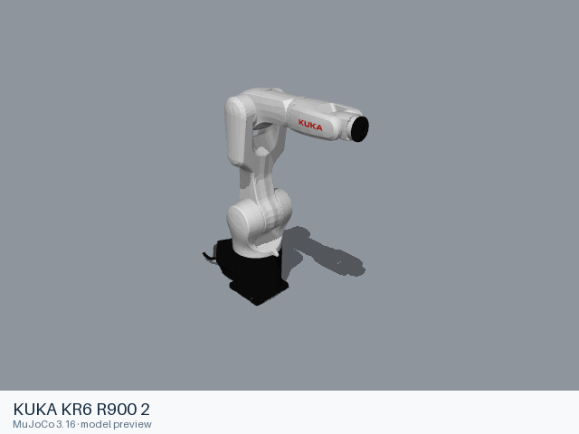](kr6_r900_2/README.md) | [KUKA KR6 R900 2](kr6_r900_2/README.md) | [URDF](kr6_r900_2/urdf/kr6_r900_2.urdf) | [kuka_robot_descriptions](https://github.com/kuka-ros/kuka_robot_descriptions) |
| [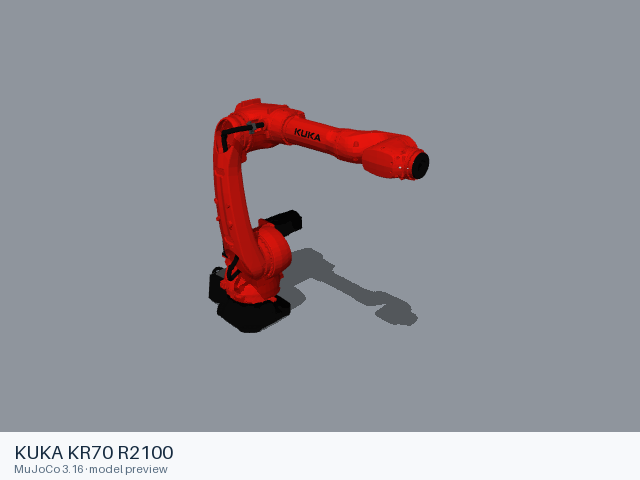](kr70_r2100/README.md) | [KUKA KR70 R2100](kr70_r2100/README.md) | [URDF](kr70_r2100/urdf/kr70_r2100.urdf) | [kuka_robot_descriptions](https://github.com/kuka-ros/kuka_robot_descriptions) |
| [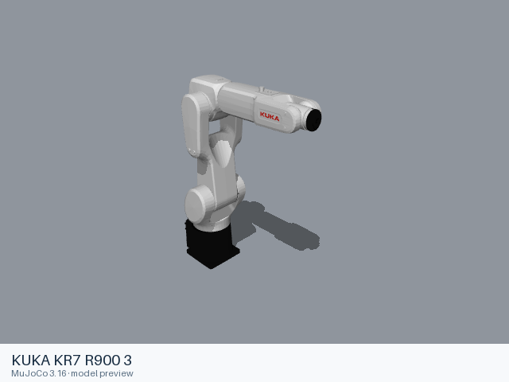](kr7_r900_3/README.md) | [KUKA KR7 R900 3](kr7_r900_3/README.md) | [URDF](kr7_r900_3/urdf/kr7_r900_3.urdf) | [kuka_robot_descriptions](https://github.com/kuka-ros/kuka_robot_descriptions) |
|  | [KUKA KR800 R2800 2](kr800_r2800_2/README.md) | [URDF](kr800_r2800_2/urdf/kr800_r2800_2.urdf) | [kuka_robot_descriptions](https://github.com/kuka-ros/kuka_robot_descriptions) |
| [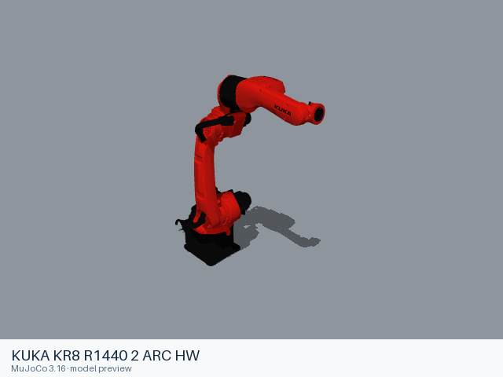](kr8_r1440_2_arc_hw/README.md) | [KUKA KR8 R1440 2 ARC HW](kr8_r1440_2_arc_hw/README.md) | [URDF](kr8_r1440_2_arc_hw/urdf/kr8_r1440_2_arc_hw.urdf) | [kuka_robot_descriptions](https://github.com/kuka-ros/kuka_robot_descriptions) |
| [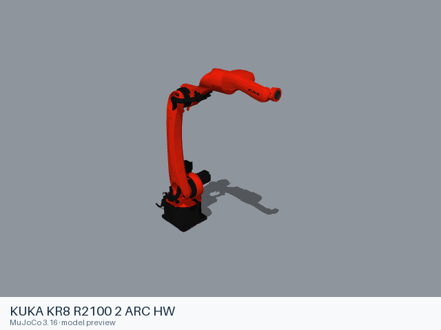](kr8_r2100_2_arc_hw/README.md) | [KUKA KR8 R2100 2 ARC HW](kr8_r2100_2_arc_hw/README.md) | [URDF](kr8_r2100_2_arc_hw/urdf/kr8_r2100_2_arc_hw.urdf) | [kuka_robot_descriptions](https://github.com/kuka-ros/kuka_robot_descriptions) |
| [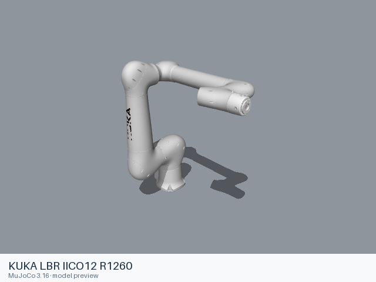](lbr_iico12_r1260/README.md) | [KUKA LBR IICO12 R1260](lbr_iico12_r1260/README.md) | [URDF](lbr_iico12_r1260/urdf/lbr_iico12_r1260.urdf) | [kuka_robot_descriptions](https://github.com/kuka-ros/kuka_robot_descriptions) |
|  | [KUKA LBR IICO7 R900](lbr_iico7_r900/README.md) | [URDF](lbr_iico7_r900/urdf/lbr_iico7_r900.urdf) | [kuka_robot_descriptions](https://github.com/kuka-ros/kuka_robot_descriptions) |
| [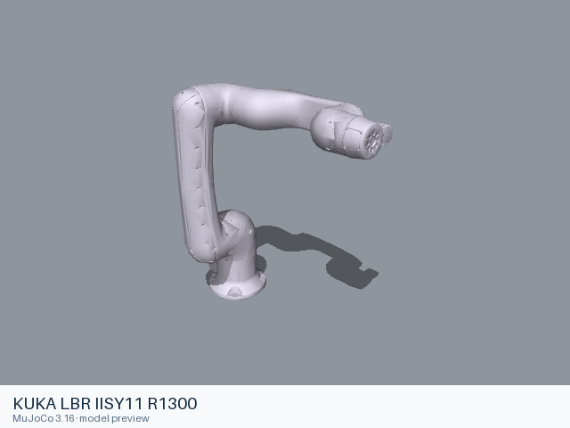](lbr_iisy11_r1300/README.md) | [KUKA LBR IISY11 R1300](lbr_iisy11_r1300/README.md) | [URDF](lbr_iisy11_r1300/urdf/lbr_iisy11_r1300.urdf) | [kuka_robot_descriptions](https://github.com/kuka-ros/kuka_robot_descriptions) |
| [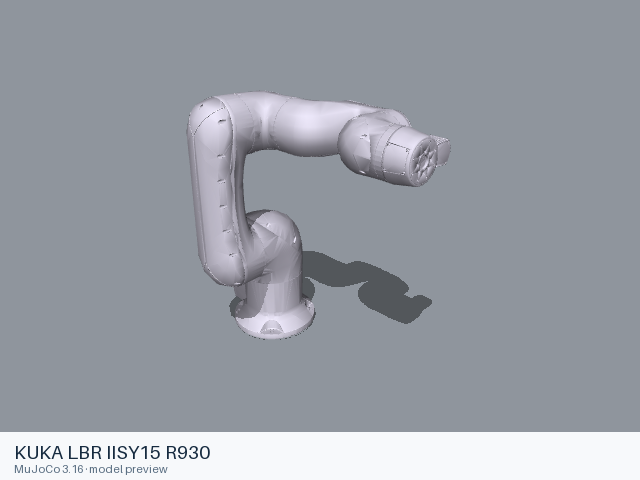](lbr_iisy15_r930/README.md) | [KUKA LBR IISY15 R930](lbr_iisy15_r930/README.md) | [URDF](lbr_iisy15_r930/urdf/lbr_iisy15_r930.urdf) | [kuka_robot_descriptions](https://github.com/kuka-ros/kuka_robot_descriptions) |
| [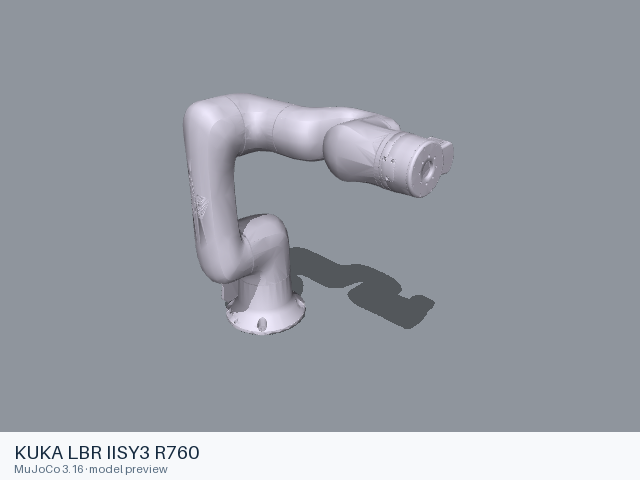](lbr_iisy3_r760/README.md) | [KUKA LBR IISY3 R760](lbr_iisy3_r760/README.md) | [URDF](lbr_iisy3_r760/urdf/lbr_iisy3_r760.urdf) | [kuka_robot_descriptions](https://github.com/kuka-ros/kuka_robot_descriptions) |
| [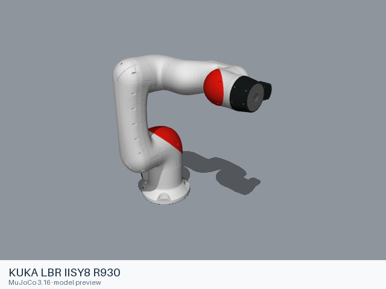](lbr_iisy8_r930/README.md) | [KUKA LBR IISY8 R930](lbr_iisy8_r930/README.md) | [URDF](lbr_iisy8_r930/urdf/lbr_iisy8_r930.urdf) | [kuka_robot_descriptions](https://github.com/kuka-ros/kuka_robot_descriptions) |
| [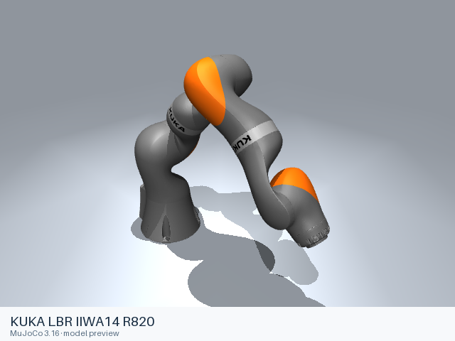](lbr_iiwa14_r820/README.md) | [KUKA LBR IIWA14 R820](lbr_iiwa14_r820/README.md) | [URDF](lbr_iiwa14_r820/urdf/lbr_iiwa14_r820.urdf) [MJCF](lbr_iiwa14_r820/mjcf/menagerie/iiwa14.xml) [All 3 entries](lbr_iiwa14_r820/README.md#model-entries) | [kuka_robot_descriptions](https://github.com/kuka-ros/kuka_robot_descriptions) |

Each model contains a static entry, the resources it references, and its applicable license files. Mechanical details and loading records are in the model READMEs.

## Curated MuJoCo entries

The following MJCF files come from the Google DeepMind-maintained MuJoCo Menagerie collection. Their model-specific licenses and source versions are recorded with each entry.

| Model | Format notes | Model documentation |
|---|---|---|
| KUKA LBR iiwa 14 | [MJCF](lbr_iiwa14_r820/mjcf/README.md) | [Model notes](lbr_iiwa14_r820/README.md) |
