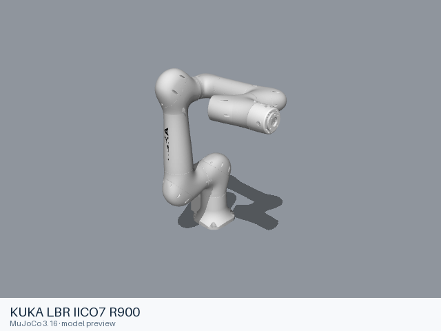

# KUKA LBR IICO7 R900

[Manufacturer gallery](../README.md) · [All manufacturers](../../../README.md)



MuJoCo preview · [Rendering record](preview.json) · [Rendering method](../../../docs/PREVIEWS.md)

6-joint arm without a gripper. The entry preserves the upstream kinematic, visual, collision, inertial and joint-limit definitions.

## Model entries

Entry paths are relative to the repository root.

| Purpose / assembly | Format | Entry path | Target environment and required loading options |
|---|---|---|---|
| Robot model: 6-joint arm without a gripper | URDF | [`models/kuka/lbr_iico7_r900/urdf/lbr_iico7_r900.urdf`](urdf/lbr_iico7_r900.urdf) | A native URDF loader with relative mesh resolution; attach the base to the consuming scene. |

## Mechanical information

| Item | Definition |
|---|---|
| Hardware revision and gripper | 6-joint arm without a gripper |
| Units | Metres, kilograms, radians; revolute joint effort in N·m and prismatic effort in N. Mesh scale attributes remain as supplied upstream. |
| Base | `world`; root of the URDF tree. Any supplied fixed base transform is retained. |
| Arm joint order | `joint_1` → `joint_2` → `joint_3` → `joint_4` → `joint_5` → `joint_6` |
| Gripper | No gripper is included. |
| End effector / TCP | `flange`, `tool0`; fixed transforms remain in the entry. |
| Included poses | No named poses are defined by this URDF entry. |

## Loading example

```python
from yourdfpy import URDF

robot = URDF.load(
    '/absolute/path/to/awesome-robot-arm-zoo/models/kuka/lbr_iico7_r900/urdf/lbr_iico7_r900.urdf',
    load_meshes=True, load_collision_meshes=True,
    build_collision_scene_graph=True,
)
```

## Sources and licensing

| Format or file scope | Upstream project | Version | Upstream file path | License file |
|---|---|---|---|---|
| Static URDF and its bundled resources (kuka_lbr_iico_support) | [https://github.com/kuka-ros/kuka_robot_descriptions](https://github.com/kuka-ros/kuka_robot_descriptions) | `5ddbc41ce8726fd680bcc19562d78bcabfbdf96d` | `kuka_lbr_iico_support/urdf/lbr_iico7_r900.urdf.xacro`; model mesh paths under the named packages | [LICENSE](urdf/LICENSE) |

Bundled upstream resource directories: `kuka_lbr_iico_support/meshes/lbr_iico7_r900/collision`, `kuka_lbr_iico_support/meshes/lbr_iico7_r900/visual`.

License scope: Apache-2.0, copyright KUKA Hungaria Kft.; source packages include ROS-Industrial-derived resources. The complete upstream license texts and notices accompany this format directory.

## Model preparation

The static entry was expanded with xacro 2.1.1 using mode:=mock, prefix:=, is_async:=false, async_thread_priority:=69, async_affinity:=[], x:=0, y:=0, z:=0, roll:=0, pitch:=0, yaw:=0, driver_version:=rsi_only, gpio_config:=, roundtrip_time:=0, client_ip:=0.0.0.0, client_port:=59152, mxa_client_port:=1337, controller_ip:=0.0.0.0, verify_robot_model:=true, rsi_xml_config_file:=. Resources were copied only when referenced by the entry or by one of its mesh/material files. Resource references are local relative paths. Mesh contents and physical parameters retain the upstream definitions. The upstream mock-control mode is selected; no external axis is included.

## Loading verification

Checks performed on 2026-10-15. The complete format directory was copied to a temporary location and loaded by absolute path from a separate working directory.

| Entry | Environment and loader version | Verification steps | Result |
|---|---|---|---|
| `models/kuka/lbr_iico7_r900/urdf/lbr_iico7_r900.urdf` | macOS 27.2, arm64, Python 3.12.14; yourdfpy 0.0.60 | Load visual/collision geometry and update the joint configuration. | Passed, including resource relocation. |

## Known limitations

Dynamic task execution, controller performance and training behavior have not been validated.

ROS, Gazebo and physics simulators have not been verified for this entry. ROS 2 control annotations remain upstream metadata.
