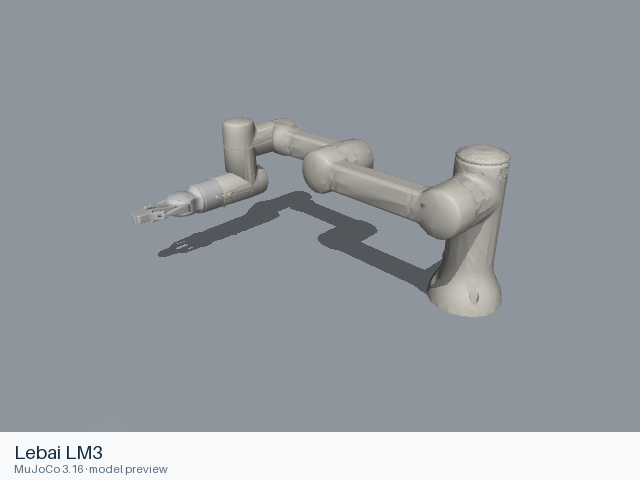
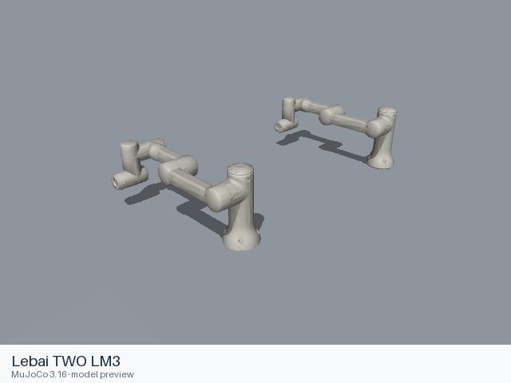

# Lebai models

[All manufacturers](../../README.md#models) · [Chinese index](../../README_CN.md#模型目录)

Previews are rendered with MuJoCo. See the [rendering method](../../docs/PREVIEWS.md); each model page links its exact entry and rendering record.

Official models from the Lebai Robotics ROS SDK jazzy-dev branch. LM3 includes the manufacturer-modeled gripper configuration. The two_lm3 entry preserves the manufacturer’s two-arm fixed assembly at y = ±0.5 m.

| Preview | Model / assembly | Native entries | Upstream |
|---|---|---|---|
|  | [Lebai LM3](lm3/README.md) | [URDF](lm3/urdf/with_gripper/lm3.urdf) | [lebai-ros-sdk](https://github.com/lebai-robotics/lebai-ros-sdk) |
|  | [Lebai TWO LM3](two_lm3/README.md) | [URDF](two_lm3/urdf/two_lm3.urdf) | [lebai-ros-sdk](https://github.com/lebai-robotics/lebai-ros-sdk) |

Each model README supplies the assembly, mechanical interfaces, source revision, license scope and actual loading records.
