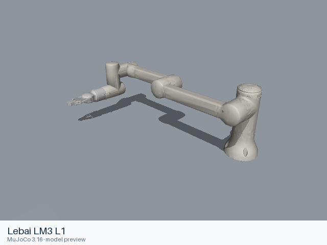

# Lebai LM3 L1

[Manufacturer gallery](../README.md) · [All manufacturers](../../../README.md)



MuJoCo preview · [Rendering record](preview.json) · [Rendering method](../../../docs/PREVIEWS.md)

LM3-L1 6-joint arm with the manufacturer modeled parallel gripper. The entry preserves the upstream kinematic, visual, collision, inertial and joint-limit definitions.

## Model entries

Entry paths are relative to the repository root.

| Purpose / assembly | Format | Entry path | Target environment and required loading options |
|---|---|---|---|
| Complete assembly: LM3-L1 6-joint arm with the manufacturer modeled parallel gripper | URDF | [`models/lebai/lm3_l1/urdf/with_gripper/lm3_l1.urdf`](urdf/with_gripper/lm3_l1.urdf) | A native URDF loader with relative mesh resolution; attach the base to the consuming scene. |

## Mechanical information

| Item | Definition |
|---|---|
| Hardware revision and gripper | LM3-L1 6-joint arm with the manufacturer modeled parallel gripper |
| Units | Metres, kilograms, radians; revolute joint effort in N·m and prismatic effort in N. Mesh scale attributes remain as supplied upstream. |
| Base | `base_link`; root of the URDF tree. Any supplied fixed base transform is retained. |
| Arm joint order | `joint_1` → `joint_2` → `joint_3` → `joint_4` → `joint_5` → `joint_6` |
| Gripper | Active `gripper_r_joint1`: closed = 0 rad, open = π/3 rad (1.0471975512), as defined by upstream MoveIt states. All other gripper joints mimic this joint with the multipliers and offsets in the URDF; this is angular actuation of a linkage gripper. |
| End effector / TCP | `tool0` is the arm flange frame; `gripper_tip` is the moving midpoint frame of the modeled jaws. |
| Included poses | The URDF has no named pose list. Upstream MoveIt `open` and `closed` gripper states are documented above; their source is `lebai_lm3_moveit_config/config/lebai_lm3_l1.srdf`. |

## Loading example

```python
from yourdfpy import URDF

robot = URDF.load(
    '/absolute/path/to/awesome-robot-arm-zoo/models/lebai/lm3_l1/urdf/with_gripper/lm3_l1.urdf',
    load_meshes=True, load_collision_meshes=True,
    build_collision_scene_graph=True,
)
```

## Sources and licensing

| Format or file scope | Upstream project | Version | Upstream file path | License file |
|---|---|---|---|---|
| Static URDF and its bundled resources (lebai_lm3_support) | [https://github.com/lebai-robotics/lebai-ros-sdk](https://github.com/lebai-robotics/lebai-ros-sdk) | `f1f13b6849f34f61dce0483e09f531816d292b63` | `lebai_lm3_support/urdf/lm3_l1_with_gripper.xacro`; model mesh paths under the named packages | [LICENSE](urdf/with_gripper/LICENSE) |

Bundled upstream resource directories: `lebai_lm3_support/meshes/gripper/collision`, `lebai_lm3_support/meshes/gripper/visual`, `lebai_lm3_support/meshes/lm3_l1/collision`, `lebai_lm3_support/meshes/lm3_l1/visual`.

License scope: Apache-2.0 for lebai_lm3_support and lebai_resources, including their mesh resources. The complete upstream license texts and notices accompany this format directory.

## Model preparation

The static entry was expanded with xacro 2.1.1 using upstream defaults. Resources were copied only when referenced by the entry or by one of its mesh/material files. Resource references are local relative paths. Mesh contents and physical parameters retain the upstream definitions. The upstream jazzy-dev description and common material macros supply all mechanical definitions.

## Loading verification

Checks performed on 2026-10-15. The complete format directory was copied to a temporary location and loaded by absolute path from a separate working directory.

| Entry | Environment and loader version | Verification steps | Result |
|---|---|---|---|
| `models/lebai/lm3_l1/urdf/with_gripper/lm3_l1.urdf` | macOS 27.2, arm64, Python 3.12.14; yourdfpy 0.0.60 | Load visual/collision geometry and update the joint configuration. | Passed, including resource relocation. |

## Known limitations

Dynamic task execution, controller performance and training behavior have not been validated.

ROS, Gazebo and physics simulators have not been verified for this entry. Gripper and robot controller connections have not been verified.

The source omits inertial definitions on these moving links with geometry: `gripper_r_link1`, `gripper_r_link2`, `gripper_r_link_finger`, `gripper_l_link1`, `gripper_l_link2`, `gripper_l_link_finger`. It does not supply a complete dynamics model.
