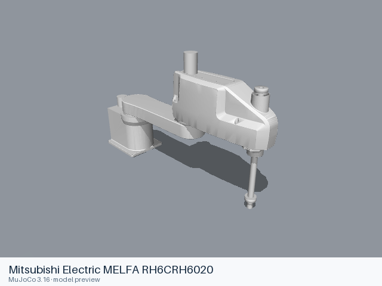
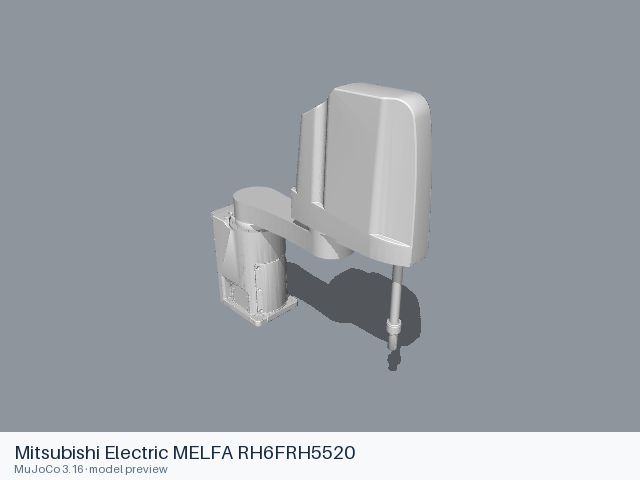
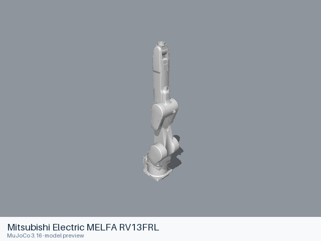
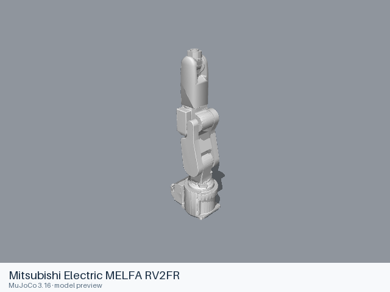
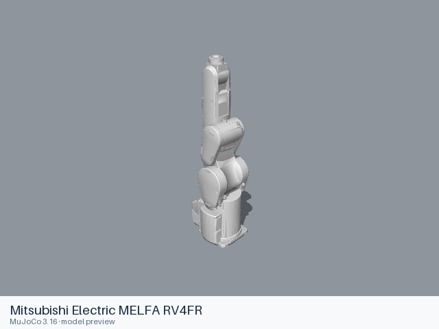
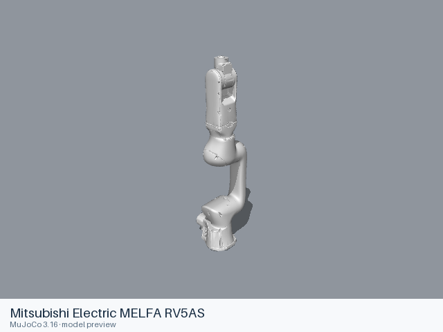
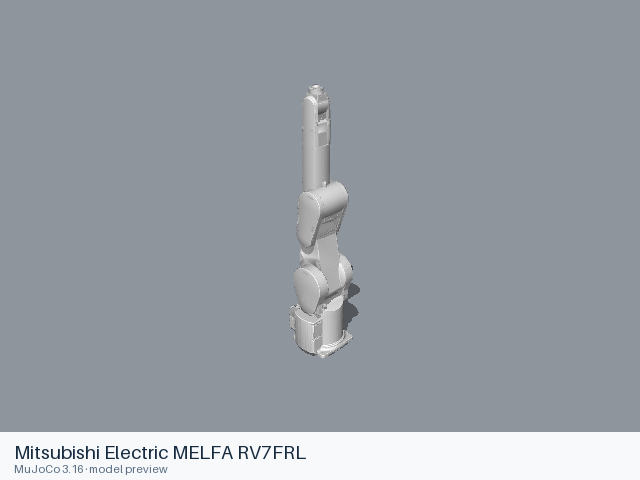
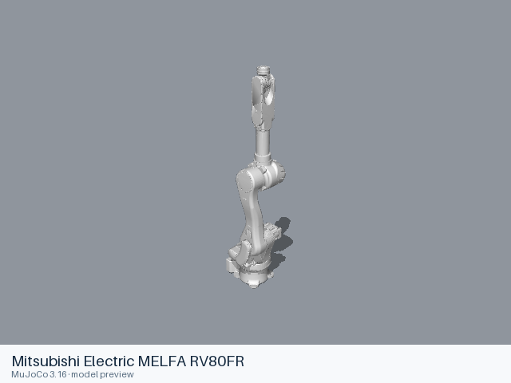
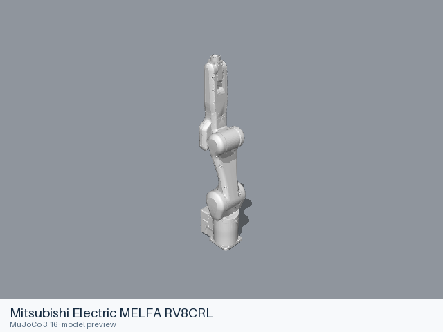

# Mitsubishi Electric MELFA models

[All manufacturers](../../README.md#models) · [Chinese index](../../README_CN.md#模型目录)

Previews are rendered with MuJoCo. See the [rendering method](../../docs/PREVIEWS.md); each model page links its exact entry and rendering record.

Official model sources from [MitsubishiElectric/melfa_ros2_driver](https://github.com/MitsubishiElectric/melfa_ros2_driver), maintained by the manufacturer. All entries below include a standalone static URDF and their local mesh dependencies.

| Preview | Model / assembly | Native entries | Movable joints | Source license |
|---|---|---|---|---|
|  | [Mitsubishi Electric MELFA RH6CRH6020](rh6crh6020/README.md) | [URDF](rh6crh6020/urdf/rh6crh6020.urdf) | 4 | Apache-2.0 |
|  | [Mitsubishi Electric MELFA RH6FRH5520](rh6frh5520/README.md) | [URDF](rh6frh5520/urdf/rh6frh5520.urdf) | 4 | Apache-2.0 |
|  | [Mitsubishi Electric MELFA RV13FRL](rv13frl/README.md) | [URDF](rv13frl/urdf/rv13frl.urdf) | 6 | Apache-2.0 |
|  | [Mitsubishi Electric MELFA RV2FR](rv2fr/README.md) | [URDF](rv2fr/urdf/rv2fr.urdf) | 6 | Apache-2.0 |
|  | [Mitsubishi Electric MELFA RV4FR](rv4fr/README.md) | [URDF](rv4fr/urdf/rv4fr.urdf) | 6 | Apache-2.0 |
|  | [Mitsubishi Electric MELFA RV4FRL](rv4frl/README.md) | [URDF](rv4frl/urdf/rv4frl.urdf) | 6 | Apache-2.0 |
|  | [Mitsubishi Electric MELFA RV5AS](rv5as/README.md) | [URDF](rv5as/urdf/rv5as.urdf) | 6 | Apache-2.0 |
|  | [Mitsubishi Electric MELFA RV7FRL](rv7frl/README.md) | [URDF](rv7frl/urdf/rv7frl.urdf) | 6 | Apache-2.0 |
|  | [Mitsubishi Electric MELFA RV80FR](rv80fr/README.md) | [URDF](rv80fr/urdf/rv80fr.urdf) | 6 | Apache-2.0 |
|  | [Mitsubishi Electric MELFA RV8CRL](rv8crl/README.md) | [URDF](rv8crl/urdf/rv8crl.urdf) | 6 | Apache-2.0 |

## Known limitations

Loading support and physical-model limitations are recorded in each model README. The manufacturer name identifies the source hardware and upstream organization; inclusion here does not imply endorsement of this collection.
