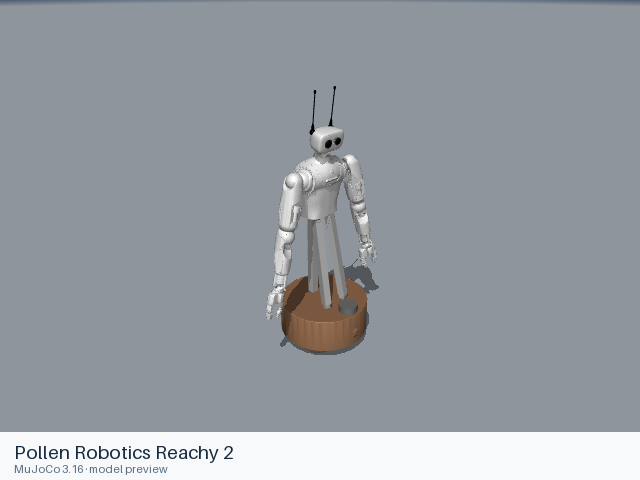

# Pollen Robotics Reachy 2

[Manufacturer gallery](../README.md) · [All manufacturers](../../../README.md)



MuJoCo preview · [Rendering record](preview.json) · [Rendering method](../../../docs/PREVIEWS.md)

Reachy 2 full-kit assembly with the mobile base, lifting torso, two seven-axis arms, neck, antennas and native parallel grippers. URDF and MJCF retain their source-specific wheel and linkage definitions.

## Model entries

Entry paths are relative to the repository root.

| Purpose / assembly | Format | Entry path | Target environment and required loading options |
|---|---|---|---|
| Reachy 2 full kit with fixed wheel joints and parallel grippers | URDF | [`models/pollen_robotics/reachy2/urdf/reachy2.urdf`](urdf/reachy2.urdf) | Native URDF geometry loader; choose base attachment in the consuming simulator. |
| Reachy 2 full mobile kit with parallel grippers | MJCF | [`models/pollen_robotics/reachy2/mjcf/reachy2.xml`](mjcf/reachy2.xml) | MuJoCo native XML loader; use an absolute entry path. |

## Mechanical information

| Item | Definition |
|---|---|
| Hardware revision and gripper | Reachy 2 full kit; native pincette parallel grippers |
| Units | Metres, kilograms, radians; native mesh scales are retained. |
| Base | URDF: `base_footprint` with fixed wheel joints. MJCF: free joint `mobile_base`, driven wheel joints and passive roller joints. |
| Arm joint order | Each arm (`r_`, `l_`): `shoulder_pitch`, `shoulder_roll`, `elbow_yaw`, `elbow_pitch`, `wrist_roll`, `wrist_pitch`, `wrist_yaw`. The torso uses `tripod_joint`; the head uses `neck_roll`, `neck_pitch`, `neck_yaw`, `antenna_left`, `antenna_right`. |
| Gripper | Each `r_hand_finger` / `l_hand_finger` drives the native proximal and distal linkages. URDF mimic offsets and multipliers and MJCF constraints are retained. |
| End effector / TCP | `r_arm_tip`, `l_arm_tip` and corresponding `*_arm_tip_bottom` frames/bodies. |
| Included poses | No named keyframe or separate pose configuration is included. |

## Loading example

```python
import mujoco

model = mujoco.MjModel.from_xml_path(
    '/absolute/path/to/awesome-robot-arm-zoo/models/pollen_robotics/reachy2/mjcf/reachy2.xml'
)
data = mujoco.MjData(model)
mujoco.mj_forward(model, data)
```

## Sources and licensing

| Format or file scope | Upstream project | Version | Upstream file path | License file |
|---|---|---|---|---|
| URDF and referenced resources | [Upstream project](https://github.com/pollen-robotics/reachy2_mujoco) | `f6d8284e812d3b96b557e2e844d55bd09d6e3ee6` | `reachy2_mujoco/description/modified_urdf` | [Apache-2.0](urdf/LICENSE) |
| MJCF and referenced resources | [Upstream project](https://github.com/pollen-robotics/reachy2_mujoco) | `f6d8284e812d3b96b557e2e844d55bd09d6e3ee6` | `reachy2_mujoco/description/mjcf` | [Apache-2.0](mjcf/LICENSE) |

Upstream copyright notices and redistribution terms are retained alongside each format.

## Model preparation

The URDF comes from the official simulator repository’s expanded, modified URDF with OBJ meshes. Its MuJoCo-specific compiler hint is omitted for direct URDF geometry loading. The MJCF entry assembles the source test scene’s Reachy body, free base, options, assets, actuators and constraints; mesh references resolve through an explicit local mesh directory. Inertias, collision shapes, limits, passive wheel rollers and gripper linkages are retained.

## Loading verification

Checks performed on 2026-10-16. The complete format directory was copied to a temporary location and loaded by absolute path from a separate working directory.

| Entry | Environment and simulator version | Verification steps | Result |
|---|---|---|---|
| `models/pollen_robotics/reachy2/urdf/reachy2.urdf` | macOS 27.2, arm64, Python 3.12.14; yourdfpy 0.0.60 | Copy the complete format directory, change caller directory, load visual/collision resources and update the joint configuration. | Passed, including resource relocation. |
| `models/pollen_robotics/reachy2/mjcf/reachy2.xml` | macOS 27.2, arm64, Python 3.12.14; MuJoCo 3.16.0 | Copy the complete format directory, change caller directory, compile XML and call `mj_forward`. | Passed, including resource relocation. |

## Known limitations

The upstream simulator is a prototype: mobile-base behavior and actuator tuning are not established as equivalent to hardware. URDF fixed wheel joints and MJCF moving wheels/rollers are separate native definitions. The included URDF retains ROS/Gazebo extensions, which require their external runtime when used; native geometry loading does not execute them. Dynamics, sensor calibration and SDK behavior have not been validated here.

Dynamic task execution, policy performance and training behavior have not been validated.
