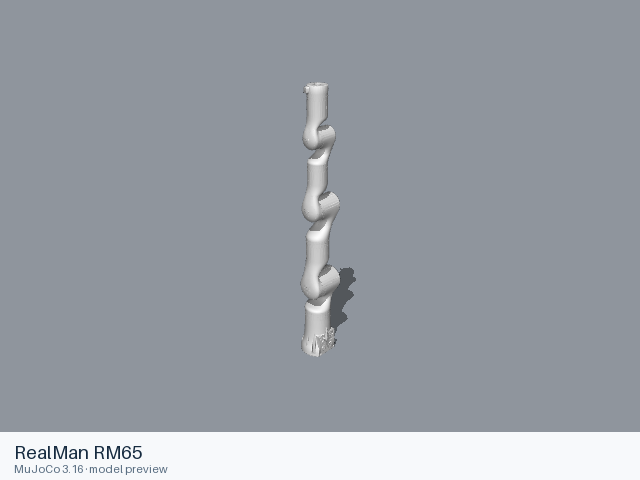
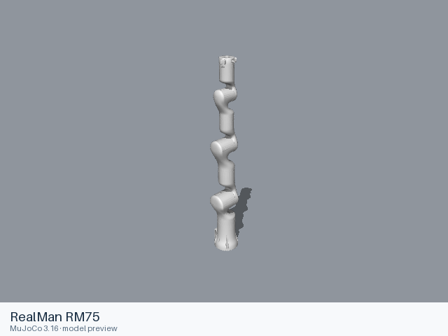

# Realman models

[All manufacturers](../../README.md#models) · [Chinese index](../../README_CN.md#模型目录)

Previews are rendered with MuJoCo. See the [rendering method](../../docs/PREVIEWS.md); each model page links its exact entry and rendering record.

These entries come from manufacturer-maintained public repositories. Source versions and file scopes are recorded with each model.

| Preview | Model / assembly | Native entries | Source status | Source |
|---|---|---|---|---|
|  | [RealMan RM65](rm65/README.md) | [URDF](rm65/urdf/rm65.urdf) | Official manufacturer repository | [rm_robot](https://github.com/RealManRobot/rm_robot) |
|  | [RealMan RM75](rm75/README.md) | [URDF](rm75/urdf/rm75.urdf) | Official manufacturer repository | [rm_robot](https://github.com/RealManRobot/rm_robot) |
|  | [RealMan RM75-6F](rm75_6f/README.md) | [URDF](rm75_6f/urdf/rm75_6f.urdf) | Official manufacturer repository | [rm_models](https://github.com/RealManRobot/rm_models) |
