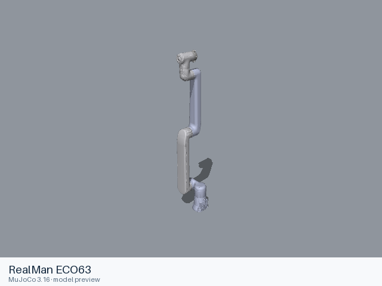
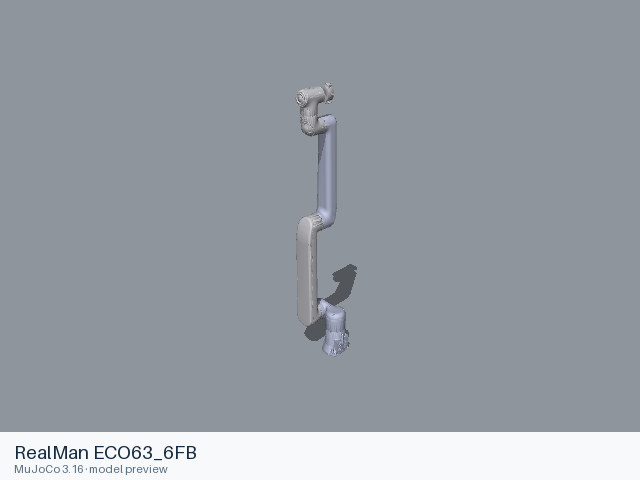
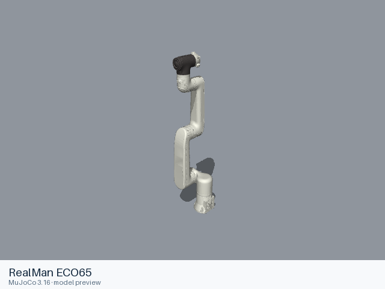
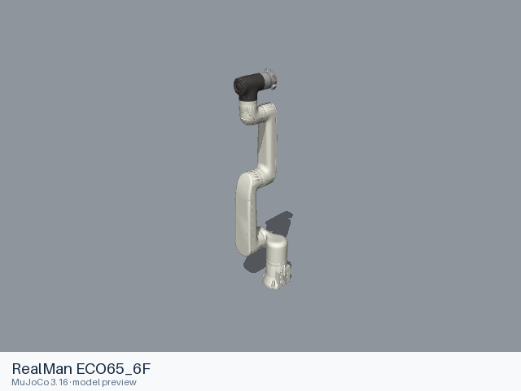
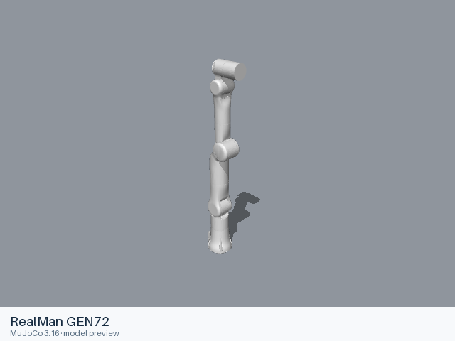
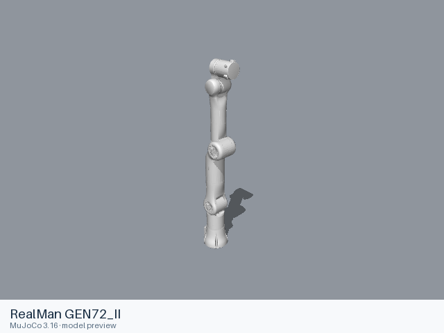
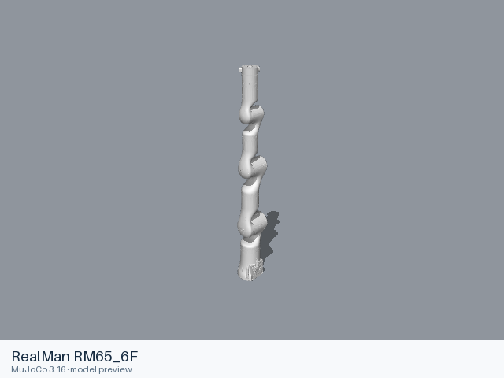
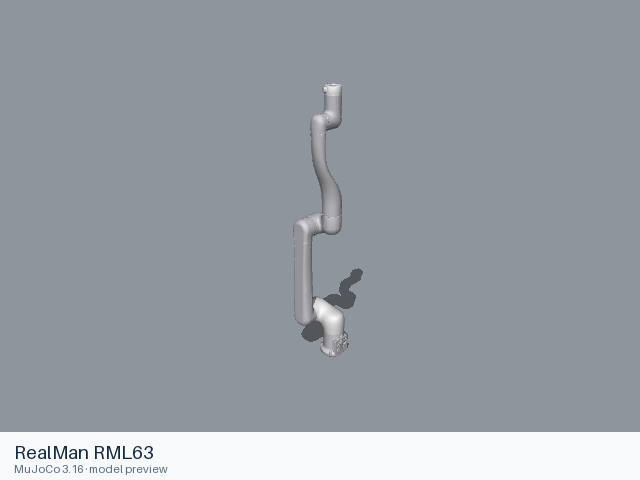

# Realman models

[All manufacturers](../../README.md#models) · [Chinese index](../../README_CN.md#模型目录)

Previews are rendered with MuJoCo. See the [rendering method](../../docs/PREVIEWS.md); each model page links its exact entry and rendering record.

These entries come from manufacturer-maintained public repositories. Source versions and file scopes are recorded with each model.

| Preview | Model / assembly | Native entries | Source status | Source |
|---|---|---|---|---|
|  | [RealMan ECO63](eco63/README.md) | [URDF](eco63/urdf/eco63.urdf) | Official manufacturer repository | [rm_robot](https://github.com/RealManRobot/rm_robot) |
|  | [RealMan ECO63_6FB](eco63_6fb/README.md) | [URDF](eco63_6fb/urdf/eco63_6fb.urdf) | Official manufacturer repository | [rm_robot](https://github.com/RealManRobot/rm_robot) |
|  | [RealMan ECO65](eco65/README.md) | [URDF](eco65/urdf/eco65.urdf) | Official manufacturer repository | [rm_robot](https://github.com/RealManRobot/rm_robot) |
|  | [RealMan ECO65_6F](eco65_6f/README.md) | [URDF](eco65_6f/urdf/eco65_6f.urdf) | Official manufacturer repository | [rm_robot](https://github.com/RealManRobot/rm_robot) |
|  | [RealMan GEN72](gen72/README.md) | [URDF](gen72/urdf/gen72.urdf) | Official manufacturer repository | [rm_robot](https://github.com/RealManRobot/rm_robot) |
|  | [RealMan GEN72_II](gen72_ii/README.md) | [URDF](gen72_ii/urdf/gen72_ii.urdf) | Official manufacturer repository | [rm_robot](https://github.com/RealManRobot/rm_robot) |
|  | [RealMan RM65](rm65/README.md) | [URDF](rm65/urdf/rm65.urdf) | Official manufacturer repository | [rm_robot](https://github.com/RealManRobot/rm_robot) |
|  | [RealMan RM65_6F](rm65_6f/README.md) | [URDF](rm65_6f/urdf/rm65_6f.urdf) | Official manufacturer repository | [rm_robot](https://github.com/RealManRobot/rm_robot) |
|  | [RealMan RM75](rm75/README.md) | [URDF](rm75/urdf/rm75.urdf) | Official manufacturer repository | [rm_robot](https://github.com/RealManRobot/rm_robot) |
|  | [RealMan RM75_6F](rm75_6f/README.md) | [URDF](rm75_6f/urdf/rm75_6f.urdf) | Official manufacturer repository | [rm_robot](https://github.com/RealManRobot/rm_robot) |
|  | [RealMan RML63](rml63/README.md) | [URDF](rml63/urdf/rml63.urdf) | Official manufacturer repository | [rm_robot](https://github.com/RealManRobot/rm_robot) |
