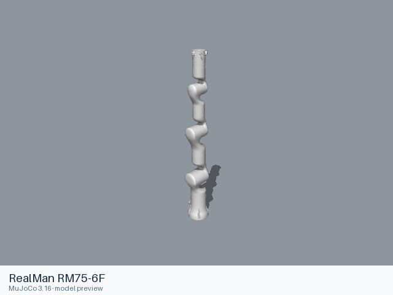

# RealMan RM75-6F

[Manufacturer gallery](../README.md) · [All manufacturers](../../../README.md)



MuJoCo preview · [Rendering record](preview.json) · [Rendering method](../../../docs/PREVIEWS.md)

Seven-axis arm with six-axis force-sensing flange. Bare flange; no hand or gripper is attached.

## Model entries

Entry paths are relative to the repository root.

| Purpose / assembly | Format | Entry path | Target environment and required loading options |
|---|---|---|---|
| Seven-axis arm with six-axis force-sensing flange | URDF | [`models/realman/rm75_6f/urdf/rm75_6f.urdf`](urdf/rm75_6f.urdf) | Native URDF loaders; select a fixed base in the consuming simulator when required. |

## Mechanical information

| Item | Definition |
|---|---|
| Hardware revision and gripper | RealMan RM75-6F; Bare flange; no hand or gripper is attached |
| Units | Metres, kilograms, radians; native mesh scales are retained. |
| Base | `base_link` |
| Movable joint order | `joint_1`, `joint_2`, `joint_3`, `joint_4`, `joint_5`, `joint_6`, `joint_7` |
| Gripper relationships | No URDF mimic relationships are declared. |
| End effector / TCP | Use the terminal link frames defined by the URDF; no additional TCP offset is introduced. |
| Included poses | No separate pose configuration is included. |

## Loading example

```python
from yourdfpy import URDF
robot = URDF.load('/absolute/path/to/awesome-robot-arm-zoo/models/realman/rm75_6f/urdf/rm75_6f.urdf',
                  load_meshes=True, load_collision_meshes=True)
```

## Sources and licensing

| Format or file scope | Upstream project | Version | Upstream file path | License file |
|---|---|---|---|---|
| URDF and its referenced resources | [Official manufacturer repository](https://github.com/RealManRobot/rm_models) | `9d37f52605aa00c7b0ed8143e5e46b8ffdb9317a` | `RM75/urdf/RM75-6F/urdf/RM75-6F.urdf` and referenced model resources | [Upstream notice](urdf/LICENSE), [Apache-2.0 terms](urdf/LICENSE.Apache-2.0) |

Upstream copyright notices and redistribution terms are retained. License: Apache-2.0. The upstream license applies to the URDF and copied meshes.

## Model preparation

The static URDF retains the upstream links, joints, inertia, limits, collision shapes and mesh scales. Resource references resolve within the format directory. Xacro sources are expanded with xacro 2.1.1 where applicable. Source argument values: `{}`. The MuJoCo-specific mesh-directory override, when present in the source, is omitted so that the prepared mesh paths are used.

## Loading verification

Checked on 2026-10-16 with yourdfpy 0.0.60, macOS 27.2 arm64 and Python 3.12.14. After copying the complete `urdf/` directory to a temporary location, the absolute entry loaded from a different working directory. All eight visual and collision geometries loaded, and the seven actuated joints updated with finite scene bounds. Result: passed, including resource relocation.

## Known limitations

Dynamic task execution, controller performance and training behavior have not been validated. ROS/Gazebo extensions in the source model require the corresponding runtime if used; direct URDF geometry loading does not execute those plugins. The consuming project supplies its controller and task configuration.
