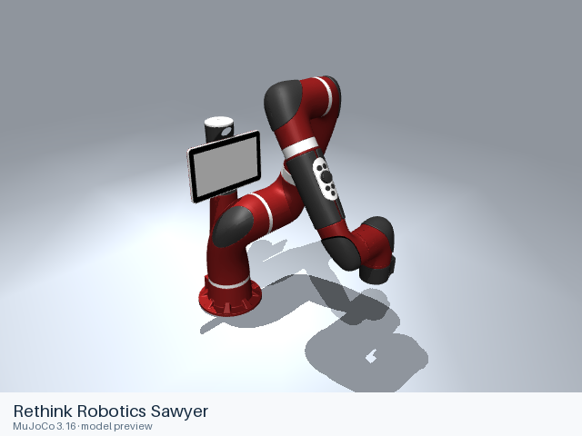

# Rethink Robotics

[All manufacturers](../../README.md#models) · [Chinese index](../../README_CN.md#模型目录)

Previews are rendered with MuJoCo. See the [rendering method](../../docs/PREVIEWS.md); each model page links its exact entry and rendering record.

Models and resources are extracted from the linked official manufacturer repositories. Each format directory retains its applicable upstream license.

| Preview | Model / assembly | Native entries |
|---|---|---|
|  | [Rethink Robotics Baxter](baxter/README.md) | [URDF](baxter/urdf/baxter.urdf) |
|  | [Rethink Robotics Sawyer](sawyer/README.md) | [URDF](sawyer/urdf/sawyer.urdf) [MJCF](sawyer/mjcf/menagerie/sawyer.xml) [All 3 entries](sawyer/README.md#model-entries) |

## Sources and licensing

- [Official upstream](https://github.com/RethinkRobotics/baxter_common). Exact revisions and file scopes are recorded in each model README.
- [Official upstream](https://github.com/RethinkRobotics/sawyer_robot). Exact revisions and file scopes are recorded in each model README.

## Curated MuJoCo entries

The following MJCF files come from the Google DeepMind-maintained MuJoCo Menagerie collection. Their model-specific licenses and source versions are recorded with each entry.

| Model | Format notes | Model documentation |
|---|---|---|
| Rethink Robotics Sawyer | [MJCF](sawyer/mjcf/README.md) | [Model notes](sawyer/README.md) |
