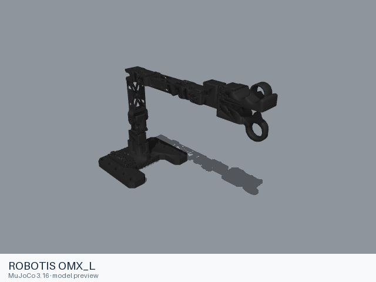
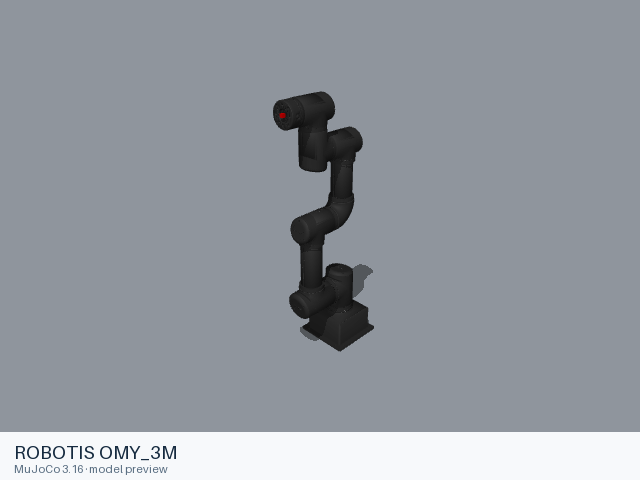
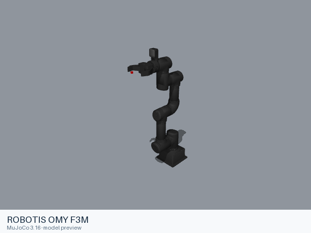
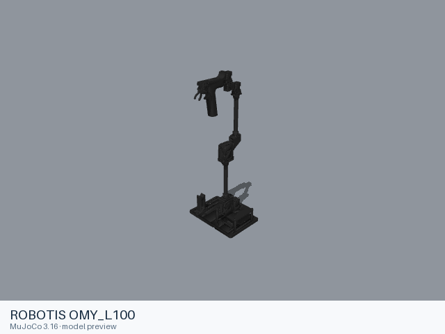
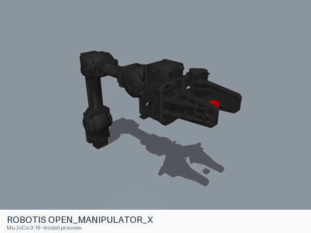

# Robotis

[All manufacturers](../../README.md#models) · [Chinese index](../../README_CN.md#模型目录)

Previews are rendered with MuJoCo. See the [rendering method](../../docs/PREVIEWS.md); each model page links its exact entry and rendering record.

Models and resources are extracted from the linked official manufacturer repositories. Each format directory retains its applicable upstream license.

| Preview | Model / assembly | Native entries |
|---|---|---|
|  | [ROBOTIS OMX_F](omx_f/README.md) | [URDF](omx_f/urdf/omx_f.urdf) |
|  | [ROBOTIS OMX_L](omx_l/README.md) | [URDF](omx_l/urdf/omx_l.urdf) |
|  | [ROBOTIS OMY_3M](omy_3m/README.md) | [URDF](omy_3m/urdf/omy_3m.urdf) |
|  | [ROBOTIS OMY F3M](omy_f3m/README.md) | [URDF](omy_f3m/urdf/omy_f3m.urdf) |
|  | [ROBOTIS OMY_L100](omy_l100/README.md) | [URDF](omy_l100/urdf/omy_l100.urdf) |
|  | [ROBOTIS OPEN_MANIPULATOR_X](open_manipulator_x/README.md) | [URDF](open_manipulator_x/urdf/open_manipulator_x.urdf) |

| ROBOTIS OMY F3M | [`URDF`](omy_f3m/urdf/omy_f3m.urdf) | [Model notes](omy_f3m/README.md) |

## Sources and licensing

- [Official upstream](https://github.com/ROBOTIS-GIT/open_manipulator). Exact revisions and file scopes are recorded in each model README.
