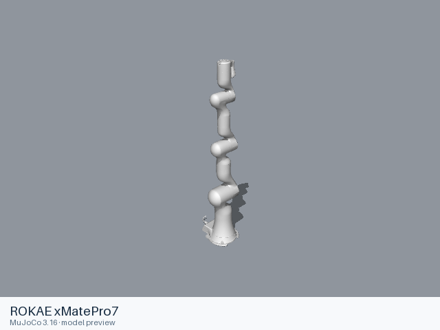

# Rokae models

[All manufacturers](../../README.md#models) · [Chinese index](../../README_CN.md#模型目录)

Previews are rendered with MuJoCo. See the [rendering method](../../docs/PREVIEWS.md); each model page links its exact entry and rendering record.

These entries come from manufacturer-maintained public repositories. Source versions and file scopes are recorded with each model.

| Preview | Model / assembly | Native entries | Source status | Source |
|---|---|---|---|---|
|  | [ROKAE xMatePro7](xmatepro7/README.md) | [URDF](xmatepro7/urdf/xmatepro7.urdf) | Official manufacturer repository | [rokae_ros2](https://github.com/RokaeRobot/rokae_ros2) |
