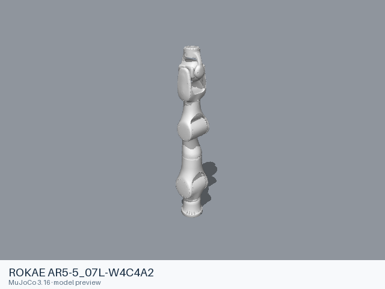
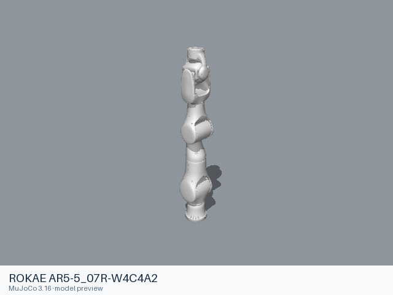
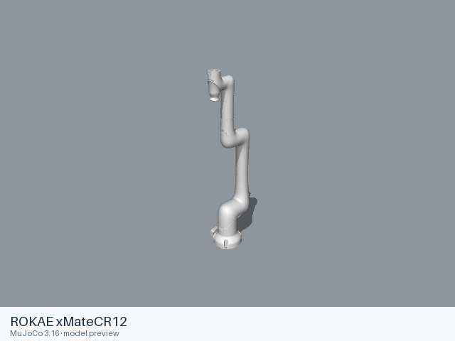
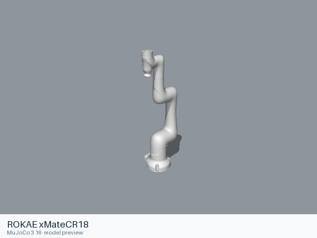
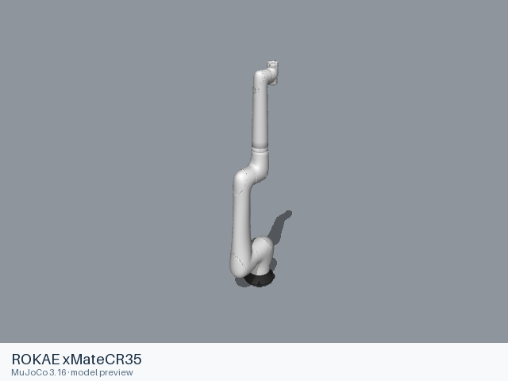
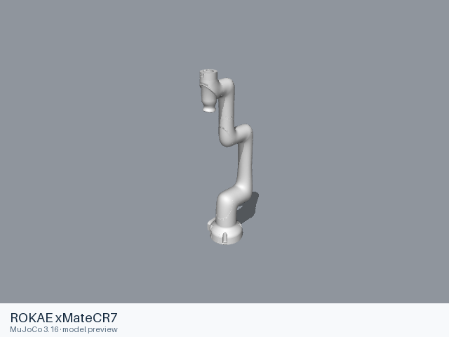
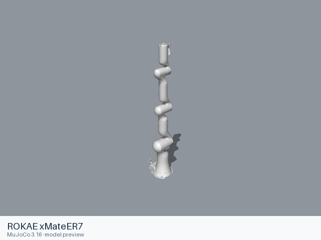
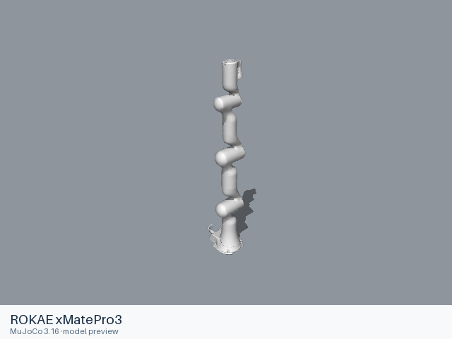
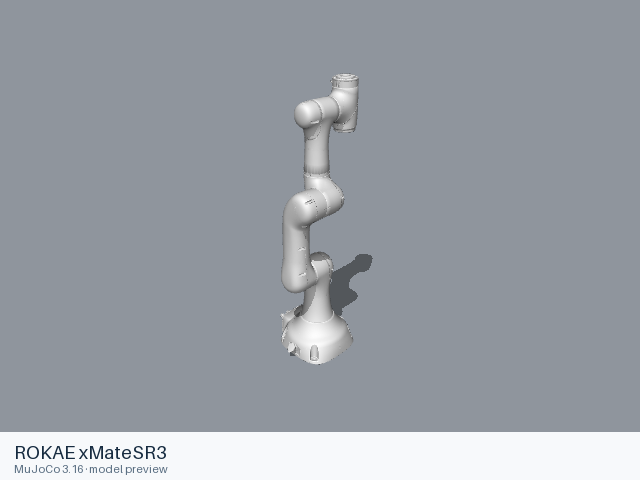
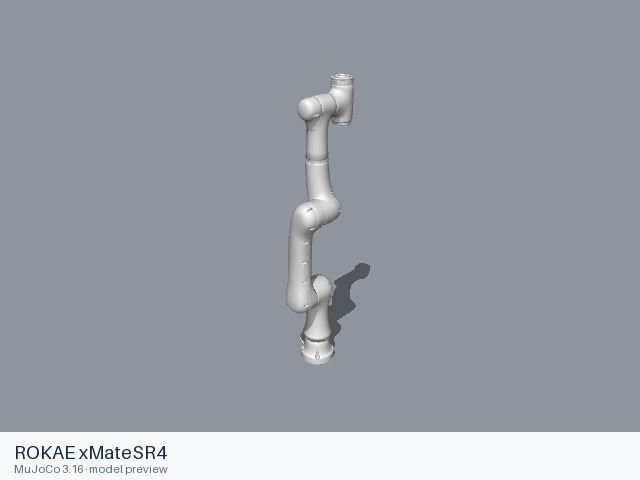

# Rokae models

[All manufacturers](../../README.md#models) · [Chinese index](../../README_CN.md#模型目录)

Previews are rendered with MuJoCo. See the [rendering method](../../docs/PREVIEWS.md); each model page links its exact entry and rendering record.

These entries come from manufacturer-maintained public repositories. Source versions and file scopes are recorded with each model.

| Preview | Model / assembly | Native entries | Source status | Source |
|---|---|---|---|---|
|  | [ROKAE AR5-5_07L-W4C4A2](ar5_5_07l_w4c4a2/README.md) | [URDF](ar5_5_07l_w4c4a2/urdf/ar5_5_07l_w4c4a2.urdf) | Official manufacturer repository | [rokae_ros2](https://github.com/RokaeRobot/rokae_ros2) |
|  | [ROKAE AR5-5_07R-W4C4A2](ar5_5_07r_w4c4a2/README.md) | [URDF](ar5_5_07r_w4c4a2/urdf/ar5_5_07r_w4c4a2.urdf) | Official manufacturer repository | [rokae_ros2](https://github.com/RokaeRobot/rokae_ros2) |
|  | [ROKAE xMateCR12](xmatecr12/README.md) | [URDF](xmatecr12/urdf/xmatecr12.urdf) | Official manufacturer repository | [rokae_ros2](https://github.com/RokaeRobot/rokae_ros2) |
|  | [ROKAE xMateCR18](xmatecr18/README.md) | [URDF](xmatecr18/urdf/xmatecr18.urdf) | Official manufacturer repository | [rokae_ros2](https://github.com/RokaeRobot/rokae_ros2) |
|  | [ROKAE xMateCR20](xmatecr20/README.md) | [URDF](xmatecr20/urdf/xmatecr20.urdf) | Official manufacturer repository | [rokae_ros2](https://github.com/RokaeRobot/rokae_ros2) |
|  | [ROKAE xMateCR35](xmatecr35/README.md) | [URDF](xmatecr35/urdf/xmatecr35.urdf) | Official manufacturer repository | [rokae_ros2](https://github.com/RokaeRobot/rokae_ros2) |
|  | [ROKAE xMateCR7](xmatecr7/README.md) | [URDF](xmatecr7/urdf/xmatecr7.urdf) | Official manufacturer repository | [rokae_ros2](https://github.com/RokaeRobot/rokae_ros2) |
|  | [ROKAE xMateER3](xmateer3/README.md) | [URDF](xmateer3/urdf/xmateer3.urdf) | Official manufacturer repository | [rokae_ros2](https://github.com/RokaeRobot/rokae_ros2) |
|  | [ROKAE xMateER7](xmateer7/README.md) | [URDF](xmateer7/urdf/xmateer7.urdf) | Official manufacturer repository | [rokae_ros2](https://github.com/RokaeRobot/rokae_ros2) |
|  | [ROKAE xMatePro3](xmatepro3/README.md) | [URDF](xmatepro3/urdf/xmatepro3.urdf) | Official manufacturer repository | [rokae_ros2](https://github.com/RokaeRobot/rokae_ros2) |
|  | [ROKAE xMatePro7](xmatepro7/README.md) | [URDF](xmatepro7/urdf/xmatepro7.urdf) | Official manufacturer repository | [rokae_ros2](https://github.com/RokaeRobot/rokae_ros2) |
|  | [ROKAE xMateSR3](xmatesr3/README.md) | [URDF](xmatesr3/urdf/xmatesr3.urdf) | Official manufacturer repository | [rokae_ros2](https://github.com/RokaeRobot/rokae_ros2) |
|  | [ROKAE xMateSR4](xmatesr4/README.md) | [URDF](xmatesr4/urdf/xmatesr4.urdf) | Official manufacturer repository | [rokae_ros2](https://github.com/RokaeRobot/rokae_ros2) |
|  | [ROKAE xMateSR5](xmatesr5/README.md) | [URDF](xmatesr5/urdf/xmatesr5.urdf) | Official manufacturer repository | [rokae_ros2](https://github.com/RokaeRobot/rokae_ros2) |
