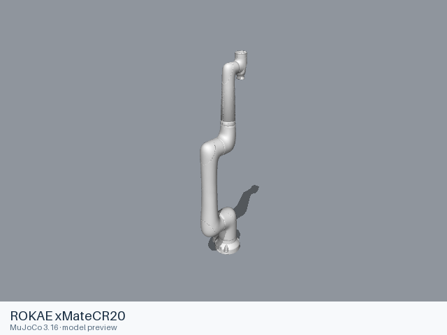

# ROKAE xMateCR20

[Manufacturer gallery](../README.md) · [All manufacturers](../../../README.md)



MuJoCo preview · [Rendering record](preview.json) · [Rendering method](../../../docs/PREVIEWS.md)

Official manufacturer model files for the assembly identified below.

## Model entries

Entry paths are relative to the repository root.

| Purpose / assembly | Format | Entry path | Target environment and required loading options |
|---|---|---|---|
| Robot model | URDF | [`models/rokae/xmatecr20/urdf/xmatecr20.urdf`](urdf/xmatecr20.urdf) | Local file loader; use a fixed base for mounted arms. |

## Mechanical information

### ROKAE xMateCR20

| Item | Definition |
|---|---|
| Hardware revision and gripper | ROKAE xMateCR20; configuration represented by the entry. |
| Units | URDF SI conventions: metres, kilograms, radians. Mesh scaling is retained from upstream. |
| Base | `world`; attach this root frame to the consuming scene. |
| Movable joint order | `joint1`, `joint2`, `joint3`, `joint4`, `joint5`, `joint6` (upstream declaration order; fixed joints omitted). |
| Gripper | No mimic coupling is declared. Any gripper joint limits remain in the entry. |
| End effector / TCP | Leaf frames: `xMateCR20_link6`. Their upstream transforms are retained. |
| Included poses | No separate pose configuration is included. |

### URDF joint limits

| Joint | Type | Lower | Upper | Units |
|---|---|---|---|---|
| `joint1` | revolute | -3.0543 | 3.0543 | radians |
| `joint2` | revolute | -3.0543 | 3.0543 | radians |
| `joint3` | revolute | -2.9671 | 2.9671 | radians |
| `joint4` | revolute | -3.0543 | 3.0543 | radians |
| `joint5` | revolute | -3.0543 | 3.0543 | radians |
| `joint6` | revolute | -3.0543 | 3.0543 | radians |

## Loading example

```python
from yourdfpy import URDF

robot = URDF.load(
    '/absolute/path/to/awesome-robot-arm-zoo/models/rokae/xmatecr20/urdf/xmatecr20.urdf',
    load_meshes=True, load_collision_meshes=True,
    build_collision_scene_graph=True,
)
```

## Sources and licensing

| Format or file scope | Upstream project | Version | Upstream file path | License file |
|---|---|---|---|---|
| URDF entry and referenced resources | [rokae_ros2](https://github.com/RokaeRobot/rokae_ros2) | `d6a508c38513d4c39b2f10f14275d0e26df7fb43` | `rokae_description/urdf/xMateCR20.urdf.xacro` | [LICENSE](urdf/LICENSE), [NOTICES](urdf/NOTICES) |

License: Apache-2.0. The license and attribution notices apply to the model entry and copied dependencies from the stated project.

## Model preparation

 Xacro 2.1.1 expansion mappings: `{}`. Referenced resources are stored inside the format directory and resource URIs are relative to the entry. Joint limits, inertial values, visual and collision geometry retain their upstream definitions.

## Loading verification

Checks performed on 2026-10-15. The complete format directory was copied to a temporary location and loaded by absolute path from a separate working directory.

| Entry | Environment and loader version | Verification steps | Result |
|---|---|---|---|
| `models/rokae/xmatecr20/urdf/xmatecr20.urdf` | macOS 27.2, arm64, Python 3.12.14; yourdfpy 0.0.60 | Load visual/collision geometry and update the joint configuration. | Passed, including resource relocation. |

## Known limitations

Dynamic task execution, controller performance and training behavior have not been validated.

- ROS and Gazebo control extensions, when present, retain their upstream metadata; their external runtime plugins are not included.
- Upstream hardware or revision distinctions beyond the source filename are not independently established.
- The upstream Xacro warns that model inertias are not correct; these values are retained.
- The URDF has no inertial element for `world`, `xMateCR20_base`.
