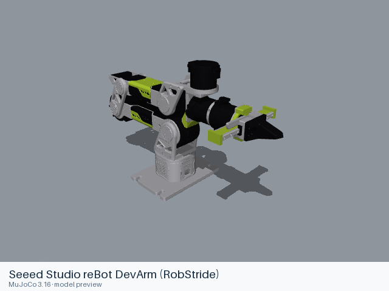

# Seeed Studio models

[All manufacturers](../../README.md#models) · [Chinese index](../../README_CN.md#模型目录)

Previews are rendered with MuJoCo. See the [rendering method](../../docs/PREVIEWS.md); each model page links its exact entry and rendering record.

Curated simulation models derived from Seeed Studio's open-source arm assets. Exact actuator assemblies and licenses are recorded with each model.

| Preview | Model / assembly | Native entries |
|---|---|---|
|  | [Seeed Studio reBot DevArm (RobStride)](rebot_devarm_rs/README.md) | [MJCF](rebot_devarm_rs/mjcf/seeed_rebot_devarm.xml) [All 2 entries](rebot_devarm_rs/README.md#model-entries) |
