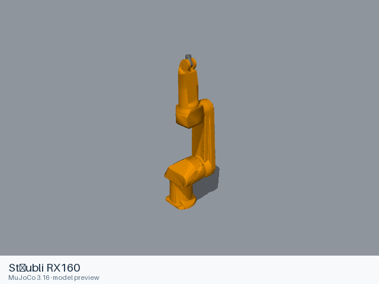
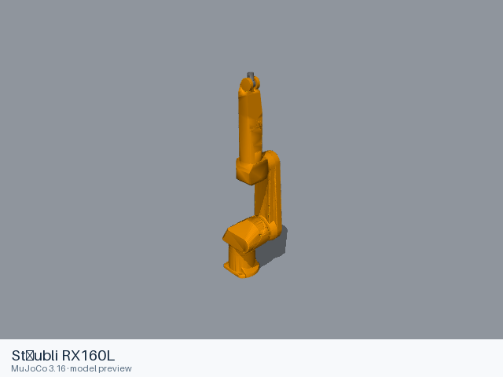
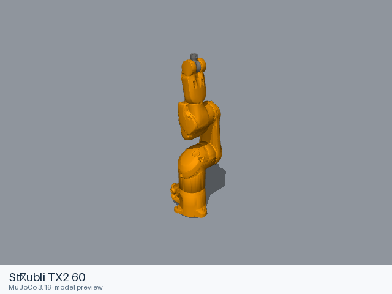
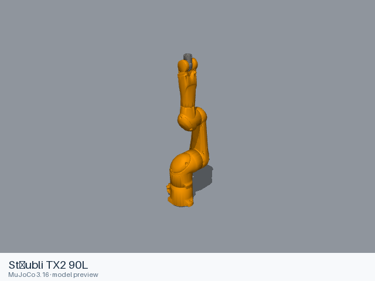
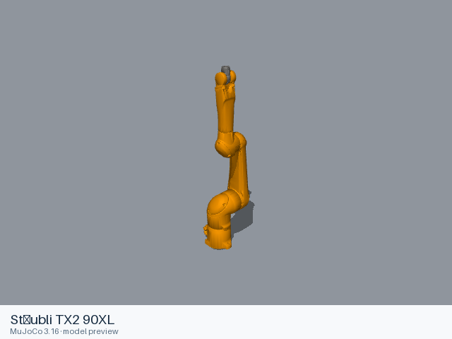
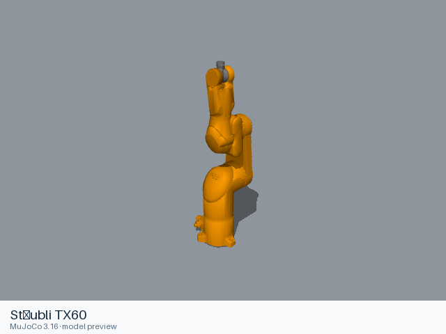
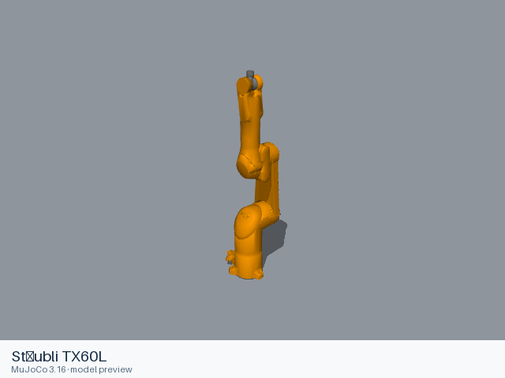
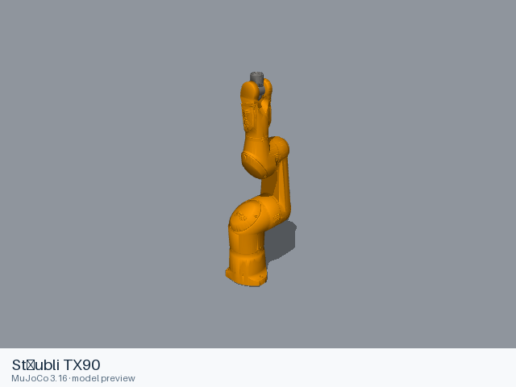
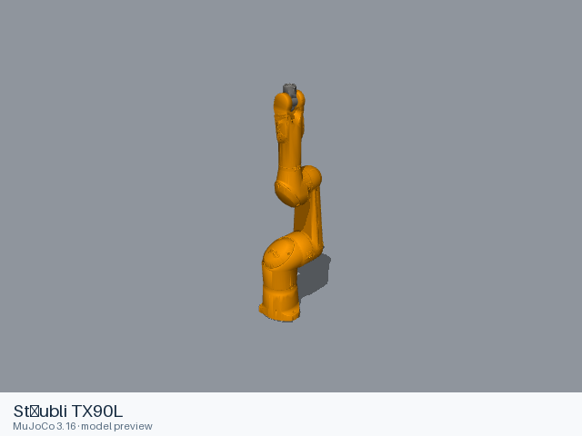
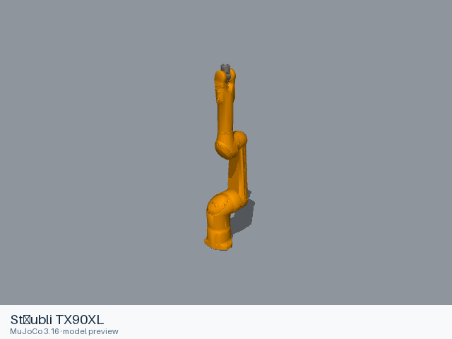

# Stäubli models

[All manufacturers](../../README.md#models) · [Chinese index](../../README_CN.md#模型目录)

Previews are rendered with MuJoCo. See the [rendering method](../../docs/PREVIEWS.md); each model page links its exact entry and rendering record.

Models maintained by ROS-Industrial in ros-industrial/staubli and ros-industrial/staubli_experimental. RX160, TX60/TX90 and TX2-60/TX2-90 families retain the upstream nominal-speed hardware definitions, with L and XL variants where supplied. These are community-maintained support packages; the experimental source identifies its packages as not yet sufficiently tested for migration into the main repository.

| Preview | Model / assembly | Native entries | Upstream |
|---|---|---|---|
|  | [Stäubli RX160](rx160/README.md) | [URDF](rx160/urdf/rx160.urdf) | [staubli](https://github.com/ros-industrial/staubli) |
|  | [Stäubli RX160L](rx160l/README.md) | [URDF](rx160l/urdf/rx160l.urdf) | [staubli](https://github.com/ros-industrial/staubli) |
|  | [Stäubli TX2 60](tx2_60/README.md) | [URDF](tx2_60/urdf/tx2_60.urdf) | [staubli_experimental](https://github.com/ros-industrial/staubli_experimental) |
|  | [Stäubli TX2 60L](tx2_60l/README.md) | [URDF](tx2_60l/urdf/tx2_60l.urdf) | [staubli_experimental](https://github.com/ros-industrial/staubli_experimental) |
|  | [Stäubli TX2 90](tx2_90/README.md) | [URDF](tx2_90/urdf/tx2_90.urdf) | [staubli_experimental](https://github.com/ros-industrial/staubli_experimental) |
|  | [Stäubli TX2 90L](tx2_90l/README.md) | [URDF](tx2_90l/urdf/tx2_90l.urdf) | [staubli_experimental](https://github.com/ros-industrial/staubli_experimental) |
|  | [Stäubli TX2 90XL](tx2_90xl/README.md) | [URDF](tx2_90xl/urdf/tx2_90xl.urdf) | [staubli_experimental](https://github.com/ros-industrial/staubli_experimental) |
|  | [Stäubli TX60](tx60/README.md) | [URDF](tx60/urdf/tx60.urdf) | [staubli_experimental](https://github.com/ros-industrial/staubli_experimental) |
|  | [Stäubli TX60L](tx60l/README.md) | [URDF](tx60l/urdf/tx60l.urdf) | [staubli_experimental](https://github.com/ros-industrial/staubli_experimental) |
|  | [Stäubli TX90](tx90/README.md) | [URDF](tx90/urdf/tx90.urdf) | [staubli_experimental](https://github.com/ros-industrial/staubli_experimental) |
|  | [Stäubli TX90L](tx90l/README.md) | [URDF](tx90l/urdf/tx90l.urdf) | [staubli_experimental](https://github.com/ros-industrial/staubli_experimental) |
|  | [Stäubli TX90XL](tx90xl/README.md) | [URDF](tx90xl/urdf/tx90xl.urdf) | [staubli_experimental](https://github.com/ros-industrial/staubli_experimental) |

Each model contains a static entry, the resources it references, and its applicable license files. Mechanical details and loading records are in the model READMEs.
