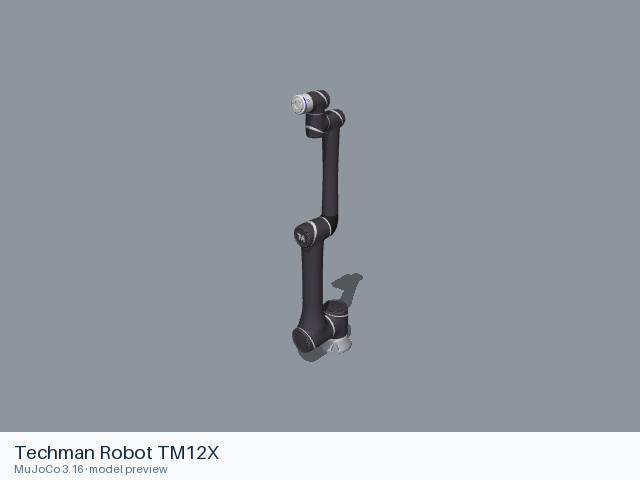
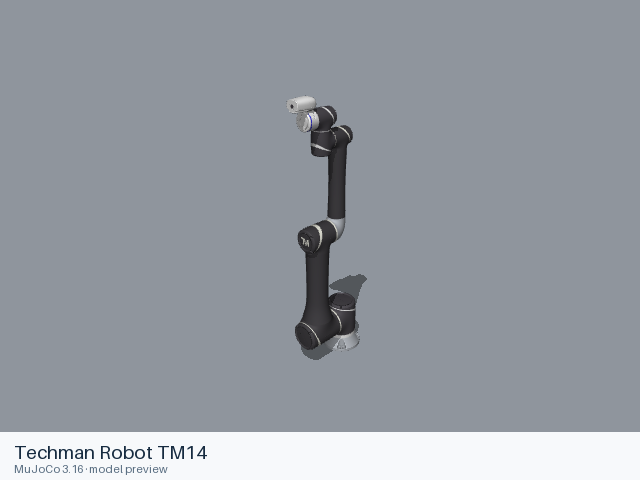
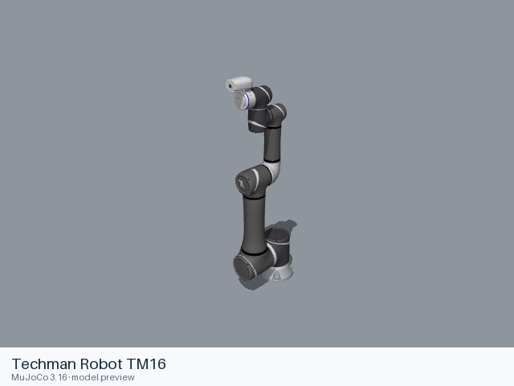
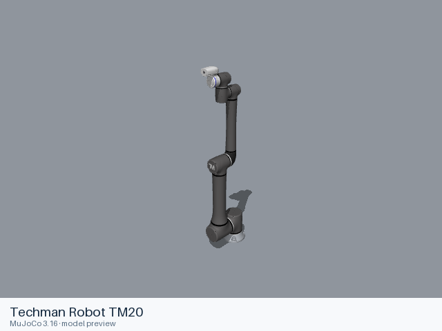
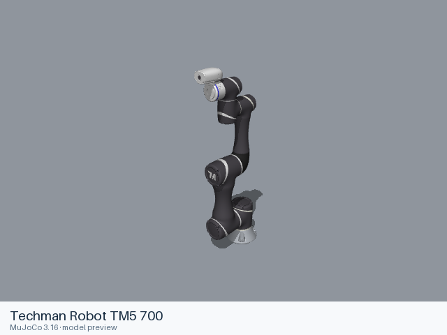
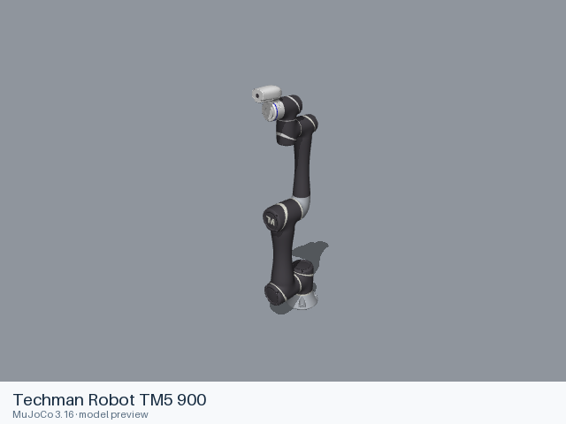
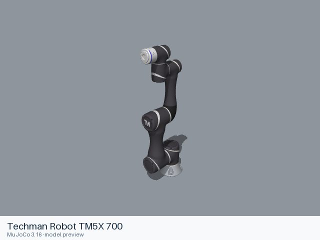
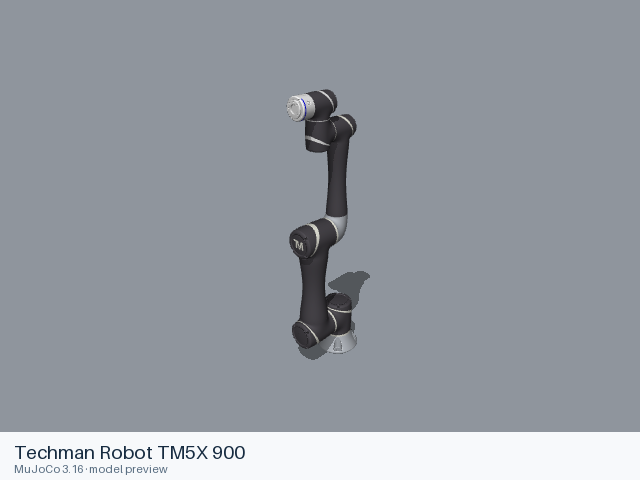

# Techman Robot models

[All manufacturers](../../README.md#models) · [Chinese index](../../README_CN.md#模型目录)

Previews are rendered with MuJoCo. See the [rendering method](../../docs/PREVIEWS.md); each model page links its exact entry and rendering record.

Official nominal robot models from `TechmanRobotInc/tmr_ros2`. The conventional TMflow generation covers camera-equipped and X variants. Hardware-specific calibration is not part of these nominal models.

| Preview | Model / assembly | Native entries | Upstream |
|---|---|---|---|
|  | [Techman Robot TM12](tm12/README.md) | [URDF](tm12/urdf/tm12.urdf) | [tmr_ros2](https://github.com/TechmanRobotInc/tmr_ros2) |
|  | [Techman Robot TM12X](tm12x/README.md) | [URDF](tm12x/urdf/tm12x.urdf) | [tmr_ros2](https://github.com/TechmanRobotInc/tmr_ros2) |
|  | [Techman Robot TM14](tm14/README.md) | [URDF](tm14/urdf/tm14.urdf) | [tmr_ros2](https://github.com/TechmanRobotInc/tmr_ros2) |
|  | [Techman Robot TM14X](tm14x/README.md) | [URDF](tm14x/urdf/tm14x.urdf) | [tmr_ros2](https://github.com/TechmanRobotInc/tmr_ros2) |
|  | [Techman Robot TM16](tm16/README.md) | [URDF](tm16/urdf/tm16.urdf) | [tmr_ros2](https://github.com/TechmanRobotInc/tmr_ros2) |
|  | [Techman Robot TM20](tm20/README.md) | [URDF](tm20/urdf/tm20.urdf) | [tmr_ros2](https://github.com/TechmanRobotInc/tmr_ros2) |
|  | [Techman Robot TM5 700](tm5_700/README.md) | [URDF](tm5_700/urdf/tm5_700.urdf) | [tmr_ros2](https://github.com/TechmanRobotInc/tmr_ros2) |
|  | [Techman Robot TM5 900](tm5_900/README.md) | [URDF](tm5_900/urdf/tm5_900.urdf) | [tmr_ros2](https://github.com/TechmanRobotInc/tmr_ros2) |
|  | [Techman Robot TM5X 700](tm5x_700/README.md) | [URDF](tm5x_700/urdf/tm5x_700.urdf) | [tmr_ros2](https://github.com/TechmanRobotInc/tmr_ros2) |
|  | [Techman Robot TM5X 900](tm5x_900/README.md) | [URDF](tm5x_900/urdf/tm5x_900.urdf) | [tmr_ros2](https://github.com/TechmanRobotInc/tmr_ros2) |

Each model contains a static entry, the resources it references, and its applicable license files. Mechanical details and loading records are in the model READMEs.
