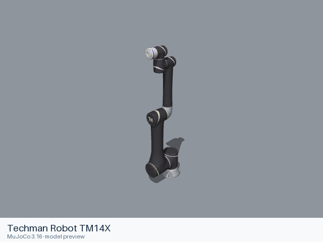

# Techman Robot TM14X

[Manufacturer gallery](../README.md) · [All manufacturers](../../../README.md)



MuJoCo preview · [Rendering record](preview.json) · [Rendering method](../../../docs/PREVIEWS.md)

6-joint arm without a gripper. The entry preserves the upstream kinematic, visual, collision, inertial and joint-limit definitions.

## Model entries

Entry paths are relative to the repository root.

| Purpose / assembly | Format | Entry path | Target environment and required loading options |
|---|---|---|---|
| Robot model: 6-joint arm without a gripper | URDF | [`models/techman/tm14x/urdf/tm14x.urdf`](urdf/tm14x.urdf) | A native URDF loader with relative mesh resolution; attach the base to the consuming scene. |

The X variant omits the integrated camera.

## Mechanical information

| Item | Definition |
|---|---|
| Hardware revision and gripper | 6-joint arm without a gripper |
| Units | Metres, kilograms, radians; revolute joint effort in N·m and prismatic effort in N. Mesh scale attributes remain as supplied upstream. |
| Base | `base`; root of the URDF tree. Any supplied fixed base transform is retained. |
| Arm joint order | `joint_1` → `joint_2` → `joint_3` → `joint_4` → `joint_5` → `joint_6` |
| Gripper | No gripper is included. |
| End effector / TCP | `flange`; fixed transforms remain in the entry. |
| Included poses | No named poses are defined by this URDF entry. |

## Loading example

```python
from yourdfpy import URDF

robot = URDF.load(
    '/absolute/path/to/awesome-robot-arm-zoo/models/techman/tm14x/urdf/tm14x.urdf',
    load_meshes=True, load_collision_meshes=True,
    build_collision_scene_graph=True,
)
```

## Sources and licensing

| Format or file scope | Upstream project | Version | Upstream file path | License file |
|---|---|---|---|---|
| Static URDF and its bundled resources (tm_description) | [https://github.com/TechmanRobotInc/tmr_ros2](https://github.com/TechmanRobotInc/tmr_ros2) | `c40bfc0d296337311f311c837861fd6318b00407` | `tm_description/urdf/tm14x-nominal.urdf`; model mesh paths under the named packages | [LICENSE](urdf/LICENSE) |

Bundled upstream resource directories: `tm_description/meshes/tm12/collision`, `tm_description/meshes/tm12/visual`, `tm_description/meshes/tm14/collision`, `tm_description/meshes/tm14/visual`, `tm_description/meshes/tm5-900/collision`, `tm_description/meshes/tm5-900/visual`.

License scope: BSD-3-Clause for `tm_description`; the upstream combined license file also preserves licenses of other driver components. The complete upstream license texts and notices accompany this format directory.

## Model preparation

The upstream static nominal URDF is retained with local resource references. Resources were copied only when referenced by the entry or by one of its mesh/material files. Resource references are local relative paths. Mesh contents and physical parameters retain the upstream definitions.

## Loading verification

Checks performed on 2026-10-15. The complete format directory was copied to a temporary location and loaded by absolute path from a separate working directory.

| Entry | Environment and loader version | Verification steps | Result |
|---|---|---|---|
| `models/techman/tm14x/urdf/tm14x.urdf` | macOS 27.2, arm64, Python 3.12.14; yourdfpy 0.0.60 | Load visual/collision geometry and update the joint configuration. | Passed, including resource relocation. |

## Known limitations

Dynamic task execution, controller performance and training behavior have not been validated.

ROS, Gazebo and physics simulators have not been verified for this entry.
