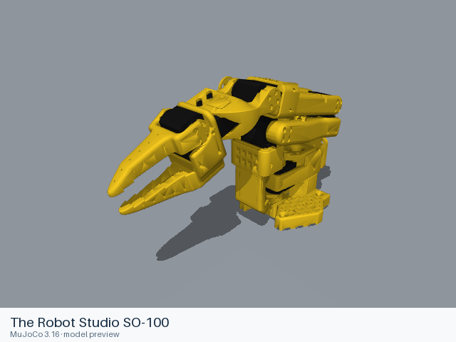

# The Robot Studio SO-100

[Manufacturer gallery](../README.md) · [All manufacturers](../../../README.md)



MuJoCo preview · [Rendering record](preview.json) · [Rendering method](../../../docs/PREVIEWS.md)

SO-100 follower arm with five arm joints and one rotary gripper joint.

## Model entries

Entry paths are relative to the repository root.

| Purpose / assembly | Format | Entry path | Target environment and required loading options |
|---|---|---|---|
| Follower robot model | URDF | [`models/the_robot_studio/so100/urdf/so100.urdf`](urdf/so100.urdf) | Native URDF loader; load visual and collision resources. Use the source fixed mounting convention. |

## Mechanical information

| Item | Definition |
|---|---|
| Hardware revision and gripper | SO-100 follower; native fixed jaw and moving jaw |
| Units | Metres, kilograms and radians; native mesh scales are retained. |
| Base | `base`; attach to a fixed support in the consuming project. |
| Movable joint order | `shoulder_pan`, `shoulder_lift`, `elbow_flex`, `wrist_flex`, `wrist_roll`, `gripper` |
| Gripper | `gripper`: revolute, −0.2 to 2.0 rad; no mimic joint. |
| End effector / TCP | Terminal `jaw` link; no separate tool frame is supplied. |
| Included poses | No separate pose configuration is included. |

## Loading example

```python
from yourdfpy import URDF
robot = URDF.load('/absolute/path/to/awesome-robot-arm-zoo/models/the_robot_studio/so100/urdf/so100.urdf',
                  load_meshes=True, load_collision_meshes=True,
                  build_collision_scene_graph=True)
robot.update_cfg({})
```

## Sources and licensing

| Format or file scope | Upstream project | Version | Upstream file path | License file |
|---|---|---|---|---|
| URDF entry and referenced meshes | [SO-ARM100](https://github.com/TheRobotStudio/SO-ARM100) | `a758567c3978dfeefe282ede0500085a48fe8f78` | [`Simulation/SO100/so100.urdf`](https://github.com/TheRobotStudio/SO-ARM100/blob/a758567c3978dfeefe282ede0500085a48fe8f78/Simulation/SO100/so100.urdf) and referenced resources | [Apache-2.0](urdf/LICENSE); [upstream license](https://github.com/TheRobotStudio/SO-ARM100/blob/a758567c3978dfeefe282ede0500085a48fe8f78/LICENSE) |

The upstream project’s Apache-2.0 terms accompany each format directory.

## Model preparation

The upstream URDF and its referenced meshes are packaged for standalone file loading. Relative resource paths are retained; XML formatting is normalized. Source joints, inertia, limits, mesh scales and collision definitions are retained. Only resources needed by the listed entries are included.

## Loading verification

| Entry | Environment and simulator version | Verification steps | Result |
|---|---|---|---|
| [`so100.urdf`](urdf/so100.urdf) | macOS; yourdfpy 0.0.60 | Copy the entire format directory, load from an unrelated working directory, configure movable joints, inspect visual and collision bounds. | Passed; 7 links, 6 actuated joints, 13 visual and 5 collision geometries. |

## Known limitations

The source labels base inertia as approximate. Physical calibration, contact behavior and controller performance have not been validated. Loading records establish resource completeness and native kinematics; they do not establish task or policy performance.
