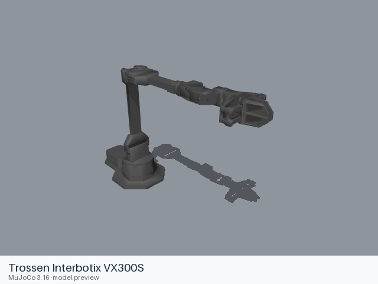
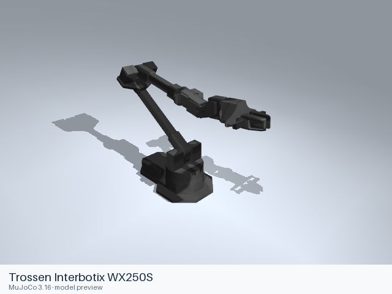

# Trossen

[All manufacturers](../../README.md#models) · [Chinese index](../../README_CN.md#模型目录)

Previews are rendered with MuJoCo. See the [rendering method](../../docs/PREVIEWS.md); each model page links its exact entry and rendering record.

Models and resources are extracted from the linked official manufacturer repositories. Each format directory retains its applicable upstream license.

| Preview | Model / assembly | Native entries |
|---|---|---|
|  | [Trossen Interbotix VX300S](vx300s/README.md) | [URDF](vx300s/urdf/vx300s.urdf) |
|  | [Trossen Interbotix WX250S](wx250s/README.md) | [URDF](wx250s/urdf/wx250s.urdf) |

## Sources and licensing

- [Official upstream](https://github.com/Interbotix/interbotix_ros_manipulators). Exact revisions and file scopes are recorded in each model README.
