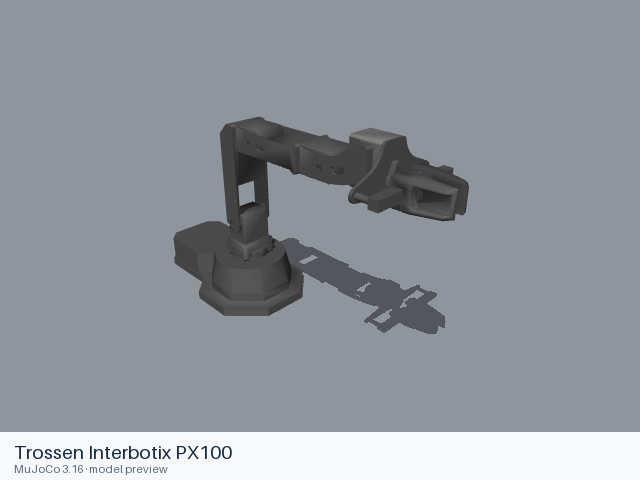
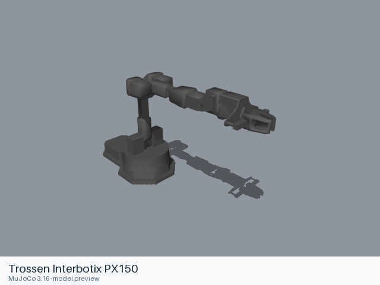
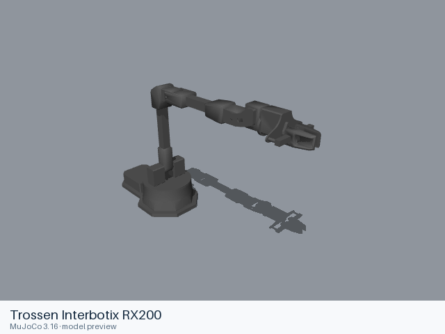
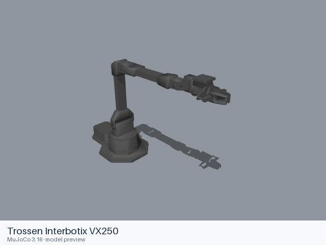
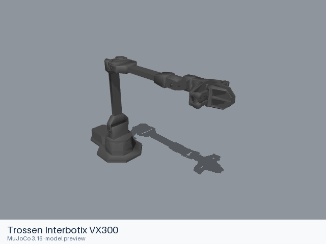
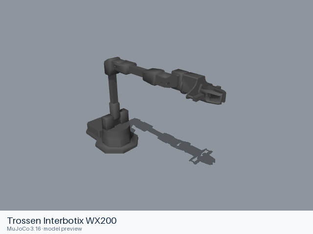
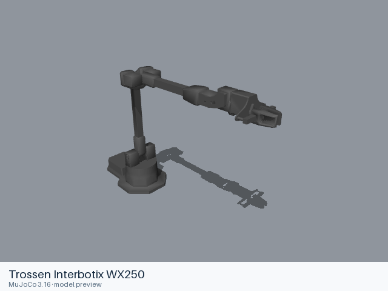

# Trossen

[All manufacturers](../../README.md#models) · [Chinese index](../../README_CN.md#模型目录)

Previews are rendered with MuJoCo. See the [rendering method](../../docs/PREVIEWS.md); each model page links its exact entry and rendering record.

Models and resources are extracted from the linked official manufacturer repositories. Each format directory retains its applicable upstream license.

| Preview | Model / assembly | Native entries |
|---|---|---|
|  | [Trossen Interbotix PX100](px100/README.md) | [URDF](px100/urdf/px100.urdf) |
|  | [Trossen Interbotix PX150](px150/README.md) | [URDF](px150/urdf/px150.urdf) |
|  | [Trossen Interbotix RX150](rx150/README.md) | [URDF](rx150/urdf/rx150.urdf) |
|  | [Trossen Interbotix RX200](rx200/README.md) | [URDF](rx200/urdf/rx200.urdf) |
|  | [Trossen Interbotix VX250](vx250/README.md) | [URDF](vx250/urdf/vx250.urdf) |
|  | [Trossen Interbotix VX300](vx300/README.md) | [URDF](vx300/urdf/vx300.urdf) |
|  | [Trossen Interbotix VX300S](vx300s/README.md) | [URDF](vx300s/urdf/vx300s.urdf) |
|  | [Trossen Interbotix WX200](wx200/README.md) | [URDF](wx200/urdf/wx200.urdf) |
|  | [Trossen Interbotix WX250](wx250/README.md) | [URDF](wx250/urdf/wx250.urdf) |
|  | [Trossen Interbotix WX250S](wx250s/README.md) | [URDF](wx250s/urdf/wx250s.urdf) |

## Sources and licensing

- [Official upstream](https://github.com/Interbotix/interbotix_ros_manipulators). Exact revisions and file scopes are recorded in each model README.
