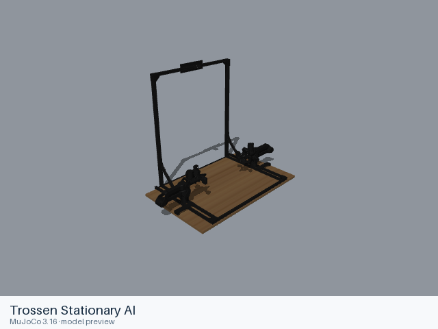
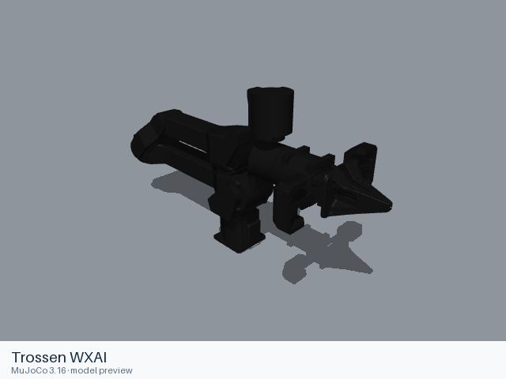

# Trossen

[All manufacturers](../../README.md#models) · [Chinese index](../../README_CN.md#模型目录)

Previews are rendered with MuJoCo. See the [rendering method](../../docs/PREVIEWS.md); each model page links its exact entry and rendering record.

Models come from Trossen's description repositories and MuJoCo Menagerie. Each model records the source for its URDF and MJCF assemblies, with the applicable licenses beside those files.

| Preview | Model / assembly | Native entries |
|---|---|---|
|  | [Trossen ALOHA 2](aloha2/README.md) | [MJCF](aloha2/mjcf/aloha.xml) [All 2 entries](aloha2/README.md#model-entries) |
|  | [Trossen Stationary AI](stationary_ai/README.md) | [MJCF](stationary_ai/mjcf/stationary_ai/stationary_ai.xml) [URDF](stationary_ai/urdf/stationary_ai.urdf) |
|  | [Trossen Interbotix VX300S](vx300s/README.md) | [URDF](vx300s/urdf/vx300s.urdf) [MJCF](vx300s/mjcf/vx300s.xml) [All 3 entries](vx300s/README.md#model-entries) |
|  | [Trossen Interbotix WX250S](wx250s/README.md) | [URDF](wx250s/urdf/wx250s.urdf) [MJCF](wx250s/mjcf/wx250s.xml) [All 3 entries](wx250s/README.md#model-entries) |
|  | [Trossen WXAI](wxai/README.md) | [MJCF](wxai/mjcf/wxai/wxai_base.xml) [URDF](wxai/urdf/wxai_base.urdf) [All 4 entries](wxai/README.md#model-entries) |

## Sources and licensing

- [Official upstream](https://github.com/Interbotix/interbotix_ros_manipulators). Exact revisions and file scopes are recorded in each model README.
